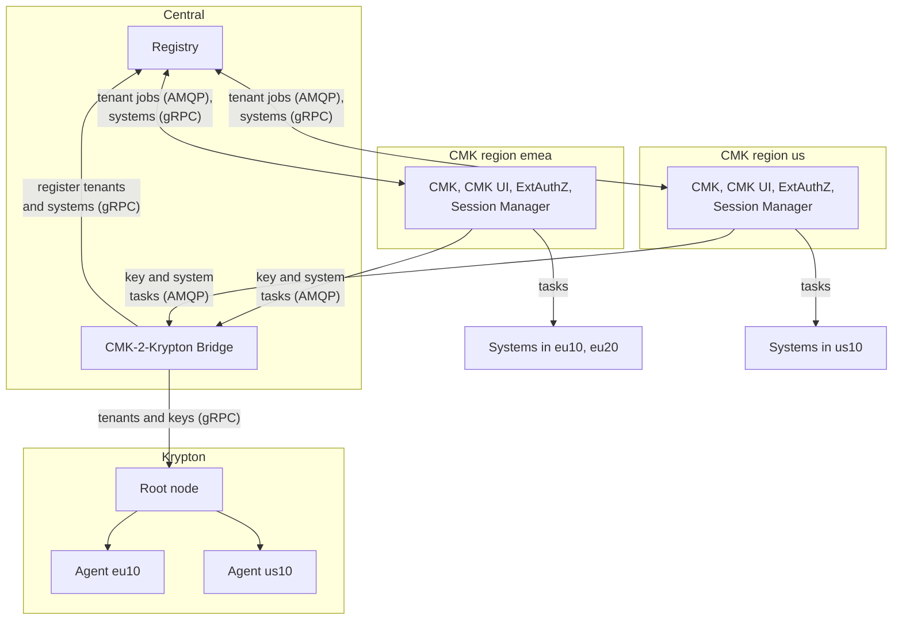

# Deployment

OpenKCM runs as a set of deployments: central components that every region
uses, one CMK deployment per CMK region, Krypton, and the provider's own
services in their system regions. This page shows where each component runs and
where the data of a tenant lives. For sizing, dependencies, ports and the
installation order, see [Deployment planning](/components/cmk/deployment).

## Deployments

| Deployment | Runs | How many | Holds |
| --- | --- | --- | --- |
| Central | [Registry](/components/cmk/registry), [CMK-2-Krypton Bridge](/components/cmk/krypton-bridge) | One | Registry: every tenant with its CMK region, every system and the tenant it belongs to. Bridge: its jobs and the keys it manages in Krypton |
| CMK region | [CMK](/components/cmk/cmk-service), [CMK UI](/components/cmk/cmk-ui), Envoy Gateway with [ExtAuthZ](/components/cmk/extauthz), [Session Manager](/components/cmk/session-manager) | One per CMK region, for example `emea`, `us` | The tenants of the region: keys, key configurations, groups, approvals, system links, sessions. Regions share nothing |
| Krypton | [Root node](/components/krypton/install), [agents](/components/krypton/agents) | One root node; agents where workloads need keys close to them | Key metadata in PostgreSQL, sealed key material in OpenBao |
| System region | The provider's services | Where the services run, for example `eu10`, `eu20` | The systems that use the keys. Each CMK region serves a set of system regions |

## Topology

### Central components

The **Registry** knows every tenant and the CMK region that serves it, and every
system and the tenant it belongs to. It sends each tenant's jobs to the CMK of
that region.

The **CMK-2-Krypton Bridge** is a central component, like the Registry. It
serves the CMKs of all regions: it receives their key and system tasks, offers an
API to onboard tenants and manage their Domain (System) keys in Krypton, and
registers the tenants and systems it creates keys for in the Registry. It is the
only component that calls Krypton on behalf of CMK.

::: info Current state
Today one Bridge instance reads the tasks of one CMK region. See the Bridge's
[current state](/components/cmk/krypton-bridge#current-state).
:::

### CMK regions and system regions

Two kinds of region make up an OpenKCM deployment:

| Region | Example | What it is |
| --- | --- | --- |
| **CMK region** | `emea`, `us` | A regional CMK deployment. It serves the tenants assigned to it, with its own UI, API, gateway, sign-in and databases |
| **System region** | `eu10`, `eu20`, `us10` | Where the provider's services run. A CMK region sends key and system tasks to each system region it serves |

A tenant belongs to exactly one CMK region. Its systems can run in any of the
system regions that its CMK region serves.

### Krypton

Krypton has one root node, which holds the top of every key hierarchy and the
key metadata of all tenants. Agents take over the lower levels of a hierarchy
for a part of the topology, for example a region, so that workloads get their
keys close to where they run. The root node sends each agent the keys of its
segment. See [Krypton architecture](/components/krypton/architecture).

## Where data lives

Data residency follows the CMK region: the databases of a tenant's CMK region
keep its key configurations, groups, approvals and settings. Only the central
components are shared, and they hold no key material.

| Data | Held by | Where |
| --- | --- | --- |
| Tenants, their CMK region and identity provider settings; systems and the tenant each belongs to; the IDs of their keys | Registry | Central PostgreSQL database |
| The Bridge's jobs, and the IDs of the keys it manages in Krypton | CMK-2-Krypton Bridge | Central PostgreSQL database |
| Key configurations, key metadata, groups, approvals, system links, per tenant | CMK | PostgreSQL database of the CMK region, one schema per tenant |
| Browser sessions | Session Manager | Valkey or Redis of the CMK region |
| Customer keys (L1) | Keystore | A keystore that the provider runs for the tenant (BYOK), or the customer's own keystore (HYOK); AWS KMS today |
| Key hierarchies below the customer key (L2 to L4) | Krypton | Key metadata in the PostgreSQL database of the root node and of each agent; key material sealed, in OpenBao |

## See also

- [Deployment planning](/components/cmk/deployment): dependencies, network
  layout and installation order
- [Install the Registry](/components/cmk/install-registry)
- [CMK-2-Krypton Bridge](/components/cmk/krypton-bridge)
- [Install the Krypton root node](/components/krypton/install)
