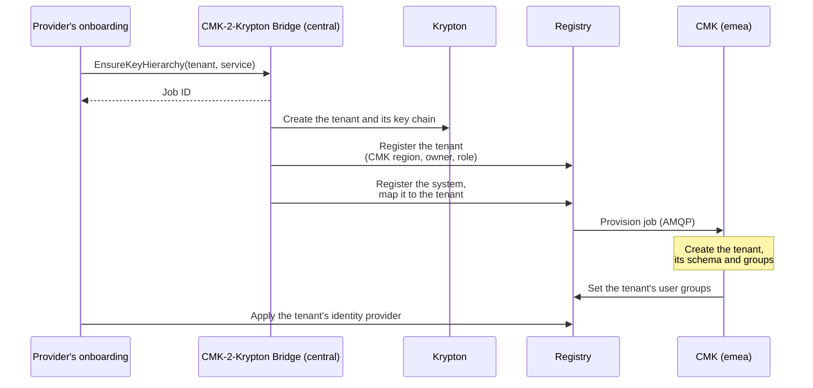
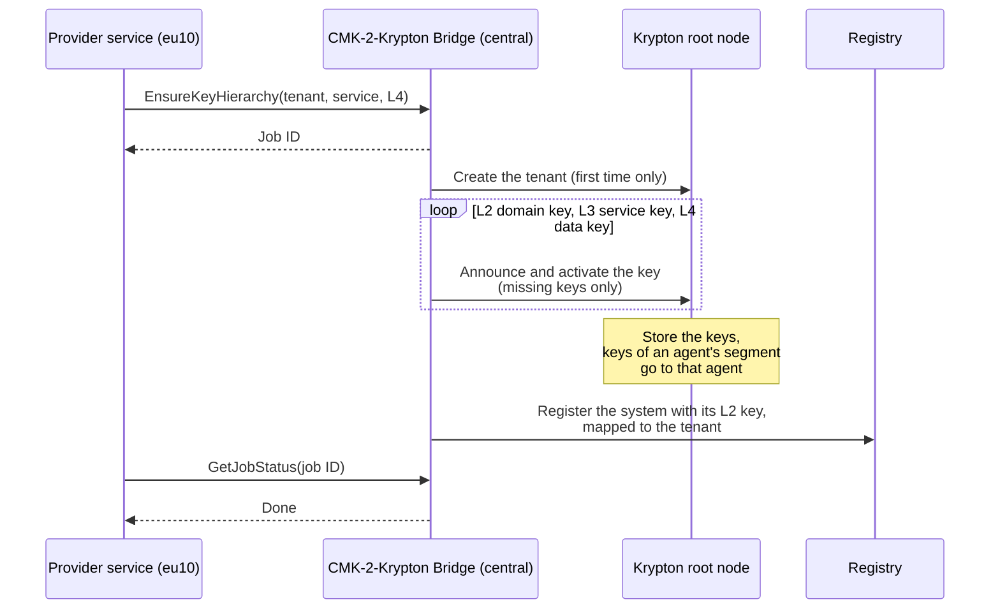
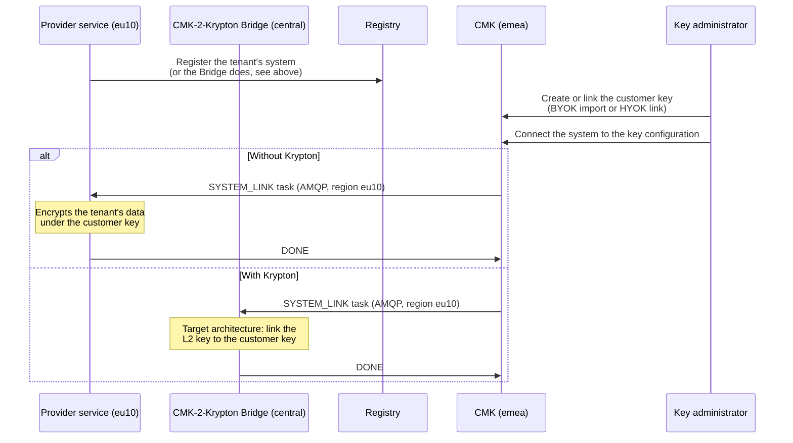
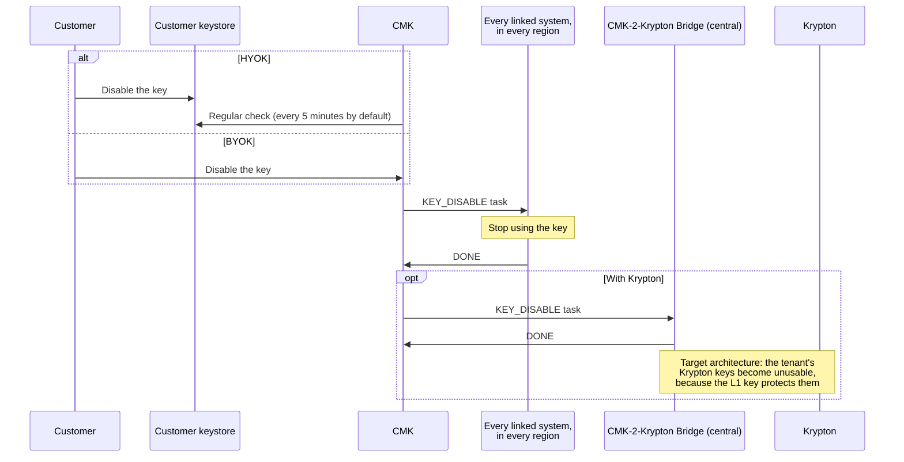
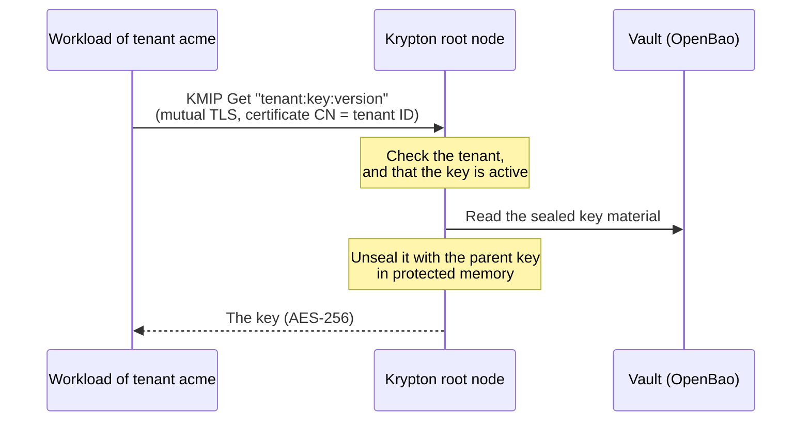

# Main flows

The flows below show the governance plane (CMK) and the execution plane
(Krypton) together. Steps in Krypton are in <Badge type="danger" text="Sandbox" />;
steps that are part of the target architecture only are marked as such.

| Flow | Who starts it |
| --- | --- |
| [Onboard a customer](#onboard-a-customer) | The provider's onboarding |
| [Create the key chain of a service](#create-the-key-chain-of-a-service) | A provider service, through the Bridge |
| [Connect a service to a customer key](#connect-a-service-to-a-customer-key) | The customer's key administrator |
| [Withdraw a key](#withdraw-a-key) | The customer |
| [Deliver keys to workloads](#deliver-keys-to-workloads) | A workload of the provider's service |

## Onboard a customer

The provider onboards a customer through the central CMK-2-Krypton Bridge. The
Bridge creates the tenant in Krypton and registers it in the Registry, which
provisions it in the CMK of its region.

1. The provider's onboarding calls the Bridge for the new tenant and its first
   service.
2. The Bridge creates the tenant and its key chain in Krypton, then registers
   the tenant in the Registry, with its CMK region, owner and role, and
   registers the service's system for it. A tenant that the Registry already
   knows is left as it is.
3. The Registry sends the tenant to the CMK of that region, which creates the
   tenant's schema and groups.
4. The provider applies the tenant's identity provider in the Registry.
5. The customer's administrators sign in with their own identity provider and
   map their directory groups to the roles.

The Bridge's role and owner come from its configuration (`config.registry`).
See [CMK-2-Krypton Bridge](/components/cmk/krypton-bridge) and
[Connect a regional tenant](/components/cmk/tenant-integration), which describes
the Registry's tenant API.

## Create the key chain of a service

The CMK-2-Krypton Bridge creates the keys below the customer key in Krypton: the
Domain (System) key (L2), the service key (L3) and the data encryption key (L4).
It runs each request as a job and registers the system in the Registry. The
first request for a new tenant also onboards it; see
[Onboard a customer](#onboard-a-customer).

<Badge type="danger" text="Sandbox" /> Krypton records the keys and accepts the
activation, but does not process activations yet: no key material is created.
Protecting the L2 key with the customer's L1 key is part of the target
architecture. See [CMK-2-Krypton Bridge](/components/cmk/krypton-bridge) and
[Key lifecycle](/components/krypton/key-lifecycle).

## Connect a service to a customer key

With Krypton, the central Bridge receives the tasks of the CMKs of all regions.
Today it receives and acknowledges them; acting on them in Krypton is part of the
target architecture. See
[Connect a regional system](/components/cmk/system-integration).

## Withdraw a key

For HYOK keys the keystore refuses further operations as soon as the customer
disables the key, independent of OpenKCM. CMK tracks which systems have
confirmed the change.

## Deliver keys to workloads

Workloads fetch their keys from Krypton over KMIP, with a client certificate that
binds them to their tenant. Krypton returns a key only while it is active, and
overwrites it in memory when the connection closes. The workload encrypts and
decrypts the data itself, and fetches the key again regularly. See
[Use keys in a workload](/components/krypton/workloads) and
[KMIP](/components/krypton/kmip). This flow is in
<Badge type="danger" text="Sandbox" />.

## See also

- [Deployment](/architecture/deployment): where each component of these flows
  runs
- [Connect a regional system](/components/cmk/system-integration): the tasks a
  system receives and how it answers them
- [Krypton key lifecycle](/components/krypton/key-lifecycle)
