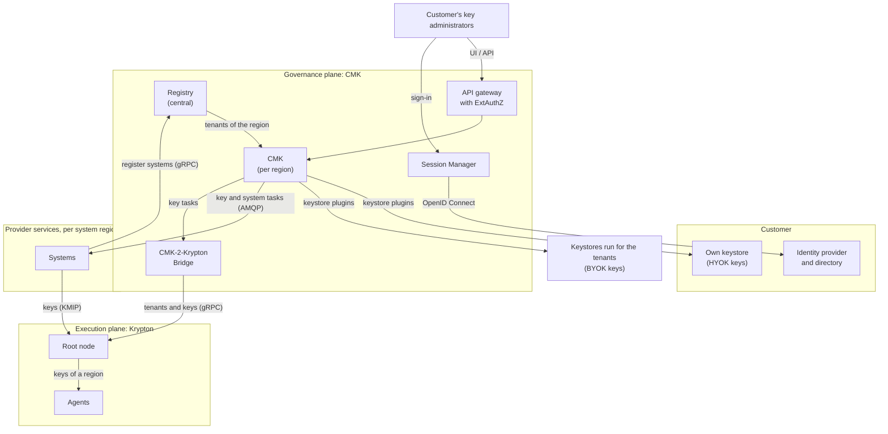
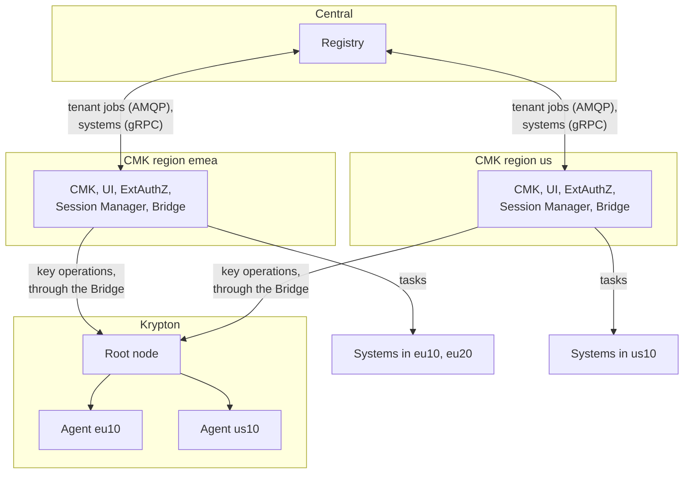
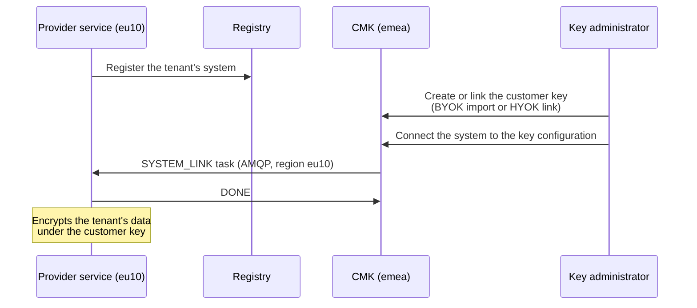
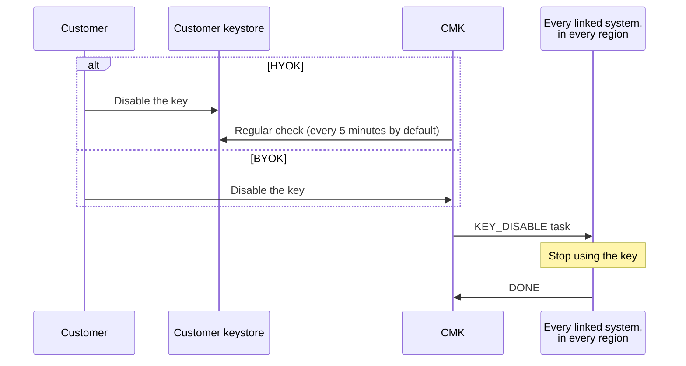

# Architecture

An adopter of OpenKCM lets its customers control the keys that protect their
data, across many services and regions. This page shows the building blocks and
how they are laid out, the main flows, what the provider's own services integrate
with, and how OpenKCM differs from other key management offerings.

## The problem it solves

A provider runs many services, in many regions, for many customers. Each service
encrypts the data it stores and sends. Customers in regulated industries ask for
three things:

1. **Own the key.** The key that protects their data comes from them (BYOK) or
   stays in their own keystore (HYOK).
2. **Decide who may use it.** Their own people, signing in with their own
   identity provider, connect services to keys, with separation of duties,
   approvals and an audit trail.
3. **Withdraw it everywhere.** Disabling the key reaches every service and region
   that uses it, without a separate request to each service team.

A key management service (KMS) answers the first point for one account in one
cloud. OpenKCM answers all three for every customer of a provider, across all of
the provider's services: it manages the **key chain**, from the customer's key
down to the keys that the services use.

## Architecture at a glance

OpenKCM separates four concerns:

| Plane | Component | Responsibility |
| --- | --- | --- |
| Governance | [CMK](/overview/cmk): Registry (central), CMK (per region) | Tenants, customer keys and their keystores, systems, roles, approvals, audit, propagation of key changes. Holds no key material |
| Root of trust | Keystores | The customer keys (L1): in a keystore that the provider runs for the tenant (BYOK), or in the customer's own keystore (HYOK) |
| Execution | [Krypton](/overview/krypton): root node, agents | The key hierarchies below the customer key (L2 to L4): generation, sealing, storage, delivery to workloads |
| Consumption | The provider's services | Use the keys to encrypt the customers' data, and act on key changes |

Identity and access sit in front of the governance plane: each customer signs in
with their own identity provider, and every request is checked at the gateway.

## Deployment topology

| Deployment | Runs | How many | Holds |
| --- | --- | --- | --- |
| Central | [Registry](/components/cmk/registry) | One | Every tenant with its CMK region, every system and the tenant it belongs to |
| CMK region | [CMK](/components/cmk/cmk-service), [CMK UI](/components/cmk/cmk-ui), Envoy Gateway with [ExtAuthZ](/components/cmk/extauthz), [Session Manager](/components/cmk/session-manager), the [CMK-2-Krypton Bridge](/components/cmk/krypton-bridge) | One per CMK region, for example `emea`, `us` | The tenants of the region: keys, key configurations, groups, approvals, system links, sessions. Regions share nothing |
| System region | The provider's services | Where the services run, for example `eu10`, `eu20` | The systems that use the keys. Each CMK region serves a set of system regions |
| Krypton | [Root node](/components/krypton/install), [agents](/components/krypton/agents) | One root node; agents where workloads need keys close to them | Key metadata in PostgreSQL, sealed key material in OpenBao |

Data residency follows the CMK region: a tenant belongs to exactly one CMK
region, whose databases keep its key configurations, groups, approvals and
settings. Only the Registry is shared, and it holds no key material: tenants,
systems and the IDs of their keys. See
[Deployment planning](/components/cmk/deployment).

## The key chain

The customer key is the root of a chain of keys. Each key protects the keys of
the level below, so a few customer keys protect the many keys that services use,
and withdrawing a customer key cuts off everything below it.

| Level | Key | Held in | Managed by | Status |
| --- | --- | --- | --- | --- |
| L1 | Customer key | Keystore (BYOK) or the customer's own keystore (HYOK) | CMK | Available, with AWS KMS |
| L2 | Tenant key | Krypton | Krypton, driven by CMK through the Bridge | Pre-production |
| L3 | Service key | Krypton | Krypton | Pre-production |
| L4 | Data encryption key | Krypton, delivered to the workload | Krypton | Pre-production |

The levels of the Krypton hierarchy are configurable; L2 to L4 is the layout that
CMK uses. Protecting the L2 key with the customer's L1 key is part of the target
architecture and not implemented yet; until then, CMK propagates key changes to
the systems, which act on them.

## Main flows

### Onboard a customer

1. The provider's onboarding tooling registers the tenant in the Registry, with
   its CMK region and its identity provider.
2. The Registry sends the tenant to the CMK of that region, which creates the
   tenant's schema and groups.
3. The customer's administrators sign in with their own identity provider and
   map their directory groups to the roles.

See [Connect a regional tenant](/components/cmk/tenant-integration).

### Connect a service to a customer key

See [Connect a regional system](/components/cmk/system-integration).

### Withdraw a key

For HYOK keys the keystore refuses further operations as soon as the customer
disables the key, independent of OpenKCM. CMK tracks which systems have
confirmed the change.

### Deliver keys to workloads

Workloads fetch their keys from Krypton over KMIP, with a client certificate that
binds them to their tenant. Krypton returns a key only while it is active. See
[KMIP](/components/krypton/kmip). This flow is pre-production.

## What the provider integrates

| Integration point | Who implements it | Interface |
| --- | --- | --- |
| Tenant onboarding | The provider's onboarding tooling | [Registry gRPC API](/components/cmk/tenant-integration) |
| System registration | Each provider service | [Registry gRPC API](/components/cmk/system-integration) |
| Key and system tasks | Each provider service, per system region | AMQP 1.0 queues, through [Orbital](https://github.com/openkcm/orbital) |
| Key delivery | Workloads | KMIP over mutual TLS (Krypton, pre-production) |
| Customer sign-in | The customer | OpenID Connect identity provider, per tenant |
| Keystores | The provider, as plugins | [Keystore plugins](/components/cmk/plugins); AWS KMS today |
| User directories | The provider, as plugins | SCIM directory plugins |
| Audit | The provider's security operations | OTLP log records to the provider's [audit collector](/components/cmk/security/audit) |
| Automation by customers | The customer | [CMK REST API](/components/cmk/api) |

## Security architecture

| Principle | How the architecture implements it |
| --- | --- |
| No key material in the governance plane | CMK and the Registry hold references, metadata and policy. Key material stays in keystores, and in Krypton only sealed |
| Every request checked twice | ExtAuthZ authenticates the caller at the gateway and signs the result; CMK verifies the signature and the caller's role |
| Tenant isolation | Own identity provider, roles and database schema per tenant; keys in Krypton separated per tenant |
| Separation of duties | Tenant administrators, key administrators and auditors are separate roles, and sensitive changes can require approval by other users |
| Encrypted, authenticated service traffic | Mutual TLS between services through a service mesh; client certificates on the AMQP broker and on KMIP |
| Traceability | Key, system, login and access events as audit events |

See the [Trust model](/overview/trust-model) and the
[CMK security architecture](/components/cmk/security/).

## Technology stack

| Need | Technology |
| --- | --- |
| Runtime | Kubernetes 1.23 or later; every service as a container image with a Helm chart |
| Databases | PostgreSQL, one database per service and region |
| Task queue and sessions | Valkey or Redis |
| Messaging between regions and services | AMQP 1.0, for example RabbitMQ 4, with client certificates |
| Gateway | Envoy Gateway with external authorization |
| Service traffic | A service mesh with mutual TLS, for example Linkerd or Istio |
| Sign-in | OpenID Connect, per tenant |
| Key storage | AWS KMS (customer keys); OpenBao (Krypton) |
| Workload key access | KMIP |
| Observability and audit | OpenTelemetry (OTLP) |

## How OpenKCM differs from other key management offerings

OpenKCM is not another key management service (KMS). A KMS holds keys and
performs key operations for its owner. OpenKCM manages the relationship between
a provider's customers and the provider's services: which customer key protects
which service, who may change that, and what happens everywhere when it changes.
It uses a KMS as the keystore for the customer keys.

### What sets OpenKCM apart

1. **Built for providers and their customers.** A provider runs OpenKCM once for
   all its customers. Each customer is a tenant with its own identity provider,
   roles, approvals and audit events. Cloud KMSs are built for the owner of an
   account; giving a provider access to a customer's key there is set up with
   cross-account or cross-tenant permissions for each resource that uses it.
2. **One customer key for every service and region.** Services register their
   systems once in the Registry. A key change reaches every linked system in
   every region, and CMK tracks which systems have confirmed it. With a KMS,
   each service checks the key when it next needs it, and each provider service
   integrates with the KMS on its own.
3. **BYOK and HYOK under one governance.** Imported and customer-held keys go
   through the same roles, approvals, propagation and audit.
4. **Governance separated from key material.** The control plane decides and
   records, and never holds key material. Key operations stay in the keystore
   that holds the key.
5. **Open source and cloud-neutral.** Apache 2.0, self-hosted on any Kubernetes,
   with keystores as plugins. Cloud KMSs are proprietary services of their
   cloud; HashiCorp Vault is source-available under the Business Source License
   since August 2023; enterprise key managers are commercial appliances or
   services.
6. **The whole key chain.** With Krypton, the chain continues below the customer
   key: tenant, service and data keys in configurable hierarchies, delivered to
   workloads over the KMIP standard (pre-production).

### Comparison

| | Cloud provider KMS | Self-hosted secrets managers | Enterprise key managers | SaaS customer key features | OpenKCM |
| --- | --- | --- | --- | --- | --- |
| Examples | AWS KMS, Azure Key Vault and Managed HSM, Google Cloud KMS | HashiCorp Vault, OpenBao | Thales CipherTrust, Fortanix DSM, Entrust KeyControl | Salesforce Shield, Microsoft Purview Customer Key, Google Workspace client-side encryption | CMK and Krypton |
| Built for | The account owner, protecting resources in that cloud and their own applications | An organization's own applications and secrets | An enterprise's keys across clouds, applications and HSMs | The customers of one SaaS vendor | A provider offering customer-controlled keys to its customers |
| Runs | In that cloud | Self-hosted; Vault also as a managed service | Physical or virtual appliance, or as a service | In the vendor's service | Self-hosted by the provider on Kubernetes |
| License | Proprietary | Vault: Business Source License 1.1; OpenBao: MPL 2.0 | Proprietary | Proprietary | Apache 2.0 |
| Customer brings the key (BYOK) | Key import | Key import into Transit | Yes, to several clouds | Salesforce Shield; Purview Customer Key with keys in Azure Key Vault | Yes, with AWS KMS today |
| Key stays with the customer (HYOK) | AWS External Key Store, Azure Managed HSM external key management, Google Cloud External Key Manager, each through a proxy or partner run outside the cloud | The keys are held in Vault or OpenBao | Yes, as the external key manager of the clouds | Salesforce cache-only keys, Workspace client-side encryption | Yes, keys in the customer's own keystore, with AWS KMS today |
| Where a key change takes effect | The services of that cloud that use the key, when they next use it | The applications that call it | The clouds and applications it is integrated with | That vendor's services | Every service of the provider that registers its systems, in every region, with confirmation |
| Workload key access | The cloud's API | API; KMIP in Vault Enterprise | API, KMIP, PKCS#11 | Inside the service | KMIP (Krypton, pre-production) |

Based on the vendors' documentation as of October 2026; see
[Sources](#sources).

### OpenKCM works with them

- **A KMS as keystore.** CMK keeps the customer keys in AWS KMS today: BYOK keys
  in an account that the provider runs for the tenant, HYOK keys in the
  customer's own account. Further keystores, such as other cloud KMSs, enterprise
  key managers or HSMs, can be added as [keystore plugins](/components/cmk/plugins).
- **OpenBao as vault.** Krypton stores its sealed key material in OpenBao.
- **Standard protocols.** Workloads get keys over KMIP; services integrate
  through documented gRPC and AMQP 1.0 interfaces, independent of any cloud.

### When to use what

| You want to | Use |
| --- | --- |
| Protect your own resources in one cloud | That cloud's KMS |
| Manage secrets and encryption for your own applications | Vault or OpenBao |
| Manage your enterprise's keys across clouds and data centers, with HSMs | An enterprise key manager |
| Let your customers control the keys for their data in all your services | OpenKCM, with one of the above as keystore |

### Sources

- AWS:
  [AWS KMS](https://docs.aws.amazon.com/kms/latest/developerguide/overview.html),
  [importing key material](https://docs.aws.amazon.com/kms/latest/developerguide/importing-keys.html),
  [external key stores](https://docs.aws.amazon.com/kms/latest/developerguide/keystore-external.html),
  [access from other accounts](https://docs.aws.amazon.com/kms/latest/developerguide/key-policy-modifying-external-accounts.html)
- Microsoft:
  [Azure Key Vault](https://learn.microsoft.com/en-us/azure/key-vault/general/basic-concepts),
  [Managed HSM external key management](https://learn.microsoft.com/en-us/azure/key-vault/managed-hsm/external-key-management-overview),
  [cross-tenant customer-managed keys](https://learn.microsoft.com/en-us/azure/storage/common/customer-managed-keys-configure-cross-tenant-new-account),
  [Purview Customer Key](https://learn.microsoft.com/en-us/purview/customer-key-overview)
- Google:
  [Cloud KMS](https://docs.cloud.google.com/kms/docs/key-management-service),
  [Cloud External Key Manager](https://docs.cloud.google.com/kms/docs/ekm),
  [Workspace client-side encryption](https://developers.google.com/workspace/cse/guides/overview)
- HashiCorp and OpenBao:
  [Vault license](https://www.hashicorp.com/en/bsl),
  [Vault Transit](https://developer.hashicorp.com/vault/docs/secrets/transit),
  [Vault KMIP](https://developer.hashicorp.com/vault/docs/secrets/kmip),
  [OpenBao secrets engines](https://openbao.org/docs/secrets/)
- Enterprise key managers:
  [Thales CipherTrust Cloud Key Management](https://www.thalesdocs.com/ctp/cm/2.7/reference/cckmapi/cckm-overview/index.html),
  [Fortanix DSM](https://www.fortanix.com/platform/data-security-manager),
  [Entrust KeyControl](https://nshielddocs.entrust.com/interops-docs/hpe-storage-9000/deploy-entrust-kc.html)
- [Salesforce Shield BYOK](https://help.salesforce.com/s/articleView?id=xcloud.security_shield_pe_byok.htm)

## Status

The governance plane is available; the execution plane is pre-production.

| Part | Status |
| --- | --- |
| Registry, CMK, CMK UI, ExtAuthZ, Session Manager | Available |
| BYOK and HYOK customer keys, with AWS KMS | Available |
| Propagation of key and system changes to the systems of every region | Available |
| Keystores other than AWS KMS | Not yet available; can be added as plugins |
| Krypton key hierarchies and KMIP delivery | Pre-production |
| CMK-2-Krypton Bridge | Early stage |
| Customer key protecting the Krypton hierarchy | Not yet available |

## See also

- [Core concepts](/overview/core-concept)
- [Trust model](/overview/trust-model)
- [Deployment planning](/components/cmk/deployment)
- [Krypton architecture](/components/krypton/architecture)
