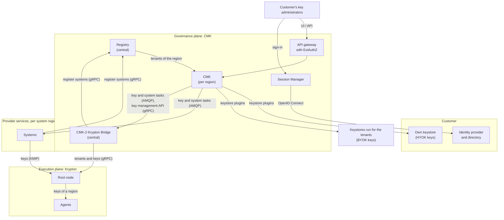

# Introduction

An adopter of OpenKCM lets its customers control the keys that protect their
data, across many services and regions. This page explains the problem OpenKCM
solves, its building blocks and the key chain. The other pages of this section
go into detail:

| Page | What it covers |
| --- | --- |
| [Deployment](/architecture/deployment) | Where each component runs, the regions, and where the data of a tenant lives |
| [Main flows](/architecture/flows) | Onboarding a customer, creating a key chain, connecting a service, withdrawing a key, delivering keys to workloads |
| [Security and integration](/architecture/security-and-integration) | Security principles, the connections between the components, what the provider integrates, and the technology stack |

## The problem it solves

A provider runs many services, in many regions, for many customers. Each service
encrypts the data it stores and sends. Customers in regulated industries ask for
three things:

1. **Own the key.** The key that protects their data comes from them (BYOK) or
   stays in their own keystore (HYOK).
2. **Decide who may use it.** Their own people, signing in with their own
   identity provider, connect services to keys, with separation of duties,
   approvals and an audit trail.
3. **Withdraw it everywhere.** Disabling the key reaches every service and region
   that uses it, without a separate request to each service team.

A key management service (KMS) answers the first point for one account in one
cloud. OpenKCM answers all three for every customer of a provider, across all of
the provider's services: it manages the **key chain**, from the customer's key
down to the keys that the services use.

## Architecture at a glance

OpenKCM separates four concerns:

| Plane | Component | Responsibility |
| --- | --- | --- |
| Governance | [CMK](/overview/cmk): Registry and CMK-2-Krypton Bridge (central); CMK (per region) | Tenants, customer keys and their keystores, systems, roles, approvals, audit, propagation of key changes. Holds no key material |
| Root of trust | Keystores | The customer keys (L1): in a keystore that the provider runs for the tenant (BYOK), or in the customer's own keystore (HYOK) |
| Execution | [Krypton](/overview/krypton): root node, agents | The key hierarchies below the customer key (L2 to L4): generation, sealing, storage, delivery to workloads |
| Consumption | The provider's services | Use the keys to encrypt the customers' data, and act on key changes |

Identity and access sit in front of the governance plane: each customer signs in
with their own identity provider, and every request is checked at the gateway.

## The key chain

The customer key is the root of a chain of keys. Each key protects the keys of
the level below, so a few customer keys protect the many keys that services use,
and withdrawing a customer key cuts off everything below it.

| Level | Key | Held in | Managed by | Status |
| --- | --- | --- | --- | --- |
| L1 | Customer key | Keystore (BYOK) or the customer's own keystore (HYOK) | CMK | Available, with AWS KMS |
| L2 | Domain (System) key | Krypton | Krypton, driven by CMK through the Bridge | <Badge type="danger" text="Sandbox" /> |
| L3 | Service key | Krypton | Krypton | <Badge type="danger" text="Sandbox" /> |
| L4 | Data encryption key | Krypton, delivered to the workload | Krypton | <Badge type="danger" text="Sandbox" /> |

The levels of the Krypton hierarchy are configurable; L2 to L4 is the layout that
CMK uses. Protecting the L2 key with the customer's L1 key is part of the target
architecture and not implemented yet; until then, CMK propagates key changes to
the systems, which act on them.

OpenKCM manages this chain for all customers of a provider, which sets it apart
from a key management service that holds the keys of one account. See
[OpenKCM vs. KMS offerings](/overview/openkcm-vs-kms).

## Status

The governance plane is available; the execution plane is in <Badge type="danger" text="Sandbox" />.

| Part | Status |
| --- | --- |
| Registry, CMK, CMK UI, ExtAuthZ, Session Manager | Available |
| BYOK and HYOK customer keys, with AWS KMS | Available |
| Propagation of key and system changes to the systems of every region | Available |
| Keystores other than AWS KMS | Not yet available; can be added as plugins |
| Krypton key hierarchies and KMIP delivery | <Badge type="danger" text="Sandbox" /> |
| CMK-2-Krypton Bridge | Early stage |
| Customer key protecting the Krypton hierarchy | Not yet available |

## See also

- [Core concepts](/overview/core-concept)
- [Trust model](/overview/trust-model)
- [Deployment planning](/components/cmk/deployment)
- [Krypton architecture](/components/krypton/architecture)
