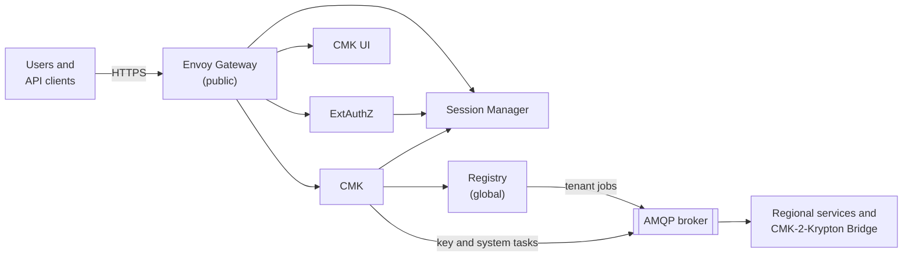

# Deployment planning

This page is for the platform team that runs CMK for its customers. It lists
what you deploy, what CMK depends on, how to lay out the network, and in which
order to install. The [configuration guide](/components/cmk/security/configuration)
then walks you through the setup step by step.

## What you deploy

| Service | Deploy | Purpose |
| --- | --- | --- |
| Envoy Gateway and ExtAuthZ | Once per CMK installation | The only public entry point. Checks every request |
| Session Manager | Once per CMK installation | Browser sign-in with each tenant's identity provider |
| CMK | Once per CMK region | The API server and four background processes, plus database migration jobs |
| CMK UI | Once per CMK installation | The web console, served as static files |
| Registry | Once, globally | The registry of tenants and systems. It sends each tenant to the CMK of its region |
| CMK-2-Krypton Bridge | Per region, when you use [Krypton](/components/krypton/) | Turns CMK's key tasks into Krypton operations |

Every service ships as a container image with a Helm chart; see
[Releases](/releases/).

## Dependencies

| Dependency | Used by | Notes |
| --- | --- | --- |
| PostgreSQL | CMK, Registry, Session Manager | Use a separate database per service. CMK creates one schema per tenant |
| Valkey or Redis | CMK (task queue), Session Manager (sessions) | |
| AMQP 1.0 broker, for example RabbitMQ | CMK, Registry, your regional services | Carries tenant jobs from the Registry and tasks from CMK to each region |
| OpenID Connect identity providers | Session Manager, ExtAuthZ | One per tenant, usually the customer's own |
| Keystore, for example AWS KMS | CMK, through plugins | The keystores that CMK provides for tenants, and access to the customers' own keystores for HYOK |
| Log, metrics and audit collector (OTLP) | All services | Optional, but needed for audit events |

## Network layout

Only Envoy Gateway is reachable from outside. It serves the CMK UI, the CMK API
(`/cmk/v1`) and the Session Manager sign-in endpoints (`/sm`) on one host, or
on two hosts under the same parent domain.

The internal APIs must be reachable only by the services that call them.
Restrict them with Kubernetes NetworkPolicies, and run the services in a
service mesh with mutual TLS.

| Endpoint | Port | Allowed callers |
| --- | --- | --- |
| ExtAuthZ gRPC | 9092 | Envoy Gateway |
| CMK HTTP | 8081 | Envoy Gateway |
| Session Manager HTTP | 8080 | Envoy Gateway |
| Session Manager gRPC | 9091 | ExtAuthZ, CMK |
| Registry gRPC | 9092 | CMK, the CMK-2-Krypton Bridge, and your tenant onboarding tooling |
| Status endpoints (probes, metrics) | 8888 (ExtAuthZ: 8080) | The kubelet and your metrics collector |
| AMQP broker | 5671 | CMK, Registry, your regional services, with mutual TLS |

## Installation order

1. **Dependencies:** PostgreSQL databases, Valkey or Redis, the AMQP broker and
   the collector.
1. **Registry**, with one Orbital target per CMK region; see the
   [Registry configuration reference](/components/cmk/security/registry-config).
1. **Session Manager.** Its migration job prepares its database.
1. **ExtAuthZ** and the **Envoy Gateway** routes and security policy.
1. **CMK.** The Helm chart migrates the database before the services start,
   and migrates data after they started.
1. **CMK UI.**
1. **Regions:** configure one task target per region in CMK and set up the
   broker addresses for the services in each region; see
   [Connect a regional system](/components/cmk/system-integration).
1. **First tenant:** register it in the Registry. CMK creates its schema and
   default groups, and its identity provider is connected through
   Session Manager.

The [configuration guide](/components/cmk/security/configuration) covers steps
3 to 8 in detail.

## Replicas

| Process | Replicas |
| --- | --- |
| CMK API server | Two or more; it can scale with an autoscaler |
| CMK tenant manager, event reconciler, task worker | One or more |
| CMK task scheduler | **Exactly one.** Each replica schedules the periodic tasks |
| Session Manager | Two or more |
| Session Manager housekeeper | Exactly one |
| ExtAuthZ | Two or more; every API request passes it |
| Registry | One or more |

## Decisions to make first

| Decision | Where it is configured |
| --- | --- |
| Region names, and which CMK serves which region | CMK `landscape`, `eventProcessor.targets`; Registry targets |
| Tenant ID format: use lowercase letters, digits and hyphens | Your tenant onboarding process |
| Which key types each tenant may use (BYOK, HYOK per keystore) | CMK [feature gates and flags](/components/cmk/security/cmk-config#featuregates-and-featureflags) |
| Keystore accounts for the keystore pool | CMK `keystorePool`, keystore plugins |
| Default tenant limits (key configurations, keys, systems) | CMK `tenant`, Registry tenant configuration |
| How customers' groups reach CMK (group claim, IAM identifiers) | Identity providers, ExtAuthZ |

## Before you go live

- Work through the [hardening checklist](/components/cmk/security/hardening).
- Set up monitoring and backups; see [Operations](/components/cmk/operations).
- Test the full path with a test tenant: sign in, create a key configuration,
  add a key, connect a test system in each region.

## See also

- [Configuration guide](/components/cmk/security/configuration)
- [Operations](/components/cmk/operations)
- [Security architecture](/components/cmk/security/)
