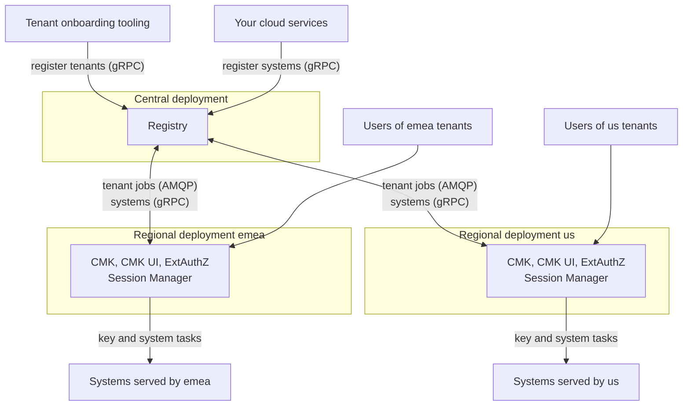

# Deployment planning

This page is for the platform team that runs CMK for its customers. It lists
what you deploy, what CMK depends on, how to lay out the network, and in which
order to install. The [configuration guide](/components/cmk/security/configuration)
then walks you through the setup step by step.

## What you deploy

CMK is deployed as **one central deployment** and **one regional deployment per
CMK region**:

| Deployment | Services | How many | Holds |
| --- | --- | --- | --- |
| Central | [Registry](/components/cmk/registry) | One | Every tenant with its region and status, every system and the tenant it is mapped to, the tenants' identity provider settings |
| Regional | [CMK](/components/cmk/cmk-service), [CMK UI](/components/cmk/cmk-ui), Envoy Gateway with [ExtAuthZ](/components/cmk/extauthz), [Session Manager](/components/cmk/session-manager); the [CMK-2-Krypton Bridge](/components/cmk/krypton-bridge) when you use [Krypton](/components/krypton/) | One per CMK region | The tenants of this region: their keys, key configurations, groups, approvals, system links, browser sessions and identity provider trust |

Every tenant belongs to exactly one CMK region, chosen when the tenant is
[registered in the Registry](/components/cmk/tenant-integration). The Registry sends the
tenant's jobs to the CMK of that region, and the tenant's users work only with
that region's CMK UI and API. Regional deployments share nothing with each
other: each has its own databases, task queue, Session Manager and ExtAuthZ.

| Service | Deployment | Purpose |
| --- | --- | --- |
| Registry | Central, once | Registers tenants and systems. Sends each tenant's jobs (provision, block, unblock, terminate, identity provider) to the CMK of the tenant's region |
| CMK | Regional | The API server and four background processes, plus database migration jobs. Serves the tenants of its region |
| Envoy Gateway and ExtAuthZ | Regional | The region's only public entry point. Checks every request |
| Session Manager | Regional | Browser sign-in with the identity providers of the region's tenants |
| CMK UI | Regional | The web console, served as static files. It is configured with one API base URL, its region's gateway |
| CMK-2-Krypton Bridge | Regional, when you use [Krypton](/components/krypton/) | Turns CMK's key tasks into Krypton operations |

Every service ships as a container image with a Helm chart; see
[Releases](/releases/).

### Connections between the deployments

| From | To | Protocol | Purpose |
| --- | --- | --- | --- |
| Registry | Tenant manager of each regional CMK | AMQP, through Orbital; one Registry target per region | Tenant jobs, and the tenants' identity provider settings |
| Regional CMK | Registry gRPC API | gRPC | API server: list the tenant's systems. Tenant manager: set the tenant's user groups, read its limits, unmap systems at termination. Event reconciler: update system status and L1 key claims. Task worker: read tenant names |
| Your tenant onboarding tooling | Registry gRPC API | gRPC | Register tenants, apply identity providers, change limits, block, unblock and terminate tenants; see [Connect a regional tenant](/components/cmk/tenant-integration) |
| Your cloud services | Registry gRPC API | gRPC | Register their systems and map them to tenants |
| CMK-2-Krypton Bridge of each region | Registry gRPC API | gRPC | Register the systems it creates keys for and map them to their tenant |

The Registry is the only service that every region reaches. Protect its gRPC API
with mutual TLS or a service mesh across the regions, and allow only the
callers above: it has no authentication of its own and can create, block and
terminate tenants.

### Regions

Two kinds of region appear in the configuration:

| Region | Example | Where it is set |
| --- | --- | --- |
| **CMK region**: the regional deployment that serves a tenant | `emea`, `us` | The tenant's `region` in the Registry, and the Registry's [`orbital.targets`](/components/cmk/security/registry-config#targets) |
| **System region**: where a system runs | `eu10`, `us20` | The system's `region` in the Registry, and the [`eventProcessor.targets`](/components/cmk/security/cmk-config#eventprocessor) of the regional CMK that serves its tenant |

A regional CMK sends key and system tasks to every system region listed in its
`eventProcessor.targets`. Plan which system regions each CMK region serves, and
configure a target for each of them.

## Dependencies

| Dependency | Used by | Notes |
| --- | --- | --- |
| PostgreSQL | Registry (central); CMK and Session Manager (each region) | Use a separate database per service and region. CMK creates one schema per tenant of its region |
| Valkey or Redis | CMK (task queue) and Session Manager (sessions), in each region | |
| AMQP 1.0 broker, for example RabbitMQ | Registry, CMK, your regional services | Carries tenant jobs from the Registry to the CMK of each region, and tasks from CMK to the system regions. Each Registry and CMK target has its own broker URL, so you can use one central broker or one per region |
| OpenID Connect identity providers | Session Manager, ExtAuthZ | One per tenant, usually the customer's own |
| Keystore, for example AWS KMS | CMK, through plugins | The keystores that CMK provides for tenants, and access to the customers' own keystores for HYOK |
| Log, metrics and audit collector (OTLP) | All services | Optional, but needed for audit events |

## Network layout

In each region, only Envoy Gateway is reachable from outside. It serves the CMK
UI, the CMK API (`/cmk/v1`) and the Session Manager sign-in endpoints (`/sm`) on
one host, or on two hosts under the same parent domain, for example
`cmk.emea.example.com`. Each region has its own hosts; the users of a tenant use
the hosts of their tenant's region.

The internal APIs must be reachable only by the services that call them.
Restrict them with Kubernetes NetworkPolicies, and run the services in a
service mesh with mutual TLS. Only the Registry's gRPC API and the AMQP broker
are called across deployments.

| Endpoint | Port | Deployment | Allowed callers |
| --- | --- | --- | --- |
| ExtAuthZ gRPC | 9092 | Regional | Envoy Gateway of the same region |
| CMK HTTP | 8081 | Regional | Envoy Gateway of the same region |
| Session Manager HTTP | 8080 | Regional | Envoy Gateway of the same region |
| Session Manager gRPC | 9091 | Regional | ExtAuthZ and CMK of the same region |
| Registry gRPC | 9092 | Central | The CMK and CMK-2-Krypton Bridge of every region, your tenant onboarding tooling, and your cloud services that register systems |
| Status endpoints (probes, metrics) | 8888 (ExtAuthZ: 8080) | Both | The kubelet and your metrics collector |
| AMQP broker | 5671 | Central or regional | Registry, CMK, your regional services, with mutual TLS |

## Installation order

Install the central deployment first, then each regional deployment:

1. **Central dependencies:** the Registry's PostgreSQL database, and the AMQP
   broker if you run a central one.
1. **Registry**, with one Orbital target per CMK region and a validation rule
   that allows only these regions; see the
   [Registry configuration reference](/components/cmk/security/registry-config).
1. **For each region:**
   1. **Regional dependencies:** PostgreSQL databases for CMK and Session
      Manager, Valkey or Redis, a regional broker if you use one, and the
      collector.
   1. **Session Manager.** Its migration job prepares its database.
   1. **ExtAuthZ** and the **Envoy Gateway** routes and security policy.
   1. **CMK**, with `services.registry` pointing to the central Registry and
      `tenantManager.amqp` matching the Registry's target for this region. The
      Helm chart migrates the database before the services start, and migrates
      data after they started.
   1. **CMK UI**, with the API base URL of this region's gateway.
   1. **System regions:** configure one `eventProcessor.targets` entry per
      system region that this CMK serves, and set up the broker addresses for
      the services there; see
      [Connect a regional system](/components/cmk/system-integration).
1. **First tenant:** [register it in the Registry](/components/cmk/tenant-integration)
   with the region that should serve it. The CMK of that region creates its
   schema and default groups. Then apply its identity provider, which that
   region's Session Manager trusts from then on.

The [configuration guide](/components/cmk/security/configuration) covers the
regional steps in detail.

### Adding a region

1. Install a regional deployment as above.
1. Add a target for the new region to the Registry's `orbital.targets`, and the
   region to its `Tenant.Region` validation rule.
1. Register new tenants with the new region. An existing tenant stays in the
   region it was registered with.

## Replicas

| Process | Replicas |
| --- | --- |
| CMK API server | Two or more; it can scale with an autoscaler |
| CMK tenant manager, event reconciler, task worker | One or more |
| CMK task scheduler | **Exactly one.** Each replica schedules the periodic tasks |
| Session Manager | Two or more |
| Session Manager housekeeper | Exactly one |
| ExtAuthZ | Two or more; every API request passes it |
| Registry (central) | One or more |

## Decisions to make first

| Decision | Where it is configured |
| --- | --- |
| CMK regions: which regional deployments you run, and which region serves which tenants | Registry `orbital.targets` and `Tenant.Region` validation; CMK `tenantManager.amqp` |
| The name of each installation, used in certificates, tasks and notifications | CMK `landscape.name` and `landscape.region` |
| System regions served by each CMK region | CMK `eventProcessor.targets` of that region; Registry `RegionalSystem.Region` validation |
| Tenant ID format: use lowercase letters, digits and hyphens | Your tenant onboarding process |
| Which key types each tenant may use (BYOK, HYOK per keystore) | CMK [feature gates and flags](/components/cmk/security/cmk-config#featuregates-and-featureflags) |
| Keystore accounts for the keystore pool | CMK `keystorePool`, keystore plugins |
| Default tenant limits (key configurations, keys, systems) | CMK `tenant`, Registry tenant configuration |
| How customers' groups reach CMK (group claim, IAM identifiers) | Identity providers, ExtAuthZ |

## Before you go live

- Work through the [hardening checklist](/components/cmk/security/hardening).
- Set up monitoring and backups; see [Operations](/components/cmk/operations).
- Test the full path with a test tenant in each CMK region: register it in the
  Registry, sign in, create a key configuration, add a key, connect a test
  system in each system region.

## See also

- [Configuration guide](/components/cmk/security/configuration)
- [Operations](/components/cmk/operations)
- [Security architecture](/components/cmk/security/)
