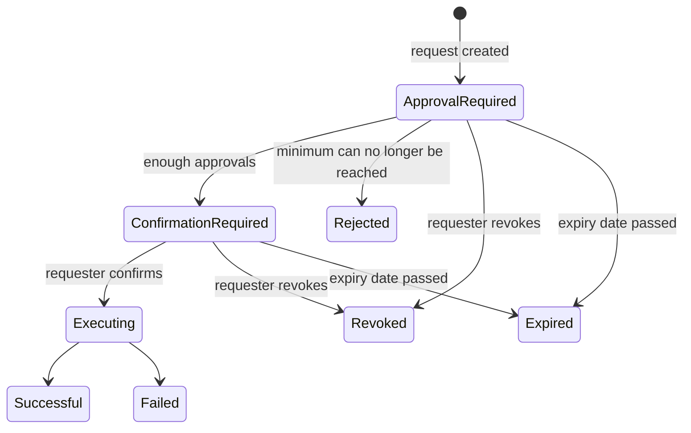

# Approvals

Approvals apply the four-eyes principle to the changes that affect your
systems' access to keys: one key administrator requests the change, colleagues
approve it, and only then does CMK carry it out. This page explains which
changes need approval, who approves them, and how a request moves from
creation to execution.

## When approvals apply

Approvals are switched on by default for live (production) tenants and off for
other tenants. Test tenants can switch them on and off in the approval settings.

When approvals are on, these changes need approval:

| Change | Request type |
| --- | --- |
| Connect a system to a key configuration | System: Connect |
| Move a system to another key configuration | System: Switch |
| Disconnect a system | System: Disconnect |
| Change the primary key of a key configuration (not the first one) | Key configuration: Update primary key |
| Enable or disable the primary key (BYOK) | Key: Update state |
| Delete the primary key | Key: Delete |

If you make such a change directly, for example through the API, CMK rejects it
with `ACTION_REQUIRE_WORKFLOW`. In the UI, the action offers **Send for
Approval** instead.

## Who approves

- The approvers are the members of the administrator group of the key
  configurations involved. Moving a system to another key configuration
  involves the groups of both configurations.
- The person who requests a change can never approve it.
- A request needs a minimum number of approvals, two by default. If the groups
  do not have enough other members, the request cannot be created
  (`WORKFLOW_GROUP_NOT_SUFFICIENT_MEMBERS`).
- Approvers must still be members of the group when they decide.

Only one open request can exist for the same key, key configuration or system at
a time.

## How a request proceeds



1. **Request.** A key administrator starts the change and selects
   **Send for Approval**. The request appears under **Tasks** with the state
   **Approval Required**, and the approvers are notified.
1. **Approve or reject.** Each approver opens the request under **Tasks** and
   selects **Approve** or **Reject**. When the approvals minus the rejections
   reach the minimum, the request moves to **Confirmation Required**. When the
   minimum can no longer be reached, it is **Rejected**.
1. **Confirm.** The requester selects **Confirm**. CMK carries out the change
   (**Executing**) and the request ends as **Successful** or **Failed**.

The requester can **Revoke** a request until it is confirmed.

## Expiry

Every request has an expiry date, by default seven days after it is created.
Requests that are not completed by then are marked **Expired** in a daily run.
Completed requests are deleted after the retention period, 30 days by default.

## Approval settings

Tenant administrators change the settings under your avatar → **Settings** →
**Workflow Settings**. Key administrators and auditors can view them.

| Setting | Default | Allowed values |
| --- | --- | --- |
| Minimum approvals | 2 | 2 to 5 |
| Default expiry period (days) | 7 | 1 up to the maximum expiry period |
| Maximum expiry period (days) | 7 | 1 to 7 |
| Retention period (days) | 30 | 7 to 30 |

A change of the minimum applies to new requests; existing requests keep the
minimum they were created with.

## Through the API

Create a request with `POST /cmk/v1/<tenant>/workflows`, for example to connect a
system:

```json
{
  "artifactType": "SYSTEM",
  "artifactID": "<system ID>",
  "actionType": "LINK",
  "parameters": "<key configuration ID>"
}
```

| `artifactType` | `actionType` | `parameters` |
| --- | --- | --- |
| `SYSTEM` | `LINK`, `SWITCH` | Target key configuration ID |
| `SYSTEM` | `UNLINK` | – |
| `KEY_CONFIGURATION` | `UPDATE_PRIMARY` | New primary key ID |
| `KEY` | `UPDATE_STATE` | `ENABLED` or `DISABLED` |
| `KEY` | `DELETE` | – |

- `POST /cmk/v1/<tenant>/workflows/check` tells you whether a change needs
  approval and whether a request can be created.
- `POST /cmk/v1/<tenant>/workflows/<ID>/state` with
  `{"transition": "APPROVE"}` (or `REJECT`, `CONFIRM`, `REVOKE`) moves a
  request on.

## See also

- [Sign-in, groups and roles](/components/cmk/guide/access)
- [Systems](/components/cmk/guide/systems)
- [Keys](/components/cmk/guide/keys)
