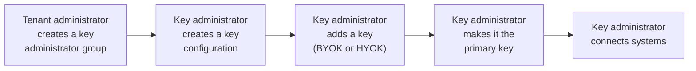

# Manage your keys

This guide is for the customers of a cloud service that uses CMK: the people who
manage the keys of their tenant. It explains how to sign in, give your
colleagues access, add your keys, and connect them to the systems that encrypt
your data.

## Before you start

Your cloud service provider gives you:

- **The address of the CMK UI**, for example `https://ui.example.com`, and your
  **tenant ID**.
- **The identity provider** your tenant signs in with. It is usually your own
  corporate login, connected by the provider during onboarding.

You also need to be a member of a group that CMK knows. When your tenant is
created, CMK creates two groups for it; your provider tells you how to become a
member of the tenant administrator group. See
[Sign-in, groups and roles](/components/cmk/guide/access).

## Roles at a glance

| Role | What you do |
| --- | --- |
| Tenant administrator | Create the groups for key administrators, decide who belongs to which group, and set the approval rules |
| Key administrator | Create key configurations, add and manage keys, connect systems, and approve changes of colleagues |
| Auditor | See everything in the tenant without changing anything |

Each person has exactly one role in a tenant.

## First steps

1. **Tenant administrator:** sign in and create a group for your key
   administrators under **User Groups**. Ask your identity provider team to put
   the right people in the matching group. See
   [Groups](/components/cmk/guide/access#create-a-key-administrator-group).
1. **Key administrator:** create a key configuration under
   **Key Configurations**, owned by your key administrator group. See
   [Key configurations](/components/cmk/guide/key-configurations).
1. **Key administrator:** add a key to the key configuration: import your own
   key material (BYOK), or link a key from your own keystore (HYOK). See
   [Keys](/components/cmk/guide/keys).
1. **Key administrator:** make the key the configuration's **primary key**. The
   systems connected to the configuration use this key.
1. **Key administrator:** connect your systems to the key configuration under
   **Systems**. See [Systems](/components/cmk/guide/systems).

If your tenant requires approvals, some of these steps create an approval
request that colleagues must approve first. See
[Approvals](/components/cmk/guide/approvals).

## Find your way in the UI

| Screen | What you find there | Who sees it |
| --- | --- | --- |
| **Key Configurations** | Your key configurations, their keys and connected systems | Key administrators, auditors |
| **Systems** | The systems of your tenant in every region, and the key configuration each one uses | Key administrators, auditors |
| **Tasks** | Approval requests that you started or are asked to approve | Key administrators, auditors |
| **User Groups** | The groups of your tenant and their roles | Everyone |
| **Settings** (from your avatar) | Language and approval settings | Everyone; tenant administrators can change the approval settings |

Tenant administrators start on **User Groups**; everyone else starts on
**Key Configurations**.

## Automate with the API

Everything you can do in the UI, you can also do through the
[CMK API](/components/cmk/api).

## See also

- [Core concepts](/overview/core-concept): key types and the key hierarchy
- [Trust model](/overview/trust-model): who holds which key and how to withdraw
  access
- [Glossary](/overview/glossary)
