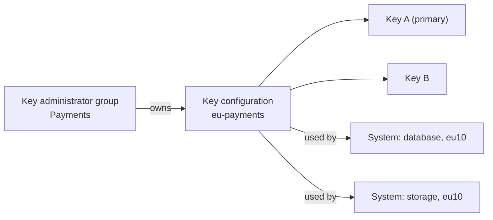

# Key configurations

A key configuration groups the keys that protect a set of your systems. It
belongs to one key administrator group, holds one or more keys, and has one
**primary key**: the key that every system connected to the configuration uses.



Only members of the owning group can see and manage a key configuration and its
keys. Use separate key configurations to keep the keys of different teams or
data sets apart.

## Create a key configuration

You need the key administrator role and must be a member of the group that will
own the configuration.

1. Go to **Key Configurations** and select **Create Configuration**.
1. Enter a **Name**, which must be unique in your tenant, and optionally a
   **Description**.
1. Select the **Administrator Group**. It cannot be changed later.
1. Select **Create**.

Through the API:

```http
POST /cmk/v1/acme/keyConfigurations
Content-Type: application/json

{
  "name": "eu-payments",
  "description": "Keys for the payment systems in the EU",
  "adminGroupID": "<ID of the key administrator group>"
}
```

## Add keys and choose the primary key

1. Open the key configuration and go to **Keys**.
1. Add a key: import your own key material (BYOK) or link a key from your own
   keystore (HYOK). See [Keys](/components/cmk/guide/keys).
1. When the key is **Enabled**, select **Make Primary**.

The first primary key can be set directly. Changing an existing primary key
switches every connected system to the new key, so it may need approval; see
[Approvals](/components/cmk/guide/approvals). Both the current and the new key
must be enabled, and all connected systems must be in the **Connected** state.

Systems can be connected to a key configuration only when its primary key
exists and is enabled.

## Change a key configuration

On the **Details** tab you can change the **Name** and the **Tags**. Tags are
free-text labels for your own use, for example a cost center or an environment.
Each tag can have up to 255 characters.

## Limits

Your cloud service provider sets limits per tenant. The defaults are:

| Limit | Default |
| --- | --- |
| Key configurations per tenant | 5 |
| Keys per key configuration (deleted and detached keys are not counted) | 10 |
| Systems per key configuration | 50 |

When you reach a limit, CMK rejects the action with `KEY_CONFIG_LIMIT_EXCEEDED`,
`KEY_LIMIT_EXCEEDED` or `SYSTEM_LIMIT_EXCEEDED`. Ask your provider if you need
more.

## Delete a key configuration

Disconnect all systems and delete all keys first. CMK refuses to delete a key
configuration that still has keys or connected systems. Deleting it also
deletes its tags.

## See also

- [Keys](/components/cmk/guide/keys)
- [Systems](/components/cmk/guide/systems)
- [Sign-in, groups and roles](/components/cmk/guide/access)
