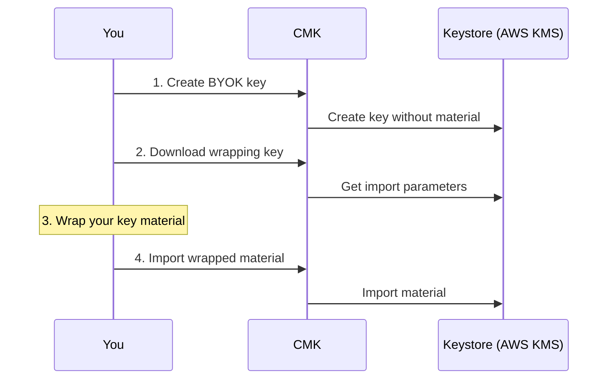

# Keys

CMK manages your keys without ever holding their material: the material stays
in a keystore, and CMK keeps references, settings and their state. This page
explains how to add keys of both types, follow their state, and change, rotate
or delete them.

## Key types

| | BYOK: bring your own key | HYOK: hold your own key |
| --- | --- | --- |
| Where the key lives | A keystore that your provider runs for your tenant | Your own keystore, in your own account |
| Who generates the material | You, outside CMK | You, in your keystore |
| How you add it | Create the key in CMK, then import your wrapped key material | Link an existing key by its identifier |
| Enable and disable | In CMK | In your own keystore. CMK follows the change |
| Delete in CMK | Also deletes the key in the provider's keystore | Removes the key from CMK only |

Both types support the **AES-256** algorithm and the **AWS KMS** keystore. Your
provider decides which key types and regions your tenant may use. If a type is
not enabled for you, CMK rejects it with `BYOK_NOT_ALLOWED` or
`HYOK_NOT_ALLOWED`.

Keys belong to a [key configuration](/components/cmk/guide/key-configurations).
Open the key configuration, go to **Keys** and select **Add**.

## Bring your own key (BYOK)

With BYOK you generate the key material yourself, for example in your own
hardware security module, and import it, encrypted ("wrapped"), into the
keystore that your provider runs for your tenant. You keep a copy of the
material.



### 1. Create the key

1. In the key configuration, go to **Keys**, select **Add** and then **BYOK**.
1. In the **Key Creation Wizard**, enter a **Key Name** and optionally a
   description.
1. Select the **Region** in which the key is created.
1. Review the details and select **Create Key**.

The key appears in the state **Pending import** (`PENDING_IMPORT`). If your
tenant's keystore is still being prepared, the key first shows **Pending
creation** (`PENDING_CREATION`) for a few minutes.

Through the API:

```http
POST /cmk/v1/acme/keys
Content-Type: application/json

{
  "name": "payments-2026",
  "type": "BYOK",
  "keyConfigurationID": "<key configuration ID>",
  "algorithm": "AES256",
  "region": "eu-central-1"
}
```

### 2. Download the wrapping key

Select **Download Public Wrapping Key** on the key's row. You receive the
keystore's public key in PEM format, and the import dialog shows which wrapping
algorithm and hash function to use.

Through the API, `GET /cmk/v1/acme/keys/<key ID>/importParams` returns:

```json
{
  "publicKey": "-----BEGIN PUBLIC KEY-----\n...",
  "wrappingAlgorithm": { "name": "CKM_RSA_PKCS_OAEP", "hashFunction": "SHA256" }
}
```

The wrapping key is valid for a limited time set by the keystore. If it has
expired when you import, download a new one and wrap the material again.

### 3. Wrap your key material

Wrap the material outside CMK, on a machine you trust. The key material for
AES-256 is 32 random bytes. The commands below use OpenSSL with the algorithm
`CKM_RSA_PKCS_OAEP`; save the downloaded public key as
`public-wrapping-key.pem`.

```bash
# Key material: 32 random bytes. In production, generate and keep it in your HSM.
openssl rand -out key-material.bin 32
```

With hash function `SHA256`:

```bash
openssl pkeyutl -encrypt -pubin -inkey public-wrapping-key.pem \
  -in key-material.bin -out wrapped-key-material.bin \
  -pkeyopt rsa_padding_mode:oaep -pkeyopt rsa_oaep_md:sha256 -pkeyopt rsa_mgf1_md:sha256
```

With hash function `SHA1`, use `sha1` in both `rsa_oaep_md` and `rsa_mgf1_md`.

Encode the result for the import:

```bash
openssl base64 -A -in wrapped-key-material.bin > wrapped-key-material.b64
```

If the import dialog shows `CKM_RSA_AES_KEY_WRAP`, wrap the material as the
keystore's documentation describes for RSA-AES key wrapping, for example
AWS KMS `RSA_AES_KEY_WRAP_SHA_256`.

### 4. Import the wrapped material

1. Select **Import** on the key's row.
1. Either **Upload Key Material** with the file, or select
   **Paste wrapped key material** and paste the base64 text.
1. Confirm the import.

Through the API:

```http
POST /cmk/v1/acme/keys/<key ID>/importKeyMaterial
Content-Type: application/json

{ "wrappedKeyMaterial": "<content of wrapped-key-material.b64>" }
```

After the import, the key takes its state from the keystore, usually
**Enabled**.

## Hold your own key (HYOK)

With HYOK the key stays in your own AWS KMS account. CMK links it, checks its
state regularly and informs your systems when it changes. You can disable the
key in your account at any time, and CMK and your systems follow.

### What you prepare in AWS

- A **symmetric AES-256 key** in AWS KMS, in the state **Enabled**, and its key
  ARN.
- Access for CMK through **IAM Roles Anywhere**: a trust anchor that trusts the
  certificate authority of CMK, a role that may use the key, and a profile. The
  wizard lets you download CMK's root CA certificate and shows the certificate
  subject to trust. Your provider tells you which permissions the role needs.
- CMK uses separate access for **management**, to read the key's state, and for
  **crypto**, the access that your systems receive in each region.

### Link the key

1. In the key configuration, go to **Keys**, select **Add** and then **HYOK**.
1. In **Key Details**, enter a **Key Name**, the **Key ARN** and optionally a
   description.
1. In **Management**, download the root CA certificate if you have not set up
   the trust anchor yet, and enter the **Trust Anchor ARN**, **Role ARN** and
   **Profile ARN**.
1. In **Crypto**, select the certificates and add the ARNs for the access that
   your systems use.
1. Review the details and select **Add Key**.

CMK checks that it can reach the key with the access you provided, that the key
is enabled, and that it is an AES-256 key. If CMK cannot authenticate yet, for
example because the trust anchor is still being set up, the key shows
**Pending registration** (`PENDING_REGISTRATION`) and CMK keeps trying for 15
minutes before it marks the key **Forbidden**.

### How CMK follows your key

CMK checks every HYOK key every five minutes, and also whenever you open it:

| State in your keystore or access | State in CMK |
| --- | --- |
| Key enabled | Enabled |
| Key disabled | Disabled |
| CMK can no longer authenticate | Forbidden |
| Key not found, for example deleted | Deleted |
| Keystore not reachable | Unknown |

When a key changes between enabled and disabled, CMK informs every system that
uses it.

The management access of a linked key cannot be changed. You can add crypto
access for further regions later.

## Key states

| State | Meaning |
| --- | --- |
| `ENABLED` | The key can be used |
| `DISABLED` | The key is disabled; systems must not use it |
| `PENDING_CREATION` | CMK is creating a BYOK key in your tenant's keystore |
| `PENDING_IMPORT` | The BYOK key waits for its key material |
| `PENDING_REGISTRATION` | CMK is still trying to reach a newly linked HYOK key |
| `FORBIDDEN` | CMK cannot authenticate to your keystore. Check the access in your account |
| `DELETED` | The key no longer exists in the keystore |
| `UNKNOWN` | CMK could not reach the keystore at the last check |
| `ERROR` | The key could not be created or linked. The key's details show the reason |
| `DETACHING`, `DETACHED` | The key is being or has been released because your tenant is being terminated |

## Enable and disable a key

For BYOK keys, select **Enable** or **Disable** on the key's row. CMK changes
the state in the keystore and informs every system that uses the key. A key in
one of the pending states cannot be enabled or disabled.

Disabling or enabling the primary key of a key configuration may need approval;
see [Approvals](/components/cmk/guide/approvals).

For HYOK keys, enable and disable the key in your own keystore.

## Rotation and key versions

CMK does not rotate keys itself.

- **HYOK:** rotate the key in your keystore. CMK detects the new version at its
  next check, lists it under **Versions**, and informs the systems that use the
  key if it is a primary key.
- **BYOK:** add a new key with new material to the key configuration and make it
  the primary key. CMK switches every connected system to the new key.

## Delete a key

Select **Delete** on the key's row. Deleting removes the key and all its
versions from CMK.

- A **BYOK** key is also deleted in the keystore. Make sure you no longer need
  it and that you keep your own copy of the material if required.
- A **HYOK** key is never deleted in your own keystore.
- The primary key cannot be deleted while systems are connected to its key
  configuration (`INVALID_KEY_DELETE`), and deleting it may need approval.

## Labels

Through the API you can attach labels, key–value pairs of up to 255 characters
each, to a key: `GET` and `POST /cmk/v1/<tenant>/key/<key ID>/labels`, and
`DELETE /cmk/v1/<tenant>/key/<key ID>/label/<name>`.

## Troubleshooting

| You see | What to do |
| --- | --- |
| `BYOK_NOT_ALLOWED` or `HYOK_NOT_ALLOWED` | The key type or provider is not enabled for your tenant. Ask your provider |
| The key stays in **Pending import** | Download the wrapping key, wrap your material and import it |
| The import fails | The wrapping key may have expired, or the material was wrapped with another algorithm or hash. Download the wrapping key again and repeat |
| A HYOK key is **Forbidden** | Check the trust anchor, role and profile in your account, and that the role may use the key |
| A HYOK key is **Unknown** | CMK could not reach your keystore at the last check. It checks again within five minutes |
| A key is in **Error** | Open the key to see the error details |

## See also

- [Key configurations](/components/cmk/guide/key-configurations)
- [Systems](/components/cmk/guide/systems)
- [Trust model](/overview/trust-model): how to withdraw access
