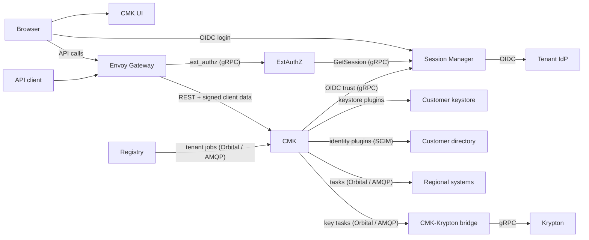

# CMK

CMK (Customer-Managed Keys) is the OpenKCM product for governing customer keys.
Tenants use it to manage their keys in their own keystores, link the keys to
the systems that use them, and control who may do what. CMK consists of six
services, plugins and shared libraries. For its cryptographic key operations,
CMK requires [Krypton](/components/krypton/), which it drives through the
CMK-Krypton bridge.

This section describes what each service does, based on its source code, how
the services work together, and how to configure and secure them.

## CMK services

| Service | Role | Repository |
| --- | --- | --- |
| [CMK service](/components/cmk/cmk-service) | Governance control plane for customer keys: REST API, workflows, propagation to regions | [cmk][cmk] |
| [CMK UI](/components/cmk/cmk-ui) | Web console for CMK | [cmk-ui][cmk-ui] |
| [Registry](/components/cmk/registry) | Global registry of tenants and the systems they own | [registry][registry] |
| [ExtAuthZ](/components/cmk/extauthz) | Authenticates every API request, evaluates Cedar policies, signs client data | [extauthz][extauthz] |
| [Session Manager](/components/cmk/session-manager) | OIDC login, browser sessions and per-tenant identity provider trust | [session-manager][sm] |
| [CMK-Krypton bridge](/components/cmk/krypton-bridge) | Turns CMK's key decisions into Krypton operations; CMK requires Krypton for its cryptographic keys | [cmk-krypton-bridge][bridge] |

## How the services work together

- The **CMK UI** runs in the browser. Users sign in through **Session Manager**,
  which runs the OpenID Connect flow with the tenant's identity provider.
- Every API call passes **Envoy Gateway**, which asks **ExtAuthZ** for a
  decision. ExtAuthZ checks the session, token or client certificate and adds
  signed client data to the request.
- **CMK** verifies the client data, authorizes the call and performs it. Key
  operations run in the keystores through plugins.
- The **Registry** onboards tenants and sends them to the CMK of their region.
  CMK propagates key and system changes to the regional systems.
- The **CMK-Krypton bridge** receives CMK's key tasks and creates and updates
  the corresponding keys in [Krypton](/components/krypton/), which CMK requires
  for its cryptographic key operations.

## Supporting building blocks

| Building block | Purpose | Repository |
| --- | --- | --- |
| [Plugins](/components/cmk/plugins) | Keystore and identity management integrations | [plugin-sdk][plugin-sdk], [keystore-plugins][ksp], [identity-management-plugins][imp] |
| [Orbital](/components/cmk/registry#orbital) | Library for jobs and tasks between services | [orbital][orbital] |
| common-sdk | Configuration, logging, audit events, OIDC and client data helpers | [common-sdk][common-sdk] |
| api-sdk | gRPC API definitions shared between services | [api-sdk][api-sdk] |

## Security

The [security section](/components/cmk/security/) explains how requests are
authenticated and authorized across these services, how to configure them, and
which settings to review before going live.

## See also

- [Overview](/overview/)
- [OpenKCM on GitHub](https://github.com/openkcm)

[cmk]: https://github.com/openkcm/cmk
[cmk-ui]: https://github.com/openkcm/cmk-ui
[registry]: https://github.com/openkcm/registry
[extauthz]: https://github.com/openkcm/extauthz
[sm]: https://github.com/openkcm/session-manager
[bridge]: https://github.com/openkcm/cmk-krypton-bridge
[plugin-sdk]: https://github.com/openkcm/plugin-sdk
[ksp]: https://github.com/openkcm/keystore-plugins
[imp]: https://github.com/openkcm/identity-management-plugins
[orbital]: https://github.com/openkcm/orbital
[common-sdk]: https://github.com/openkcm/common-sdk
[api-sdk]: https://github.com/openkcm/api-sdk
