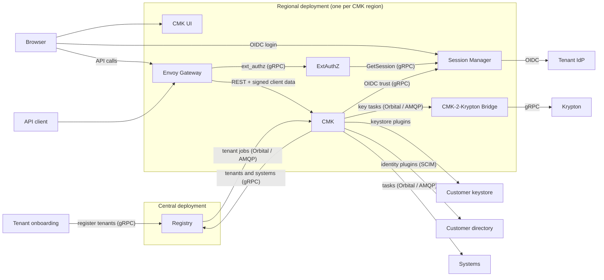

# CMK

CMK (Customer-Managed Keys) is the OpenKCM product for governing customer keys.
Tenants use it to manage their keys in their own keystores, link the keys to
the systems that use them, and control who may do what. CMK consists of six
services, plugins and shared libraries. For its cryptographic key operations,
CMK requires [Krypton](/components/krypton/), which it drives through the
CMK-2-Krypton Bridge.

This section is for everyone who works with CMK: the customers who manage their
keys in it, the teams who connect their cloud services to it, and the operators
who run it.

## Start here

| You want to… | Read |
| --- | --- |
| Manage keys, key configurations, systems or approvals in CMK | [Manage your keys](/components/cmk/guide/) |
| Give users access to a tenant, or understand what each role may do | [Sign-in, groups and roles](/components/cmk/guide/access) |
| Automate CMK through its REST API | [CMK API](/components/cmk/api) |
| Onboard a customer: register the tenant for its region, connect its identity provider, block or terminate it | [Connect a regional tenant](/components/cmk/tenant-integration) |
| Make your cloud service receive key changes from CMK | [Connect a regional system](/components/cmk/system-integration) |
| Plan and install a CMK deployment | [Deployment planning](/components/cmk/deployment), then the [configuration guide](/components/cmk/security/configuration) |
| Run, upgrade and troubleshoot CMK | [Operations](/components/cmk/operations) |
| Review how CMK protects access before going live | [Security architecture](/components/cmk/security/) and the [hardening checklist](/components/cmk/security/hardening) |

## CMK services

CMK runs as one **central deployment** with the Registry, and one **regional
deployment** per CMK region with the other services. Every tenant is
registered in the Registry with a region and is served by that region's
deployment. See [Deployment planning](/components/cmk/deployment#what-you-deploy).

| Service | Deployment | Role | Repository |
| --- | --- | --- | --- |
| [Registry](/components/cmk/registry) | Central | Registers all tenants and their systems, and sends each tenant's jobs to the CMK of its region | [registry][registry] |
| [CMK service](/components/cmk/cmk-service) | Regional | Governance control plane for the customer keys of the region's tenants: REST API, workflows, propagation to systems | [cmk][cmk] |
| [CMK UI](/components/cmk/cmk-ui) | Regional | Web console for CMK | [cmk-ui][cmk-ui] |
| [ExtAuthZ](/components/cmk/extauthz) | Regional | Authenticates every API request, evaluates Cedar policies, signs client data | [extauthz][extauthz] |
| [Session Manager](/components/cmk/session-manager) | Regional | OIDC login, browser sessions and per-tenant identity provider trust | [session-manager][sm] |
| [CMK-2-Krypton Bridge](/components/cmk/krypton-bridge) | Regional | Turns CMK's key decisions into Krypton operations; CMK requires Krypton for its cryptographic keys | [cmk-krypton-bridge][bridge] |

## How the services work together

- The **CMK UI** runs in the browser. Users sign in through **Session Manager**,
  which runs the OpenID Connect flow with the tenant's identity provider.
- Every API call passes **Envoy Gateway**, which asks **ExtAuthZ** for a
  decision. ExtAuthZ checks the session, token or client certificate and adds
  signed client data to the request.
- **CMK** verifies the client data, authorizes the call and performs it. Key
  operations run in the keystores through plugins.
- The **Registry**, in the central deployment, registers every tenant with its
  region, and the systems of the cloud services. It sends each tenant's jobs,
  such as provisioning, blocking or its identity provider, to the CMK of the
  tenant's region. See [Connect a regional tenant](/components/cmk/tenant-integration).
- CMK propagates key and system changes to the systems of its tenants.
- The **CMK-2-Krypton Bridge** receives CMK's key tasks and creates and updates
  the corresponding keys in [Krypton](/components/krypton/), which CMK requires
  for its cryptographic key operations.

## Supporting building blocks

| Building block | Purpose | Repository |
| --- | --- | --- |
| [Plugins](/components/cmk/plugins) | Keystore and identity management integrations | [plugin-sdk][plugin-sdk], [keystore-plugins][ksp], [identity-management-plugins][imp] |
| [Orbital](/components/cmk/registry#orbital) | Library for jobs and tasks between services | [orbital][orbital] |
| common-sdk | Configuration, logging, audit events, OIDC and client data helpers | [common-sdk][common-sdk] |
| api-sdk | gRPC API definitions shared between services | [api-sdk][api-sdk] |

## Security

The [security section](/components/cmk/security/) explains how requests are
authenticated and authorized across these services, how to configure them, and
which settings to review before going live.

## See also

- [Overview](/overview/)
- [OpenKCM on GitHub](https://github.com/openkcm)

[cmk]: https://github.com/openkcm/cmk
[cmk-ui]: https://github.com/openkcm/cmk-ui
[registry]: https://github.com/openkcm/registry
[extauthz]: https://github.com/openkcm/extauthz
[sm]: https://github.com/openkcm/session-manager
[bridge]: https://github.com/openkcm/cmk-krypton-bridge
[plugin-sdk]: https://github.com/openkcm/plugin-sdk
[ksp]: https://github.com/openkcm/keystore-plugins
[imp]: https://github.com/openkcm/identity-management-plugins
[orbital]: https://github.com/openkcm/orbital
[common-sdk]: https://github.com/openkcm/common-sdk
[api-sdk]: https://github.com/openkcm/api-sdk
