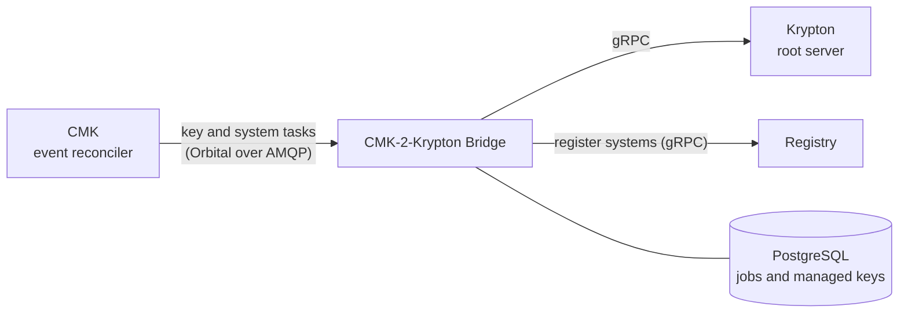

# CMK-2-Krypton Bridge

The CMK-2-Krypton Bridge is the CMK service that connects CMK to
[Krypton](/components/krypton/). CMK relies on Krypton for its cryptographic key
operations: the bridge turns CMK operations, such as creating, enabling,
disabling and deleting keys, into Krypton requests, so that a customer's
decisions in CMK are enforced in Krypton as well.

Repository: [openkcm/cmk-krypton-bridge](https://github.com/openkcm/cmk-krypton-bridge)

::: warning Early stage
The bridge is under active development. See [Current state](#current-state).
:::

## How it fits



1. CMK sends key and system changes for a region as tasks. In a deployment with
   Krypton, the bridge is the receiver of these tasks for its region.
1. The bridge maps CMK's key levels onto a Krypton key hierarchy and makes sure
   every key in the chain exists in Krypton.
1. It reports the result back to CMK and registers the systems it serves in the
   central Registry: it registers each system, maps it to its tenant, and
   registers the tenant first if the Registry does not know it yet.

## Key hierarchy

The bridge owns the mapping between CMK's key levels and Krypton:

| CMK level | Meaning | Krypton key kind | Key ID |
| --- | --- | --- | --- |
| L1 | Customer key, managed in CMK | - | - |
| L2 | Tenant root key | `K0` (root) | `{tenantID}-l2` |
| L3 | Service key | `K1` (KEK) | `{tenantID}-{serviceID}-l3` |
| L4 | Data encryption key | `K2` (DEK) | `{tenantID}-{serviceID}-l4` |

Creating a key is **recursive and idempotent**: requesting an L4 key creates the
missing L2 and L3 keys first, and repeating the request creates no duplicates.
The key IDs are deterministic, so the same tenant and service always map to the
same keys.

## Interfaces

| Interface | Port | Purpose |
| --- | --- | --- |
| Orbital tasks from CMK | AMQP | `KEY_ENABLE`, `KEY_DISABLE`, `KEY_DELETE`, `KEY_DETACH`, `SYSTEM_LINK`, `SYSTEM_UNLINK` |
| gRPC API | 9092 | `EnsureKeyHierarchy`, `GetJobStatus`, `GetKey`, `ListKeys`, `Health` |
| HTTP health | 8080 | `/healthz`, `/readyz` |
| CLI `cmk2kryptonctl` | - | `health`, `ensure-hierarchy`, `list-keys` against the gRPC API |

```bash
cmk2kryptonctl --addr=cmk-krypton-bridge:9092 ensure-hierarchy \
  --tenant-id=acme --service-id=payments --level=L4
```

## Configuration

The bridge reads `config.yaml`. The Helm chart writes everything under its
`config` value into this file; the chart's
[values.yaml](https://github.com/openkcm/cmk-krypton-bridge/blob/main/charts/cmk-krypton-bridge/values.yaml)
documents every key and its default. The bridge ignores keys it does not know,
so check their spelling.

An environment variable `KRYPTON_PROXY_<KEY>`, the key in upper case with `_`
for `.`, overrides a setting, for example `KRYPTON_PROXY_KRYPTONCLIENT_ADDRESS`.
It takes effect only for keys that are in the configuration or have a built-in
default. Use it for secrets: keep the key in `config` with an empty value, and
set the variable from a Secret with `extraEnvs`.

Chart values for the region `eu10`, for example `cmk-krypton-bridge.yaml`:

```yaml
fullnameOverride: cmk-krypton-bridge

database:
  existingSecret: cmk-krypton-bridge-db            # PostgreSQL connection string, key DATABASE_DSN
rabbitmq:
  existingSecret: cmk-krypton-bridge-rabbitmq-tls  # AMQP client certificate: tls.crt, tls.key, ca.crt

networkPolicy:
  enabled: true
  grpc:
    from: []                    # callers of the gRPC API, for example the pods that run cmk2kryptonctl

config:
  kryptonClient:                # connection to the Krypton root server
    address: krypton-root.services.svc.cluster.local:8080
    secretRef:
      type: insecure            # inside a service mesh with mutual TLS; tls or mtls otherwise

  orbital:                      # tasks from CMK
    amqp:
      url: amqps://rabbitmq.services.svc.cluster.local:5671
      source: /queues/krypton-bridge.eu10.requests          # tasks the bridge receives from CMK
      target: /exchanges/cmk/eu10.krypton-bridge.replies    # where the bridge sends its answers

  registry:                     # registration of the systems
    address: registry.services.svc.cluster.local:9092
    region: eu10
    ownerId: krypton-bridge     # owner of the tenants that the bridge registers
    systemType: system          # a type that the Registry's System.Type rule allows
```

| Value | Description |
| --- | --- |
| `database.existingSecret` | Secret with the PostgreSQL connection string, `postgres://<user>:<password>@<host>:<port>/<database>?sslmode=verify-full`, in the key `database.dsnKey` (default `DATABASE_DSN`). The chart passes it as `KRYPTON_PROXY_DATABASE_DSN`. Required. Keep `config.database.dsn` empty |
| `rabbitmq.existingSecret` | Secret with the bridge's client certificate for the AMQP broker, mounted at `/etc/credentials/rabbitmq`. Required with `config.orbital.amqp.auth.type: mtls`, the default |
| `config.kryptonClient` | Address of the Krypton root server and the transport: `insecure` (plaintext, inside a service mesh with mutual TLS), `tls` or `mtls` (client certificate, for a root server with mutual TLS) |
| `config.orbital.amqp` | The broker, the queue of the region's tasks (`source`) and the exchange for the answers (`target`). Authentication: `mtls` (default), `basic` or `anonymous` |
| `config.registry` | The Registry's gRPC address and the `region` of the registered systems. `ownerId` and `systemType` are required by the Registry, and `systemType` must pass its [`System.Type` rule](/components/cmk/security/registry-config#validations). The connection is plaintext by default, for a service mesh with mutual TLS; `insecure: false` with `caCert`, `clientCert` and `clientKey` uses TLS |
| `config.worker` | Number of concurrent jobs per pod (`concurrency`), polling interval and the timeout after which a job in progress is retried |

On the CMK side, the event reconciler sends the region's tasks to the bridge
and reads its answers:

```yaml
# CMK configuration
eventProcessor:
  targets:
    - region: eu10
      amqp:
        url: amqps://rabbitmq.services.svc.cluster.local:5671
        target: /exchanges/cmk/eu10.krypton-bridge.requests
        source: /queues/cmk.krypton-bridge.eu10.replies
```

The broker routes the messages between the two. With RabbitMQ and the exchange
`cmk`:

| Direction | CMK | Broker binding | Bridge |
| --- | --- | --- | --- |
| Tasks | publishes to `/exchanges/cmk/eu10.krypton-bridge.requests` | routing key `eu10.krypton-bridge.requests` → queue `krypton-bridge.eu10.requests` | reads `/queues/krypton-bridge.eu10.requests` |
| Answers | reads `/queues/cmk.krypton-bridge.eu10.replies` | routing key `eu10.krypton-bridge.replies` → queue `cmk.krypton-bridge.eu10.replies` | publishes to `/exchanges/cmk/eu10.krypton-bridge.replies` |

See the [CMK configuration reference](/components/cmk/security/cmk-config#eventprocessor)
for the event reconciler settings.

## Current state

| Area | State |
| --- | --- |
| Key hierarchy in Krypton (`EnsureKeyHierarchy`) | Implemented |
| Key and system tasks from CMK | Received and acknowledged; no effect in Krypton yet |
| L1 customer key protecting the L2 tenant key | Not implemented yet; a fixed placeholder is used |
| Connection to Krypton | Plaintext inside a service mesh with mutual TLS, TLS, or mutual TLS (`config.kryptonClient.secretRef`) |

## Deployment

The bridge ships as the container image
`ghcr.io/openkcm/images/cmk-krypton-bridge` and the Helm chart
`oci://ghcr.io/openkcm/charts/cmkkryptonbridge`. It runs next to CMK, one
instance per region, and needs:

- PostgreSQL. The bridge creates its tables at startup, so its database user
  needs to own the database or have `CREATE` on its schema.
- The AMQP broker used by CMK, with the queue of the bridge's region and a
  queue for CMK bound to the answers exchange; see
  [Configuration](#configuration).
- Network access to the [Krypton root node](/components/krypton/install)
  and the Registry.

Install it:

1. Create the Secrets with the PostgreSQL connection string and the bridge's
   client certificate for the broker:

   ```bash
   kubectl -n services create secret generic cmk-krypton-bridge-db \
     --from-literal=DATABASE_DSN='postgres://bridge:<password>@postgresql.services:5432/cmk_krypton_bridge?sslmode=verify-full'
   kubectl -n services create secret generic cmk-krypton-bridge-rabbitmq-tls \
     --from-file=tls.crt=bridge.crt --from-file=tls.key=bridge.key --from-file=ca.crt=rabbitmq-ca.crt
   ```

1. Create the values file `cmk-krypton-bridge.yaml` as in
   [Configuration](#configuration), and install the chart:

   ```bash
   helm upgrade --install cmk-krypton-bridge oci://ghcr.io/openkcm/charts/cmkkryptonbridge \
     --version 0.2.0 --namespace services -f cmk-krypton-bridge.yaml
   ```

1. Check the release notes: they warn about values with which the bridge would
   not start, not connect or not register its systems. The pod is ready once it
   reaches Krypton:

   ```bash
   kubectl -n services port-forward service/cmk-krypton-bridge 8080:http
   curl -s http://localhost:8080/readyz
   ```

The chart deploys the bridge release of its `appVersion`; set `image.tag` or
`image.digest` to deploy another build. It runs the bridge as a non-root user
with a read-only root filesystem, all capabilities dropped and the
`RuntimeDefault` seccomp profile, and keeps secrets out of its ConfigMap. Keep
the Service `ClusterIP`, and allow only the callers of the gRPC API in
`networkPolicy.grpc.from`, or restrict them with a service mesh. The pods
restart when `config` changes.

The chart's [README](https://github.com/openkcm/cmk-krypton-bridge/tree/main/charts/cmk-krypton-bridge)
lists the resources it creates and its troubleshooting hints.

### Upgrading from chart 0.1.0

The chart stops with an error while the renamed values of 0.1.0 are set:

| Chart 0.1.0 | Chart 0.2.0 |
| --- | --- |
| `database.secretName`, `database.dsn` | `database.existingSecret`, with the key in `database.dsnKey` |
| `orbital.rabbitmq.secretName` | `rabbitmq.existingSecret` |
| `service.grpcPort`, `service.httpPort` | The port lists `service.ports` and `ports` |
| Only some keys of `config` reached the bridge | Every key under `config` reaches the bridge. Set `config.registry.systemType` and `config.registry.ownerId` |

Resource names and selector labels are unchanged.
