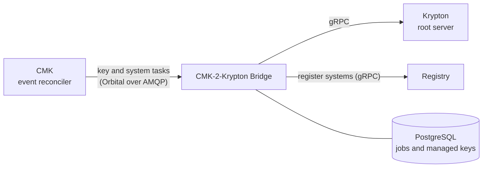

# CMK-2-Krypton Bridge

The CMK-2-Krypton Bridge is the CMK service that connects CMK to
[Krypton](/components/krypton/). CMK relies on Krypton for its cryptographic key
operations: the bridge turns CMK operations, such as creating, enabling,
disabling and deleting keys, into Krypton requests, so that a customer's
decisions in CMK are enforced in Krypton as well.

Repository: [openkcm/CMK-2-Krypton-bridge](https://github.com/openkcm/cmk-krypton-bridge)

::: warning Early stage
The bridge is under active development. See [Current state](#current-state).
:::

## How it fits



1. CMK sends key and system changes for a region as tasks. In a deployment with
   Krypton, the bridge is the receiver of these tasks for its region.
1. The bridge maps CMK's key levels onto a Krypton key hierarchy and makes sure
   every key in the chain exists in Krypton.
1. It reports the result back to CMK and registers the systems it serves in the
   Registry.

## Key hierarchy

The bridge owns the mapping between CMK's key levels and Krypton:

| CMK level | Meaning | Krypton key kind | Key ID |
| --- | --- | --- | --- |
| L1 | Customer key, managed in CMK | - | - |
| L2 | Tenant root key | `K0` (root) | `{tenantID}-l2` |
| L3 | Service key | `K1` (KEK) | `{tenantID}-{serviceID}-l3` |
| L4 | Data encryption key | `K2` (DEK) | `{tenantID}-{serviceID}-l4` |

Creating a key is **recursive and idempotent**: requesting an L4 key creates the
missing L2 and L3 keys first, and repeating the request creates no duplicates.
The key IDs are deterministic, so the same tenant and service always map to the
same keys.

## Interfaces

| Interface | Port | Purpose |
| --- | --- | --- |
| Orbital tasks from CMK | AMQP | `KEY_ENABLE`, `KEY_DISABLE`, `KEY_DELETE`, `KEY_DETACH`, `SYSTEM_LINK`, `SYSTEM_UNLINK` |
| gRPC API | 9092 | `EnsureKeyHierarchy`, `GetJobStatus`, `GetKey`, `ListKeys`, `Health` |
| HTTP health | 8080 | `/healthz`, `/readyz` |
| CLI `cmk2kryptonctl` | - | `health`, `ensure-hierarchy`, `list-keys` against the gRPC API |

```bash
cmk2kryptonctl --addr=CMK-2-Krypton-bridge:9092 ensure-hierarchy \
  --tenant-id=acme --service-id=payments --level=L4
```

## Configuration

The bridge reads `config.yaml`; environment variables with the prefix
`KRYPTON_PROXY_` override single settings, for example
`KRYPTON_PROXY_KRYPTONCLIENT_ADDRESS`.

```yaml
grpcServer:
  address: ":9092"

kryptonClient:                  # connection to the Krypton root server
  address: krypton-root.krypton.svc.cluster.local:9090
  mockMode: false               # true answers from memory, for development

orbital:                        # tasks from CMK
  enabled: true
  amqp:
    url: amqps://rabbitmq.services.svc.cluster.local:5671
    source: /queues/krypton-bridge.eu10.requests          # tasks the bridge receives from CMK
    target: /exchanges/cmk/eu10.krypton-bridge.replies    # where the bridge sends its answers
    auth:
      type: mtls                # mtls, basic or anonymous
      mtls:
        certFile: /etc/credentials/rabbitmq/tls.crt
        keyFile: /etc/credentials/rabbitmq/tls.key
        caFile: /etc/credentials/rabbitmq-ca/ca.crt

keyHierarchy:
  maxDepth: 4

database:
  dsn: "postgres://<user>:<password>@postgresql:5432/cmk_krypton_bridge?sslmode=verify-full"

worker:
  concurrency: 3
  pollInterval: 500ms
  maxAttempts: 10
  stuckTimeout: 5m

registry:
  enabled: true
  address: registry.services.svc.cluster.local:9092
  region: eu10
```

On the CMK side, the event reconciler sends the region's tasks to the bridge
and reads its answers:

```yaml
# CMK configuration
eventProcessor:
  targets:
    - region: eu10
      amqp:
        url: amqps://rabbitmq.services.svc.cluster.local:5671
        target: /exchanges/cmk/eu10.krypton-bridge.requests
        source: /queues/cmk.krypton-bridge.eu10.replies
```

The broker routes the messages between the two. With RabbitMQ and the exchange
`cmk`:

| Direction | CMK | Broker binding | Bridge |
| --- | --- | --- | --- |
| Tasks | publishes to `/exchanges/cmk/eu10.krypton-bridge.requests` | routing key `eu10.krypton-bridge.requests` → queue `krypton-bridge.eu10.requests` | reads `/queues/krypton-bridge.eu10.requests` |
| Answers | reads `/queues/cmk.krypton-bridge.eu10.replies` | routing key `eu10.krypton-bridge.replies` → queue `cmk.krypton-bridge.eu10.replies` | publishes to `/exchanges/cmk/eu10.krypton-bridge.replies` |

See the [CMK configuration reference](/components/cmk/security/cmk-config#eventprocessor)
for the event reconciler settings.

## Current state

| Area | State |
| --- | --- |
| Key hierarchy in Krypton (`EnsureKeyHierarchy`) | Implemented |
| Key and system tasks from CMK | Received and acknowledged; no effect in Krypton yet |
| L1 customer key protecting the L2 tenant key | Not implemented yet; a fixed placeholder is used |
| TLS for the connection to Krypton | Not implemented yet; run both in a service mesh with mutual TLS |

## Deployment

The bridge ships as a container image and a Helm chart. It runs next to CMK, one
instance per region, and needs PostgreSQL, the AMQP broker used by CMK, and
network access to the Krypton root server and the Registry.
