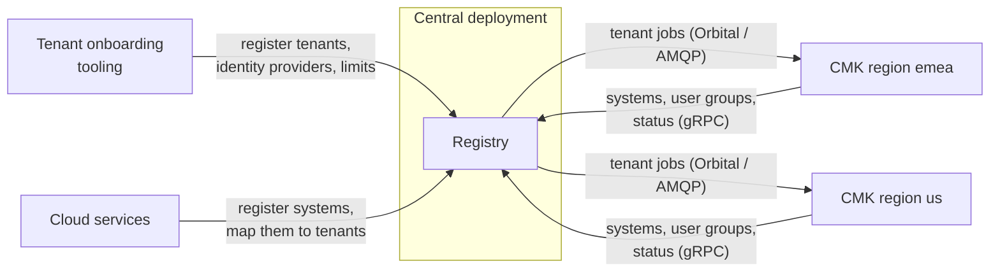

# Registry and Orbital

The Registry is the central source of truth for the **tenants** of a CMK
installation and the **systems** of the cloud services that use their keys.
It runs once, in the central deployment, and sends each tenant to the CMK of
its region. Orbital is the library that OpenKCM services use to send work to
each other and track it until it is done.

## Registry

Repository: [openkcm/registry](https://github.com/openkcm/registry)

The Registry keeps:

| Object | What the Registry holds | Registered by |
| --- | --- | --- |
| **Tenant** | ID, name, **region**, owner, role (live, test, trial), labels, user groups, status | Your tenant onboarding tooling |
| **Authentication** | The tenant's identity provider settings: issuer, client ID, JWKS URI, audiences | Your tenant onboarding tooling |
| **Tenant configuration** | Limit overrides for one tenant | Your tenant onboarding tooling |
| **System** | External ID, type, the tenant it is mapped to; per system region its status, L2 key ID, labels and whether its L1 key is claimed | Your cloud services and the CMK-2-Krypton Bridge |

It stores no key material.

### Tenants

A tenant is registered once, with the **region** of the CMK deployment that
will serve it. Every change to a tenant is a job that the Registry sends to the
CMK of that region and tracks until CMK answers:

| Call | Job for CMK | Result in CMK |
| --- | --- | --- |
| `RegisterTenant` | Provision | Tenant, database schema and the groups `KMS_TenantAdministrator_<id>` and `KMS_TenantAuditor_<id>` are created |
| `ApplyAuth`, `RemoveAuth` | Apply or remove the identity provider | The tenant's trust record in the region's Session Manager is written or removed |
| `UpdateTenantConfig` | Update the tenant configuration | The tenant's limits are overridden |
| `BlockTenant`, `UnblockTenant` | Block or unblock | The tenant's trust record is blocked or unblocked: while it is blocked, requests with a session of its users are rejected |
| `TerminateTenant` | Terminate | Systems unlinked, keys detached, trust record, tenant and schema deleted |

The tenant's status shows where a job stands: `PROVISIONING`, then `ACTIVE`;
`BLOCKING`, then `BLOCKED`; and so on, with an `_ERROR` status when CMK failed
the job. A tenant's region cannot be changed, and a terminated tenant's ID
cannot be used again. [Connect a regional tenant](/components/cmk/tenant-integration)
explains each call, the statuses and the errors.

### Systems

A system is an instance of a cloud service that uses a tenant's key, in one or
more **system regions**. The cloud service registers it and maps it to a
tenant; only mapped systems appear in the tenant's CMK. CMK reads the tenant's
systems from the Registry and reports their status and L1 key claims back.
[Connect a regional system](/components/cmk/system-integration) explains the
registration.

### Registry API

| gRPC service | Operations |
| --- | --- |
| Tenant | Register, get, list, block, unblock, terminate, labels, user groups |
| Auth | Apply, get, list and remove a tenant's identity provider settings |
| Tenant configuration | Get and update a tenant's limit overrides |
| System | Register, list, delete, update status, update L1 key claim, labels |
| Mapping | Map or unmap a system to a tenant, get a mapping |

The API definitions are in [api-sdk](https://github.com/openkcm/api-sdk). The
API is gRPC only and does not authenticate its callers: allow only your
onboarding tooling, your cloud services and the regional CMK deployments to
reach it.

Every setting of the Registry is described in the
[Registry configuration reference](/components/cmk/security/registry-config).

### Registry and the regional CMKs

The Registry has one Orbital **target** per CMK region, each with the AMQP
queues of that region's CMK tenant manager. It sends a tenant's jobs to the
target whose region equals the tenant's region. A tenant whose region has no
target fails with `PROVISIONING_ERROR`. CMK does not check the region itself:
make sure that each region's CMK reads the queues of its own target.

## Orbital

Repository: [openkcm/orbital](https://github.com/openkcm/orbital)

Orbital is a Go library, not a service. It synchronizes state across service
boundaries with eventual consistency:

1. A service creates a **job**, for example "disable this key".
1. Orbital splits the job into **tasks**, one per **target**, for example one
   per region.
1. Orbital sends each task to its target and tracks the result until all tasks
   are done or have failed.

Jobs and tasks are stored in PostgreSQL, so they survive restarts.

| Transport | Typical use |
| --- | --- |
| AMQP | Between CMK, the Registry and regional systems |
| Solace | Message broker alternative to AMQP |
| gRPC | Direct service-to-service calls |
| Embedded | Within a single process |

Orbital can sign task requests and responses. The signature travels in the
`X-Message-Signature` header, and a receiver can be configured to reject
messages without a valid signature.

CMK and the Registry use Orbital.
