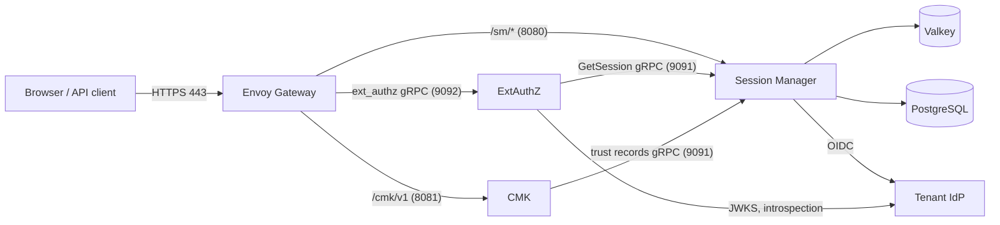

# Security configuration guide

This guide sets up authentication and authorization for the CMK services, step
by step: secrets, identity provider, [Session Manager](/components/cmk/session-manager),
[ExtAuthZ](/components/cmk/extauthz), [CMK](/components/cmk/cmk-service), the CMK UI and Envoy
Gateway, and finally a tenant. It follows a reference deployment on Kubernetes
with Envoy Gateway, Helm and a service mesh.

Every setting is described in detail in the
[ExtAuthZ configuration reference](/components/cmk/security/extauthz-config), the
[Session Manager configuration reference](/components/cmk/security/session-manager-config)
and the [CMK configuration reference](/components/cmk/security/cmk-config).
The [request walkthrough](/components/cmk/security/walkthrough) shows the resulting
HTTP exchanges.

Replace these placeholders:

| Placeholder | Meaning |
| --- | --- |
| `api.example.com` | Public host of the API gateway. Serves the CMK API and the Session Manager endpoints |
| `ui.example.com` | Public host of the CMK UI |
| `example.com` | Parent domain of both hosts |
| `https://idp.example.com/realms/acme` | Issuer of the tenant's identity provider |
| `acme` | Tenant ID |
| `cmk-session-manager` | Client ID of Session Manager at the identity provider |

## Overview



| Component | Namespace in the reference deployment | Ports |
| --- | --- | --- |
| Envoy Gateway, ExtAuthZ | `envoy-gateway-system` | ExtAuthZ: gRPC 9092, status 8080 |
| Session Manager, CMK, Registry, CMK UI | `services` | Session Manager: HTTP 8080, gRPC 9091, status 8888. CMK: HTTP 8081 |
| Valkey | `storage` | 6379 |

### Settings that must match

| What | Where | Rule |
| --- | --- | --- |
| CSRF secret | Session Manager `sessionManager.csrfSecret`, ExtAuthZ `csrfSecret` | **The same secret in both services**: identical bytes, at least 32. See [Shared CSRF secret](#shared-csrf-secret) |
| Client data signing keys | ExtAuthZ `clientData.signingKeyIDFilePath`, CMK `clientData.signingKeysPath` | ExtAuthZ has the private keys, CMK the public keys, with the same file names |
| Session cookie name | Session Manager `sessionCookieTemplate.name` | `__Host-Http-SESSION`. ExtAuthZ reads `__Host-Http-SESSION-<tenant>` |
| CSRF cookie name | Session Manager `csrfCookieTemplate.name` | `CSRF`. The CMK UI reads `CSRF-<tenant>` |
| Session paths | ExtAuthZ `sessionPathPrefixes` | `/cmk/v1/`, the CMK API base path; the next segment is the tenant |
| Session Manager address | ExtAuthZ `sessionManager.address`, CMK `services.sessionManager.address` | Session Manager's `grpc.address` |
| API host | CMK UI `apiBaseUrl` | One host for `/cmk/v1` and `/sm/*` |
| Return URLs | Session Manager `allowedRedirectBaseURLs` | The CMK UI origin, ending with `/` |
| Callback URL | Session Manager `callbackURL` | `https://api.example.com/sm/callback`, registered at every identity provider |
| Browser origin | CORS of the CMK `SecurityPolicy` | `https://ui.example.com` |
| Group names | Identity provider `groups` claim | CMK group identifiers, for example `KMS_TenantAdministrator_<tenant>` |
| Issuer for tenant lookup | CMK `clientData.authContextFields` | Must contain `issuer` |

## Shared CSRF secret

::: danger One CSRF secret for ExtAuthZ and Session Manager
ExtAuthZ and Session Manager **must be configured with the same CSRF secret**:
Session Manager's `sessionManager.csrfSecret` and ExtAuthZ's `csrfSecret` must
contain exactly the same bytes. If they differ, users can still sign in, but
every API call from the CMK UI is rejected with `401` and
`CSRF token is not valid`.
:::

### Why both services need it

The CSRF token is created by one service and checked by the other:

1. When a user signs in, **Session Manager** creates the CSRF token: a random
   value plus an HMAC-SHA256 over the new session ID and that random value,
   keyed with its `csrfSecret`. It sends the token to the browser in the
   `CSRF-<tenant>` cookie.
1. The CMK UI copies the token into the `X-CSRF-Token` header of every API call.
1. **ExtAuthZ** recomputes the HMAC from the session ID in the session cookie and
   the random value in the token, keyed with its own `csrfSecret`, and compares
   it with the token, on every request, including `GET`.

Only the same secret produces the same token.

### Requirements

| Requirement | Detail |
| --- | --- |
| Identical | Byte for byte the same in both services. A trailing newline in one of the files is already a difference |
| Length | At least 32 bytes. Session Manager does not start with a shorter secret; ExtAuthZ does not check the length |
| Random | Generated with a cryptographic random generator, for example `openssl rand` |
| Stored as a secret | In a Kubernetes Secret mounted as a file, never inline in the configuration |

### Configuration

Both services read the secret from a file. Use the same file content, and
preferably the same mount path, in both. Note the different nesting: in Session
Manager the setting is inside `sessionManager`, in ExtAuthZ it is at the top
level.

Session Manager:

```yaml
config:
  sessionManager:
    csrfSecret:                 # same secret as ExtAuthZ csrfSecret
      source: file
      file:
        path: /etc/credentials/csrf-secret/csrf_secret
        format: binary
```

ExtAuthZ:

```yaml
config:
  csrfSecret:                   # same secret as Session Manager sessionManager.csrfSecret
    source: file
    file:
      path: /etc/credentials/csrf-secret/csrf_secret
      format: binary
```

### One value, one or two Kubernetes Secrets

A pod can only mount Secrets from its own namespace:

- If ExtAuthZ and Session Manager run in the **same namespace**, create one
  Secret and mount it into both.
- If they run in **different namespaces**, as in the reference deployment
  (`envoy-gateway-system` and `services`), create a Secret in each namespace
  from the **same file**, or let a secret synchronization tool copy one Secret
  to the other namespace.

```bash
openssl rand -hex 32 | tr -d '\n' > csrf_secret
kubectl -n envoy-gateway-system create secret generic csrf-secret --from-file=csrf_secret
kubectl -n services create secret generic csrf-secret --from-file=csrf_secret
rm csrf_secret
```

### Check that both services use the same secret

Compare the hashes of the two Secrets; they must be identical:

```bash
kubectl -n envoy-gateway-system get secret csrf-secret -o jsonpath='{.data.csrf_secret}' | openssl dgst -sha256
kubectl -n services get secret csrf-secret -o jsonpath='{.data.csrf_secret}' | openssl dgst -sha256
```

If users can sign in but every API call returns `401` with
`CSRF token is not valid`, the two secrets differ.

### Rotate the secret

Both services read the secret only at startup.

1. Generate a new value.
1. Update the Secret of **both** services with the same new value.
1. Restart Session Manager and ExtAuthZ right after each other.
1. Users sign in again: CSRF tokens issued with the old secret are no longer
   accepted.

## Configuration conventions

All OpenKCM services read a YAML file that their Helm charts render from the
`config` value.

### Values from files, environment or inline

Settings that may hold secrets accept a value reference:

| Field | Meaning |
| --- | --- |
| `source` | `embedded` (default), `env` or `file` |
| `value` | The value itself, for `embedded` |
| `env` | Name of the environment variable, for `env` |
| `file.path` | Path of the file, for `file` |
| `file.format` | `binary` (the whole file, byte for byte), `json` or `yaml` |
| `file.jsonPath` | Path to the value inside a `json` or `yaml` file |

```yaml
password:
  source: file
  file:
    path: /etc/credentials/valkey/password
    format: binary
```

With `format: binary`, a trailing newline in the file is part of the value.
Create secret files without one.

### Credentials for outgoing connections

| `type` | Meaning | Fields |
| --- | --- | --- |
| `insecure` | No transport security | - |
| `mtls` | Mutual TLS | `mtls.cert`, `mtls.certKey`, `mtls.serverCa`, `mtls.rootCAs`, `mtls.attributes.serverName` |
| `api-token` | Bearer token | `apiToken` |
| `basic` | Basic authentication | `basic.username`, `basic.password` |
| `oauth2` | OAuth 2.0 client credentials | `oauth2.url`, `oauth2.credentials`, `oauth2.mtls` |

Which types a connection supports is listed in the references. Use `insecure`
only inside a service mesh that encrypts and authenticates traffic between pods.

## Step 1: Create the secrets

Generate the CSRF secret that ExtAuthZ and Session Manager **share**, without a
trailing newline (see [Shared CSRF secret](#shared-csrf-secret)):

```bash
openssl rand -hex 32 | tr -d '\n' > csrf_secret
```

Generate the client data signing key pair and the key ID file:

```bash
openssl genpkey -algorithm RSA -pkeyopt rsa_keygen_bits:3072 -out key1.pem
openssl pkey -in key1.pem -pubout -out key1.pub.pem
printf 'key1' > keyId
```

Create the Kubernetes secrets. Both CSRF Secrets are created from the **same**
`csrf_secret` file: one for ExtAuthZ, one for Session Manager. ExtAuthZ gets the
private signing key, CMK the public key under the same file name:

```bash
# Same CSRF secret for ExtAuthZ (envoy-gateway-system) and Session Manager (services)
kubectl -n envoy-gateway-system create secret generic csrf-secret --from-file=csrf_secret
kubectl -n services create secret generic csrf-secret --from-file=csrf_secret

kubectl -n envoy-gateway-system create secret generic extauthz-signing-keys-secret \
  --from-file=keyId --from-file=key1.pem
kubectl -n services create secret generic cmk-client-data-public-keys \
  --from-file=key1.pem=key1.pub.pem
```

Also create, in `services`, the secrets for Session Manager's database and
Valkey credentials and for its client credentials at the identity providers
(client secret, or client certificate and key).

::: warning
The two `csrf-secret` Secrets must always hold the same value. Nothing keeps
them in sync: when you change one, change the other and restart both services,
as described in [Rotate the secret](#rotate-the-secret). Delete the generated
files after you have created the secrets.
:::

## Step 2: Register Session Manager at the identity provider

Each tenant's identity provider needs a client for Session Manager:

| Setting | Value |
| --- | --- |
| Client type | Confidential, authorization code flow |
| PKCE | `S256` |
| Redirect URI | `https://api.example.com/sm/callback` |
| Post-logout redirect URI | `https://ui.example.com/` |
| Back-channel logout URL (optional) | `https://api.example.com/sm/bclogout`, with the session ID (`sid`) included |
| Client authentication | Client certificate if supported, otherwise client secret |
| Scopes | `openid`, `profile`, `email`, `groups` |
| ID token claims | `sub`, `email`, `given_name`, `family_name`, `groups` as a list of strings |
| Group names | The `groups` claim must contain CMK's group identifiers, for example `KMS_TenantAdministrator_acme`; see below |
| Token introspection | Enabled for this client |

Session Manager always requests the `groups` scope. Make sure the identity
provider offers a scope with that name; some providers reject unknown scopes
with `invalid_scope`.

### Groups

CMK maps users to roles by the exact entries of the `groups` claim. Create
groups in the identity provider whose names are CMK's group identifiers, and add
the users to them:

| Identity provider group | CMK role |
| --- | --- |
| `KMS_TenantAdministrator_acme` | Tenant administrator, created by CMK at onboarding |
| `KMS_TenantAuditor_acme` | Tenant auditor, created by CMK at onboarding |
| `KMS_<group name>_acme` | Key administrator, for each key administrator group created in CMK |

See [Groups and identity provider claims](/components/cmk/security/cmk-authorization#groups-and-identity-provider-claims).

### Example: Keycloak

1. In the tenant's realm, create a client `cmk-session-manager` with
   **Client authentication** on and **Standard flow** on.
1. Set **Valid redirect URIs** to `https://api.example.com/sm/callback` and
   **Valid post logout redirect URIs** to `https://ui.example.com/*`.
1. Under **Advanced**, set **Proof Key for Code Exchange Code Challenge Method**
   to `S256`.
1. Optionally set **Backchannel logout URL** to
   `https://api.example.com/sm/bclogout` with **Backchannel logout session
   required** on.
1. Create a client scope named `groups` with a **Group Membership** mapper:
   token claim name `groups`, **Full group path** off, added to the ID token,
   access token, userinfo and token introspection.
1. Assign the `groups` scope to the client.
1. Create the groups `KMS_TenantAdministrator_acme` and
   `KMS_TenantAuditor_acme`, and add the tenant's administrators and auditors.
1. Copy the client secret into the Session Manager secret.

## Step 3: Configure Session Manager

Helm values:

```yaml
config:
  logger:
    level: info
  status:
    enabled: true
  http:
    address: :8080
  grpc:
    address: :9091
    flags:
      health: true
      reflection: false

  database:
    host: { value: postgresql.services.svc.cluster.local }
    port: "5432"
    name: session_manager
    user:     { source: file, file: { path: /etc/credentials/database/username, format: binary } }
    password: { source: file, file: { path: /etc/credentials/database/password, format: binary } }

  valkey:
    host: { value: valkey-primary.storage.svc.cluster.local:6379 }
    user: { value: default }
    password: { source: file, file: { path: /etc/credentials/valkey/password, format: binary } }
    prefix: session-manager
    secretRef:
      type: mtls
      mtls:
        cert:     { source: file, file: { path: /etc/credentials/valkey/tls.crt, format: binary } }
        certKey:  { source: file, file: { path: /etc/credentials/valkey/tls.key, format: binary } }
        serverCa: { source: file, file: { path: /etc/credentials/valkey/ca.crt, format: binary } }

  sessionManager:
    callbackURL: https://api.example.com/sm/callback
    sessionDuration: 12h
    idleSessionTimeout: 15m
    allowedRedirectBaseURLs:
      - https://ui.example.com/
    csrfSecret:                 # same secret as ExtAuthZ csrfSecret (Step 4)
      source: file
      file: { path: /etc/credentials/csrf-secret/csrf_secret, format: binary }
    clientAuth:
      type: client_secret
      clientID: cmk-session-manager
      clientSecret:
        source: file
        file: { path: /etc/credentials/client-auth/client-secret, format: binary }
    sessionCookieTemplate:
      name: __Host-Http-SESSION
      path: /
      secure: true
      httpOnly: true
      sameSite: None
    csrfCookieTemplate:
      name: CSRF
      path: /
      domain: example.com
      secure: true
      sameSite: Strict
    loginCSRFCookieTemplate:
      path: /
      secure: true
      httpOnly: true
      sameSite: Lax

  apps:
    grpc:
      module: app.module.grpcserver
      services:
        - module: service.module.grpc.session
        - module: service.module.grpc.trustmapping
        - module: service.module.grpc.oidcmapping

  audit:
    endpoint: https://otel-collector.example.com/v1/logs

extraVolumes:
  - name: db-credentials
    secret: { secretName: session-manager-db }
  - name: valkey-credentials
    secret: { secretName: session-manager-valkey }
  - name: csrf-secret
    secret: { secretName: csrf-secret }
  - name: client-auth
    secret: { secretName: session-manager-client-auth }
extraVolumeMounts:
  - { name: db-credentials,     mountPath: /etc/credentials/database,    readOnly: true }
  - { name: valkey-credentials, mountPath: /etc/credentials/valkey,      readOnly: true }
  - { name: csrf-secret,        mountPath: /etc/credentials/csrf-secret, readOnly: true }   # shared with ExtAuthZ
  - { name: client-auth,        mountPath: /etc/credentials/client-auth, readOnly: true }
```

Notes:

- `sessionManager.csrfSecret` must be **the same secret as ExtAuthZ's
  `csrfSecret`** (Step 4). Mount the `csrf-secret` Secret created from the same
  file in Step 1. See [Shared CSRF secret](#shared-csrf-secret).
- Do not set `nameOverride`; Session Manager reads its configuration only from
  `/etc/session-manager`.
- `clientAuth.clientID` is required by the migration job even though each
  tenant's client ID comes from its trust record.
- The client secret or certificate is the same for all tenants.
- Session Manager does not report unknown keys. Compare your file with the
  [reference](/components/cmk/security/session-manager-config) when something has
  no effect.

## Step 4: Configure ExtAuthZ

Helm values:

```yaml
config:
  logger:
    level: info
    format: json
  status:
    enabled: true
    address: :8080
    profiling: false
  featureGates:
    enrich-header-with-client-type: true
    enrich-header-with-client-region: true

  grpcServer:
    address: :9092
    flags:
      health: true

  cedar:
    policyPath: /etc/extauthz-policies
  mtls:
    trustedSubjectsYaml: /etc/extauthz-mtls/trustedSubjects.yaml

  jwt:
    issuerClaimKeys: [iss]
    providers:
      - issuer: https://idp.example.com/realms/automation
        audiences: [cmk-api]
    httpClient:
      basicAuth:
        username: { source: file, file: { path: /etc/credentials/idp/client-id, format: binary } }
        password: { source: file, file: { path: /etc/credentials/idp/client-secret, format: binary } }
    oauth2:
      credentials:
        authMethod: post
        clientSecret: { source: file, file: { path: /etc/credentials/tenant-idp/client-secret, format: binary } }

  sessionPathPrefixes: ["/cmk/v1/"]
  sessionManager:
    enabled: true
    address: session-manager.services.svc.cluster.local:9091
    secretRef:
      type: insecure        # the service mesh provides mutual TLS

  clientData:
    signingKeyIDFilePath: /etc/extauthz-signing/keyId

  csrfSecret:                   # same secret as Session Manager sessionManager.csrfSecret (Step 3)
    source: file
    file: { path: /etc/credentials/csrf-secret/csrf_secret, format: binary }

  audit:
    endpoint: https://otel-collector.example.com/v1/logs

extraPorts:
  - { name: grpc,        containerPort: 9092, protocol: TCP }
  - { name: http-status, containerPort: 8080, protocol: TCP }
livenessProbe:
  httpGet: { path: /probe/liveness, port: http-status }
readinessProbe:
  httpGet: { path: /probe/readiness, port: http-status }

extraVolumes:
  - name: extauthz-policies
    projected:
      sources:
        - configMap: { name: extauthz-user-policies }
        - configMap: { name: extauthz-system-policies }
  - name: extauthz-trusted-subjects
    configMap: { name: extauthz-trusted-subjects }
  - name: extauthz-signing-keys
    secret: { secretName: extauthz-signing-keys-secret }
  - name: csrf-secret
    secret: { secretName: csrf-secret }
  - name: idp-credentials
    secret: { secretName: extauthz-idp-credentials }
  - name: tenant-idp-credentials
    secret: { secretName: extauthz-tenant-idp-credentials }
extraVolumeMounts:
  - { name: extauthz-policies,         mountPath: /etc/extauthz-policies,      readOnly: true }
  - { name: extauthz-trusted-subjects, mountPath: /etc/extauthz-mtls,          readOnly: true }
  - { name: extauthz-signing-keys,     mountPath: /etc/extauthz-signing,       readOnly: true }
  - { name: csrf-secret,               mountPath: /etc/credentials/csrf-secret, readOnly: true }   # shared with Session Manager
  - { name: idp-credentials,           mountPath: /etc/credentials/idp,        readOnly: true }
  - { name: tenant-idp-credentials,    mountPath: /etc/credentials/tenant-idp, readOnly: true }
```

Setting `extraVolumes` replaces the chart's default volumes, so the example
lists all of them.

- `csrfSecret` must be **the same secret as Session Manager's
  `sessionManager.csrfSecret`** (Step 3). See [Shared CSRF secret](#shared-csrf-secret).
- `jwt.providers` lists issuers that are trusted for all tenants, typically the
  platform's own identity provider for automation. Tenant identity providers
  come from the trust records and need no entry here.
- `jwt.httpClient` authenticates introspection at the static providers;
  `jwt.oauth2` authenticates introspection at tenant identity providers.

### Cedar policies

Policies are mounted from ConfigMaps. The file names must end in `.cedar`:

```yaml
apiVersion: v1
kind: ConfigMap
metadata:
  name: extauthz-user-policies
  namespace: envoy-gateway-system
data:
  users.cedar: |
    // CMK UI users, signed in through Session Manager
    permit (
        principal is Subject,
        action in [Action::"GET", Action::"POST", Action::"PUT", Action::"PATCH", Action::"DELETE"],
        resource
    ) when {
        context.type == "session" &&
        context.host == "api.example.com" &&
        context.path like "/cmk/v1/*"
    };

    // Users with tokens from their tenant's identity provider
    permit (
        principal is Subject,
        action in [Action::"GET", Action::"POST", Action::"PUT", Action::"PATCH", Action::"DELETE"],
        resource
    ) when {
        context.type == "jwt" &&
        context.host == "api.example.com" &&
        context.path like "/cmk/v1/*"
    };
---
apiVersion: v1
kind: ConfigMap
metadata:
  name: extauthz-system-policies
  namespace: envoy-gateway-system
data:
  systems.cedar: |
    // Automation with tokens from the platform identity provider
    permit (
        principal == Subject::"svc-automation",
        action in [Action::"GET", Action::"POST"],
        resource
    ) when {
        context.type == "jwt" &&
        context.issuer == "https://idp.example.com/realms/automation" &&
        context.path like "/cmk/v1/*"
    };

    // Billing service with a client certificate
    permit (
        principal == Subject::"CN=billing-service,O=Example Corp,C=DE",
        action in [Action::"GET"],
        resource
    ) when {
        context.type == "x509" &&
        context.path like "/cmk/v1/*"
    };
```

The tenant JWT policy needs no issuer condition: a token from a tenant identity
provider is only accepted for that tenant's paths, because ExtAuthZ looks up the
provider by the tenant ID in the path.

### Trusted subjects

```yaml
apiVersion: v1
kind: ConfigMap
metadata:
  name: extauthz-trusted-subjects
  namespace: envoy-gateway-system
data:
  trustedSubjects.yaml: |
    eu10:
      - "CN=billing-service,O=Example Corp,C=DE"
```

Write subjects as Envoy formats them: most specific attribute first, commas
without spaces. If you have no certificate clients, use `trustedSubjects.yaml: "{}"`.

ExtAuthZ reads policies and trusted subjects only at startup. Restart it after
every change:

```bash
kubectl -n envoy-gateway-system rollout restart deployment/extauthz
```

## Step 5: Configure CMK

CMK runs several processes from one image: API server, tenant manager, event
reconciler, task scheduler and task worker. Their security-relevant settings:

```yaml
apiServer:
  deploy: true
  image: { command: /cmkd, args: [api-server] }
tenantManager:
  deploy: true
  image: { command: /cmkd, args: [tenant-manager] }
eventReconciler:
  image: { command: /cmkd, args: [event-reconciler] }

config:
  logger:
    level: info                 # debug logs the complete configuration
  http:
    swaggerEnabled: false

  clientData:
    signingKeysPath: /etc/signing-keys
    authContextFields:
      - issuer                  # required: CMK lists a user's tenants by issuer
      - client_id

  services:
    sessionManager:             # tenant manager writes tenant trust records here
      enabled: true
      address: session-manager.services.svc.cluster.local:9091
      secretRef: { type: insecure }   # the service mesh provides mutual TLS
    registry:
      enabled: true
      address: registry.services.svc.cluster.local:9092
      secretRef: { type: insecure }

  database:
    host: { value: postgresql.services.svc.cluster.local }
    port: "5432"
    name: cmk
    user:   { source: file, file: { path: /etc/credentials/database/username, format: binary } }
    secret: { source: file, file: { path: /etc/credentials/database/password, format: binary } }
    parameters:
      ssl:
        mode: verify-full
        rootCert: /etc/credentials/database/ca.crt

  tenantManager:                # tenant jobs from the Registry, including ApplyAuth
    secretRef:
      type: mtls
      mtls:
        cert:     { source: file, file: { path: /etc/credentials/rabbitmq/tls.crt, format: binary } }
        certKey:  { source: file, file: { path: /etc/credentials/rabbitmq/tls.key, format: binary } }
        serverCa: { source: file, file: { path: /etc/credentials/rabbitmq-ca/ca.crt, format: binary } }
    amqp:
      url: amqps://rabbitmq.services.svc.cluster.local:5671   # amqps:// is required for TLS
      source: /queues/cmk.tenants.requests
      target: /exchanges/cmk/mesh.tenants

  plugins:
    - name: scim
      type: IdentityManagementService
      yamlConfiguration: |
        # SCIM directory of the tenants

  audit:
    endpoint: https://otel-collector.example.com/v1/logs

extraVolumes:
  - name: client-data-public-keys
    secret: { secretName: cmk-client-data-public-keys }
extraVolumeMounts:
  - { name: client-data-public-keys, mountPath: /etc/signing-keys, readOnly: true }
```

- `signingKeysPath` holds ExtAuthZ's **public** keys, named like ExtAuthZ's
  private keys (`key1.pem`). CMK uses the file name without `.pem` as the key ID.
- `authContextFields` must contain `issuer`. The entries are also passed to the
  [identity management plugin](/components/cmk/plugins#identity-management-plugins).
- The tenant manager is the component that turns a tenant's `ApplyAuth` into a
  Session Manager trust record. It needs both `services` entries enabled.
- Use `amqps://` for the broker. With `amqp://`, CMK connects without TLS even
  when `secretRef.type` is `mtls`.
- `extraVolumes` are mounted into all CMK pods, including the migration Jobs.

All other sections, such as the task queue and the event reconciler targets,
are described in the [CMK configuration reference](/components/cmk/security/cmk-config).
Examples for the keystore and identity management plugins are in
[CMK plugin configuration](/components/cmk/security/cmk-plugins).

## Step 6: Configure the CMK UI

Mount a `config.json` with the API host into the web server's document root at
`config/config.json`:

```json
{
  "apiBaseUrl": "https://api.example.com"
}
```

The UI uses this host for the CMK API and for the Session Manager endpoints.

## Step 7: Configure Envoy Gateway

### Gateway

```yaml
apiVersion: gateway.networking.k8s.io/v1
kind: Gateway
metadata:
  name: ingress-gateway
  namespace: envoy-gateway-system
spec:
  gatewayClassName: envoy-gateway
  listeners:
    - name: https
      protocol: HTTPS
      port: 443
      hostname: api.example.com
      tls:
        mode: Terminate
        certificateRefs:
          - name: ingress-gateway-tls
```

Routes in other namespaces, such as `services`, need a `ReferenceGrant` that
allows the gateway's routes to reference their Services.

### Session Manager routes

The login endpoints must work without a session. Do **not** attach the external
authorization policy to this route:

```yaml
apiVersion: gateway.networking.k8s.io/v1
kind: HTTPRoute
metadata:
  name: session-manager-http-route
  namespace: envoy-gateway-system
spec:
  parentRefs:
    - name: ingress-gateway
  hostnames: [api.example.com]
  rules:
    - matches:
        - path: { type: PathPrefix, value: /sm/auth }
        - path: { type: PathPrefix, value: /sm/callback }
        - path: { type: PathPrefix, value: /sm/logout }
        - path: { type: PathPrefix, value: /sm/bclogout }
      backendRefs:
        - name: session-manager
          namespace: services
          port: 8080
```

### CMK route and security policy

```yaml
apiVersion: gateway.networking.k8s.io/v1
kind: HTTPRoute
metadata:
  name: cmk-http-route
  namespace: envoy-gateway-system
spec:
  parentRefs:
    - name: ingress-gateway
  hostnames: [api.example.com]
  rules:
    - matches:
        - path: { type: PathPrefix, value: /cmk/v1 }
      backendRefs:
        - name: cmk
          namespace: services
          port: 8081
---
apiVersion: gateway.envoyproxy.io/v1alpha1
kind: SecurityPolicy
metadata:
  name: cmk-security-policy
  namespace: envoy-gateway-system
spec:
  targetRefs:
    - group: gateway.networking.k8s.io
      kind: HTTPRoute
      name: cmk-http-route
  extAuth:
    grpc:
      backendRefs:
        - name: extauthz
          port: 9092
  cors:
    allowOrigins: [https://ui.example.com]
    allowMethods: [GET, POST, PUT, PATCH, DELETE]
    allowHeaders: [content-type, x-csrf-token]
    allowCredentials: true
```

Attach an equivalent `SecurityPolicy` with `extAuth` to the Registry's
`GRPCRoute`. Every route to a CMK service, except the Session Manager routes,
needs one.

### Client certificates and path handling

A `ClientTrafficPolicy` on the gateway validates client certificates, replaces
any `x-forwarded-client-cert` header sent by clients, and rejects ambiguous
paths:

```yaml
apiVersion: gateway.envoyproxy.io/v1alpha1
kind: ClientTrafficPolicy
metadata:
  name: ingress-client-traffic
  namespace: envoy-gateway-system
spec:
  targetRefs:
    - group: gateway.networking.k8s.io
      kind: Gateway
      name: ingress-gateway
  tls:
    clientValidation:
      optional: true          # browsers without certificates use the same listener
      caCertificateRefs:
        - kind: ConfigMap
          name: client-ca
  headers:
    xForwardedClientCert:
      mode: SanitizeSet
      certDetailsToAdd: [Subject, Cert]
  path:
    escapedSlashesAction: RejectRequest
    disableMergeSlashes: false
```

ExtAuthZ needs both `Subject` and `Cert` in the header. Without this policy,
certificate-based clients cannot authenticate.

## Step 8: Onboard a tenant

A tenant's identity provider is registered with the Registry's `ApplyAuth`
call. The Registry passes it to the CMK of the tenant's region, and CMK writes
the trust record in Session Manager.

```json
{
  "external_id": "acme-oidc",
  "tenant_id": "acme",
  "type": "oidc",
  "properties": {
    "issuer": "https://idp.example.com/realms/acme",
    "client_id": "cmk-session-manager",
    "jwks_uri": "https://idp.example.com/realms/acme/protocol/openid-connect/certs",
    "audiences": "cmk-api,account"
  }
}
```

The tenant must already be registered and active in the Registry. Send the
request to `kms.api.cmk.registry.auth.v1.Service/ApplyAuth`, for example with
`grpcurl` from a pod inside the service mesh, and check the result with
`GetAuth`:

```bash
grpcurl -plaintext -d @ registry.services.svc.cluster.local:9092 \
  kms.api.cmk.registry.auth.v1.Service/ApplyAuth < acme-auth.json
grpcurl -plaintext -d '{"external_id":"acme-oidc"}' registry.services.svc.cluster.local:9092 \
  kms.api.cmk.registry.auth.v1.Service/GetAuth
```

If the Registry has gRPC reflection disabled, pass the proto files from
[api-sdk](https://github.com/openkcm/api-sdk) with `-import-path` and `-proto`.
The status moves from `AUTH_STATUS_APPLYING` to `AUTH_STATUS_APPLIED`; on
failure it shows `AUTH_STATUS_APPLYING_ERROR` and an `error_message`.

| Property | Required | Effect |
| --- | --- | --- |
| `issuer` | yes | Must equal the identity provider's issuer exactly, including any trailing `/` |
| `client_id` | yes, for logins | Client of Session Manager at this identity provider |
| `jwks_uri` | no | Signing keys for bearer tokens from this provider, used by ExtAuthZ |
| `audiences` | no | Comma-separated. Accepted `aud` values for bearer tokens, checked by ExtAuthZ |

CMK reads only `properties`; `type` is checked only if your Registry has a
validation rule for it. Applying the call again updates the record.

## Step 9: Check the setup

1. Open
   `https://api.example.com/sm/auth?tenant_id=acme&request_uri=https%3A%2F%2Fui.example.com%2F`.
   After signing in, you return to the CMK UI with the cookies
   `__Host-Http-SESSION-acme` and `CSRF-acme` set.
1. Use the CMK UI. In the browser's developer tools, API calls to
   `/cmk/v1/acme/...` carry the `X-CSRF-Token` header and return `200`. A
   `403` with `ZERO_ROLES_NOT_ALLOWED` means the user's `groups` claim contains
   no CMK group identifier such as `KMS_TenantAdministrator_acme`.
1. Send an API call without the header:

   ```bash
   curl -i -b "__Host-Http-SESSION-acme=<session ID>" https://api.example.com/cmk/v1/acme/keys
   ```

   The answer is `401` with `"message":"CSRF token is not valid"` or a similar
   reason.
1. Call the API with a token from an issuer that is neither configured nor the
   tenant's: the answer is `403`.
1. Check that your audit endpoint receives `UserLoginSuccess` events.

Then go through the [hardening checklist](/components/cmk/security/hardening).

## Local development

The [session-manager repository](https://github.com/openkcm/session-manager)
contains a Docker Compose setup with PostgreSQL, Valkey and the Dex identity
provider, and the [extauthz repository](https://github.com/openkcm/extauthz)
contains example configuration, policies and trusted subjects. Both use relaxed
settings, such as plain HTTP and debug logging, that must not be used in
production.
