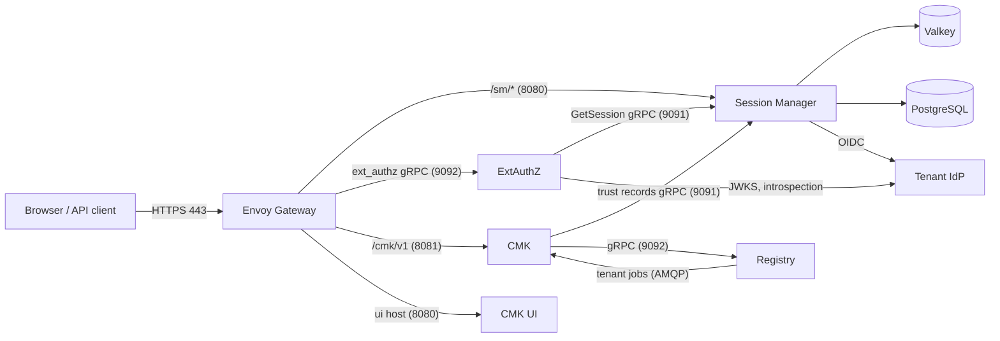

# Install a regional deployment

This guide installs one regional deployment of CMK with Helm, step by step:
the secrets, the identity provider, [Session Manager](/components/cmk/session-manager),
[ExtAuthZ](/components/cmk/extauthz), [CMK](/components/cmk/cmk-service), the
[CMK UI](/components/cmk/cmk-ui) and the Envoy Gateway routes, and finally a
tenant. Each step ends with a check that it worked.

Install the central [Registry](/components/cmk/install-registry) first, and
repeat this guide for every CMK region, each with its own hosts, secrets and
databases. [Deployment planning](/components/cmk/deployment) explains what you
deploy and why; the [request walkthrough](/components/cmk/security/walkthrough)
shows the resulting HTTP exchanges.

## Before you start

You need:

- Kubernetes 1.23 or later, `kubectl`, Helm 3.8 or later, `openssl` and
  [`grpcurl`](https://github.com/fullstorydev/grpcurl).
- A service mesh with mutual TLS, for example Linkerd or Istio, for the
  namespaces `envoy-gateway-system` and `services`. The services connect to each
  other's gRPC APIs inside the mesh, which encrypts and authenticates the
  traffic.
- [Envoy Gateway](https://gateway.envoyproxy.io), the region's only public
  entry point. This guide was written for Envoy Gateway 1.9:

  ```bash
  helm install eg oci://docker.io/envoyproxy/gateway-helm --version 1.9.2 \
    --namespace envoy-gateway-system --create-namespace
  ```

- PostgreSQL with one database each for CMK and Session Manager, Valkey (or
  Redis) with TLS, and the AMQP 1.0 broker that the Registry uses. On the broker,
  create the queues of this region before you install:
  `cmk.emea.tenants` and `cmk.emea.tenants.replies` for the tenant jobs of the
  Registry, and one pair per system region, for example `cmk.eu10.requests`
  and `cmk.eu10.replies`. The services authenticate at the broker with client
  certificates (SASL `EXTERNAL`).
- An OpenID Connect identity provider for each tenant, and an AWS account for
  the keystores of your tenants' HYOK keys.
- TLS certificates for the two public hosts of the region, and an OTLP
  collector for audit events.

The charts are OCI artifacts in the GitHub Container Registry; see
[Releases](/releases/#artifacts). This guide uses these chart versions or later:

| Chart | Version | Namespace |
| --- | --- | --- |
| `oci://ghcr.io/openkcm/charts/session-manager` | 0.11.0 | `services` |
| `oci://ghcr.io/openkcm/charts/extauthz` | 0.15.0 | `envoy-gateway-system` |
| `oci://ghcr.io/openkcm/charts/cmk` | 0.2.0 | `services` |
| `oci://ghcr.io/openkcm/charts/cmk-ui` | 0.3.0 | `services` |
| `oci://ghcr.io/openkcm/charts/checker` | 0.2.0 | `services` |

Each chart's `values.yaml` documents every setting, with examples, and its
`README.md` lists what it creates. The examples below set only what you must
decide; everything else keeps the chart defaults.

Replace these placeholders:

| Placeholder | Meaning |
| --- | --- |
| `api.example.com` | Public host of the region's API gateway. Serves the CMK API and the Session Manager endpoints |
| `ui.example.com` | Public host of the region's CMK UI |
| `example.com` | Parent domain of both hosts |
| `emea` | CMK region of this regional deployment |
| `eu10` | A system region that this CMK serves |
| `https://idp.example.com/realms/acme` | Issuer of the tenant's identity provider |
| `acme` | Tenant ID |
| `cmk-session-manager` | Client ID of Session Manager at the identity providers |

The examples install the Registry in the same cluster, in the namespace
`services`. With the Registry in another cluster, CMK reaches it through a
gateway or a multi-cluster mesh with mutual TLS; see
[Deployment planning](/components/cmk/deployment#connections-between-the-deployments).

## Overview



| Component | Namespace | Ports |
| --- | --- | --- |
| Envoy Gateway, ExtAuthZ | `envoy-gateway-system` | ExtAuthZ: gRPC 9092, status 8080 |
| Session Manager | `services` | HTTP 8080, gRPC 9091, status 8888 |
| CMK | `services` | HTTP 8081, status 8888 |
| CMK UI | `services` | HTTP 8080 |
| Registry (central deployment) | `services` | gRPC 9092, status 8888 |
| Valkey | `storage` | 6379 |

### Settings that must match

| What | Where | Rule |
| --- | --- | --- |
| CSRF secret | Session Manager `sessionManager.csrfSecret`, ExtAuthZ `csrfSecret` | **The same secret in both services**: identical bytes, at least 32. See [Shared CSRF secret](#shared-csrf-secret) |
| Client data signing keys | ExtAuthZ `clientData.signingKeyIDFilePath`, CMK `clientData.signingKeysPath` | ExtAuthZ's `keyId` file names the active key, for example `key1`. ExtAuthZ has the private key `key1.pem`, CMK the matching public key under the **same** name `key1.pem`. See [Signing keys](/components/cmk/security/client-data#signing-keys) |
| Tenant jobs | CMK `tenantManager.amqp.source` and `target`, Registry `orbital.targets[].connection.amqp.target` and `source` | CMK's `source` is the Registry's `target`, and the other way round. One pair per CMK region |
| CMK region | Registry `orbital.targets[].region`, the tenant's `region`, CMK `landscape.region` | The same name, for example `emea` |
| Session cookie name | Session Manager `sessionCookieTemplate.name` | `__Host-Http-SESSION`. ExtAuthZ reads `__Host-Http-SESSION-<tenant>` |
| CSRF cookie name | Session Manager `csrfCookieTemplate.name` | `CSRF`. The CMK UI reads `CSRF-<tenant>` |
| Session paths | ExtAuthZ `sessionPathPrefixes` | `/cmk/v1/`, the CMK API base path; the next segment is the tenant |
| Session Manager address | ExtAuthZ `sessionManager.address`, CMK `services.sessionManager.address` | Session Manager's gRPC Service, port 9091 |
| Registry address | CMK `services.registry.address` | The Registry's gRPC API, port 9092 |
| API host | CMK UI `config.apiBaseUrl` | One host for `/cmk/v1` and `/sm/*` |
| Return URLs | Session Manager `allowedRedirectBaseURLs` | The CMK UI origin, ending with `/` |
| Callback URL | Session Manager `callbackURL` | `https://api.example.com/sm/callback`, registered at every identity provider |
| Browser origin | CORS of the CMK `SecurityPolicy` | `https://ui.example.com` |
| Group names | Identity provider `groups` claim | CMK group identifiers, for example `KMS_TenantAdministrator_<tenant>` |
| Issuer for tenant lookup | CMK `clientData.authContextFields` | Must contain `issuer` (the chart default) |

## Shared CSRF secret

::: danger One CSRF secret for ExtAuthZ and Session Manager
ExtAuthZ and Session Manager **must be configured with the same CSRF secret**:
Session Manager's `sessionManager.csrfSecret` and ExtAuthZ's `csrfSecret` must
contain exactly the same bytes. If they differ, users can still sign in, but
every API call from the CMK UI is rejected with `401` and
`CSRF token is not valid`.
:::

### Why both services need it

The CSRF token is created by one service and checked by the other:

1. When a user signs in, **Session Manager** creates the CSRF token: a random
   value plus an HMAC-SHA256 over the new session ID and that random value,
   keyed with its `csrfSecret`. It sends the token to the browser in the
   `CSRF-<tenant>` cookie.
1. The CMK UI copies the token into the `X-CSRF-Token` header of every API call.
1. **ExtAuthZ** recomputes the HMAC from the session ID in the session cookie and
   the random value in the token, keyed with its own `csrfSecret`, and compares
   it with the token, on every request, including `GET`.

Only the same secret produces the same token.

### Requirements

| Requirement | Detail |
| --- | --- |
| Identical | Byte for byte the same in both services. A trailing newline in one of the files is already a difference |
| Length | At least 32 bytes. Session Manager does not start with a shorter secret |
| Random | Generated with a cryptographic random generator, for example `openssl rand` |
| Stored as a secret | In a Kubernetes Secret mounted as a file, never inline in the configuration |

### One value, two Kubernetes Secrets

A pod can mount Secrets only from its own namespace. ExtAuthZ runs in
`envoy-gateway-system` and Session Manager in `services`, so create a Secret in
each namespace from the **same file**, or let a secret synchronization tool copy
one Secret to the other namespace. Step 1 creates both.

### Check that both services use the same secret

Compare the hashes of the two Secrets; they must be identical:

```bash
kubectl -n envoy-gateway-system get secret csrf-secret -o jsonpath='{.data.csrf_secret}' | openssl dgst -sha256
kubectl -n services get secret csrf-secret -o jsonpath='{.data.csrf_secret}' | openssl dgst -sha256
```

If users can sign in but every API call returns `401` with
`CSRF token is not valid`, the two secrets differ.

### Rotate the secret

Both services read the secret only at startup.

1. Generate a new value.
1. Update the Secret of **both** services with the same new value.
1. Restart Session Manager and ExtAuthZ right after each other.
1. Users sign in again: CSRF tokens issued with the old secret are no longer
   accepted.

## Configuration conventions

All OpenKCM services read a YAML file, `config.yaml`, that their Helm charts
render from the `config` value and mount into the pods.

### Values from files, environment or inline

Settings that may hold secrets accept a *value reference*:

```yaml
password:
  source: file                 # embedded (the default), env or file
  file:
    path: /etc/credentials/valkey/password
    format: binary             # binary: the whole file; json: see jsonPath
```

| Form | Meaning |
| --- | --- |
| `{ source: embedded, value: "…" }` | The value itself. It is stored in plain text in the ConfigMap: use it only for values that are not secret |
| `{ source: env, env: NAME }` | An environment variable of the container |
| `{ source: file, file: { path: …, format: binary } }` | The whole file. A trailing newline is part of the value, so create secret files without one, for example with `kubectl create secret generic … --from-literal` |
| `{ source: file, file: { path: …, format: json, jsonPath: "$.password" } }` | One string field of a JSON file, selected in dot notation from `$`, for example `$.auth.password` |

### Credentials for outgoing connections

Connections take a `secretRef` with a `type`. Which types a connection accepts
is documented at the setting in the chart's `values.yaml`:

| `type` | Meaning |
| --- | --- |
| `insecure` | No transport security of its own. Use it for the gRPC connections between the services inside the service mesh, which provides mutual TLS |
| `mtls` | TLS with a client certificate: `mtls.cert`, `mtls.certKey`, `mtls.serverCa`, optionally `mtls.rootCAs` and `mtls.attributes.serverName`. Use it for Valkey, the AMQP broker and connections that leave the mesh |
| `api-token` | Sends `Authorization: Api-Token <token>` (telemetry) |
| `basic`, `oauth2` | Basic authentication or OAuth 2.0 client credentials, where supported |

Mount Secrets with `defaultMode: 0440`: all pods run as user and group 65532
with `fsGroup: 65532`, so they can read these files.

## Step 1: Create the secrets

Generate the CSRF secret that ExtAuthZ and Session Manager **share**, without a
trailing newline (see [Shared CSRF secret](#shared-csrf-secret)), and the client
data signing key pair with its key ID file:

```bash
openssl rand -hex 32 | tr -d '\n' > csrf_secret

openssl genpkey -algorithm RSA -pkeyopt rsa_keygen_bits:3072 -out key1.pem
openssl pkey -in key1.pem -pubout -out key1.pub.pem
printf 'key1' > keyId
```

Create the Secrets of ExtAuthZ, in `envoy-gateway-system`. ExtAuthZ gets the
private signing key:

```bash
kubectl -n envoy-gateway-system create secret generic csrf-secret --from-file=csrf_secret
kubectl -n envoy-gateway-system create secret generic extauthz-signing-keys-secret \
  --from-file=keyId --from-file=key1.pem
```

Create the Secrets of Session Manager and CMK, in `services`. CMK gets the
public key, under the same file name as ExtAuthZ's private key:

```bash
kubectl -n services create secret generic csrf-secret --from-file=csrf_secret
kubectl -n services create secret generic cmk-client-data-public-keys \
  --from-file=key1.pem=key1.pub.pem

kubectl -n services create secret generic session-manager-database \
  --from-literal=password='<password>' --from-file=ca.crt=postgresql-ca.crt
kubectl -n services create secret generic session-manager-valkey \
  --from-literal=password='<password>' --from-file=ca.crt=valkey-ca.crt \
  --from-file=tls.crt=session-manager-valkey.crt --from-file=tls.key=session-manager-valkey.key
kubectl -n services create secret generic session-manager-oidc-client \
  --from-literal=client-secret='<client secret from Step 2>'

kubectl -n services create secret generic cmk-database \
  --from-literal=password='<password>' --from-file=ca.crt=postgresql-ca.crt
kubectl -n services create secret generic cmk-valkey \
  --from-literal=password='<password>' --from-file=ca.crt=valkey-ca.crt \
  --from-file=tls.crt=cmk-valkey.crt --from-file=tls.key=cmk-valkey.key
kubectl -n services create secret generic cmk-broker \
  --from-file=tls.crt=cmk-broker.crt --from-file=tls.key=cmk-broker.key \
  --from-file=ca.crt=broker-ca.crt
```

`--from-literal` writes no trailing newline, which the services require for
passwords. Delete the generated key files once the Secrets exist.

::: warning
The two `csrf-secret` Secrets must always hold the same value. Nothing keeps
them in sync: when you change one, change the other and restart both services,
as described in [Rotate the secret](#rotate-the-secret).
:::

## Step 2: Register Session Manager at the identity provider

Each tenant's identity provider needs a client for Session Manager:

| Setting | Value |
| --- | --- |
| Client type | Confidential, authorization code flow |
| PKCE | `S256` |
| Redirect URI | `https://api.example.com/sm/callback` |
| Post-logout redirect URI | `https://ui.example.com/` |
| Back-channel logout URL (optional) | `https://api.example.com/sm/bclogout`, with the session ID (`sid`) included |
| Client authentication | Client certificate if supported, otherwise client secret |
| Scopes | `openid`, `profile`, `email`, `groups` |
| ID token claims | `sub`, `email`, `given_name`, `family_name`, `groups` as a list of strings |
| Group names | The `groups` claim must contain CMK's group identifiers, for example `KMS_TenantAdministrator_acme`; see below |
| Token introspection | Enabled for this client |

Session Manager always requests the `groups` scope. Make sure the identity
provider offers a scope with that name; some providers reject unknown scopes
with `invalid_scope`.

### Groups

CMK maps users to roles by the exact entries of the `groups` claim. Create
groups in the identity provider whose names are CMK's group identifiers, and add
the users to them:

| Identity provider group | CMK role |
| --- | --- |
| `KMS_TenantAdministrator_acme` | Tenant administrator, created by CMK at onboarding |
| `KMS_TenantAuditor_acme` | Tenant auditor, created by CMK at onboarding |
| `KMS_<group name>_acme` | Key administrator, for each key administrator group created in CMK |

See [Groups and identity provider claims](/components/cmk/security/cmk-authorization#groups-and-identity-provider-claims).

### Example: Keycloak

1. In the tenant's realm, create a client `cmk-session-manager` with
   **Client authentication** on and **Standard flow** on.
1. Set **Valid redirect URIs** to `https://api.example.com/sm/callback` and
   **Valid post logout redirect URIs** to `https://ui.example.com/*`.
1. Under **Advanced**, set **Proof Key for Code Exchange Code Challenge Method**
   to `S256`.
1. Optionally set **Backchannel logout URL** to
   `https://api.example.com/sm/bclogout` with **Backchannel logout session
   required** on.
1. Create a client scope named `groups` with a **Group Membership** mapper:
   token claim name `groups`, **Full group path** off, added to the ID token,
   access token, userinfo and token introspection.
1. Assign the `groups` scope to the client.
1. Create the groups `KMS_TenantAdministrator_acme` and
   `KMS_TenantAuditor_acme`, and add the tenant's administrators and auditors.
1. Put the client secret into the `session-manager-oidc-client` Secret of
   Step 1.

## Step 3: Install Session Manager

Create `session-manager-values.yaml`:

```yaml
replicaCount: 2

pod:
  disruptionBudget:
    enabled: true

networkPolicy:
  enabled: true
  http:
    from:
      - namespaceSelector: { matchLabels: { kubernetes.io/metadata.name: envoy-gateway-system } }
  grpc:
    from:
      - namespaceSelector: { matchLabels: { kubernetes.io/metadata.name: envoy-gateway-system } }
        podSelector: { matchLabels: { app.kubernetes.io/name: extauthz } }
      - podSelector: { matchLabels: { app.kubernetes.io/part-of: cmk } }   # every CMK process

extraEnvs:
  - { name: PGSSLMODE, value: verify-full }
  - { name: PGSSLROOTCERT, value: /etc/credentials/database/ca.crt }

extraVolumes:
  - name: credentials
    projected:
      defaultMode: 0440
      sources:
        - secret: { name: session-manager-database, items: [{ key: password, path: database/password }, { key: ca.crt, path: database/ca.crt }] }
        - secret: { name: session-manager-valkey, items: [{ key: password, path: valkey/password }, { key: tls.crt, path: valkey/tls.crt }, { key: tls.key, path: valkey/tls.key }, { key: ca.crt, path: valkey/ca.crt }] }
        - secret: { name: session-manager-oidc-client, items: [{ key: client-secret, path: client-auth/client-secret }] }
        - secret: { name: csrf-secret, items: [{ key: csrf_secret, path: csrf-secret/csrf_secret }] }
extraVolumeMounts:
  - { name: credentials, mountPath: /etc/credentials, readOnly: true }

config:
  database:
    host: { value: postgresql.services.svc.cluster.local }
    user: { value: session_manager }
    password: { source: file, file: { path: /etc/credentials/database/password, format: binary } }
  valkey:
    host: { value: valkey-primary.storage.svc.cluster.local:6379 }
    password: { source: file, file: { path: /etc/credentials/valkey/password, format: binary } }
    secretRef:
      type: mtls
      mtls:
        cert:     { source: file, file: { path: /etc/credentials/valkey/tls.crt, format: binary } }
        certKey:  { source: file, file: { path: /etc/credentials/valkey/tls.key, format: binary } }
        serverCa: { source: file, file: { path: /etc/credentials/valkey/ca.crt, format: binary } }
  sessionManager:
    callbackURL: https://api.example.com/sm/callback
    allowedRedirectBaseURLs:
      - https://ui.example.com/
    csrfSecret:                 # same secret as ExtAuthZ csrfSecret (Step 4)
      source: file
      file: { path: /etc/credentials/csrf-secret/csrf_secret, format: binary }
    clientAuth:
      type: client_secret
      clientID: cmk-session-manager
      clientSecret: { source: file, file: { path: /etc/credentials/client-auth/client-secret, format: binary } }
    sessionCookieTemplate:
      sameSite: Lax             # the UI and API hosts share example.com
    csrfCookieTemplate:
      domain: example.com
  audit:
    endpoint: http://otel-collector.observability.svc:4318/v1/logs
```

Install it:

```bash
helm upgrade --install session-manager oci://ghcr.io/openkcm/charts/session-manager \
  --version 0.11.0 --namespace services -f session-manager-values.yaml
```

The chart runs the database migration as a Helm hook before the pods start.

- `sessionManager.csrfSecret` must be **the same secret as ExtAuthZ's
  `csrfSecret`** (Step 4).
- `clientAuth.clientID` is required at the first installation: the migration
  copies it into existing trust records. Each tenant's client ID comes from its
  trust record later.
- The client secret or certificate is the same for all tenants.
- Session Manager ignores unknown keys without a warning. If a setting has no
  effect, compare its spelling with the chart's [values.yaml][sm-values] and the
  [Session Manager configuration reference](/components/cmk/security/session-manager-config).

**Check:** the release notes list no warnings, and the pods are ready:

```bash
kubectl -n services rollout status deployment/session-manager
kubectl -n services rollout status deployment/session-manager-housekeeper
```

If the migration fails, its log is in the Job `session-manager-migrate`, which is
kept for five minutes.

## Step 4: Install ExtAuthZ

ExtAuthZ reads its Cedar policies, the trusted client certificate subjects and
the signing key from objects that you create in `envoy-gateway-system`; the
chart mounts them.

### Cedar policies

The policies decide which callers may call which paths. Create them in two
ConfigMaps; the file names must end in `.cedar`:

```yaml
apiVersion: v1
kind: ConfigMap
metadata:
  name: extauthz-users-policies
  namespace: envoy-gateway-system
data:
  users.cedar: |
    // CMK UI users, signed in through Session Manager
    permit (
        principal is Subject,
        action in [Action::"GET", Action::"POST", Action::"PUT", Action::"PATCH", Action::"DELETE"],
        resource
    ) when {
        context.type == "session" &&
        context.host == "api.example.com" &&
        context.path like "/cmk/v1/*"
    };

    // Users with tokens from their tenant's identity provider
    permit (
        principal is Subject,
        action in [Action::"GET", Action::"POST", Action::"PUT", Action::"PATCH", Action::"DELETE"],
        resource
    ) when {
        context.type == "jwt" &&
        context.host == "api.example.com" &&
        context.path like "/cmk/v1/*"
    };
---
apiVersion: v1
kind: ConfigMap
metadata:
  name: extauthz-systems-policies
  namespace: envoy-gateway-system
data:
  systems.cedar: |
    // Billing service with a client certificate
    permit (
        principal == Subject::"CN=billing-service,O=Example Corp,C=DE",
        action in [Action::"GET"],
        resource
    ) when {
        context.type == "x509" &&
        context.path like "/cmk/v1/*"
    };
```

The tenant JWT policy needs no issuer condition: a token from a tenant identity
provider is only accepted for that tenant's paths, because ExtAuthZ looks up the
provider by the tenant ID in the path. The
[ExtAuthZ configuration reference](/components/cmk/security/extauthz-config)
describes the request attributes that policies can use.

### Trusted subjects

```yaml
apiVersion: v1
kind: ConfigMap
metadata:
  name: extauthz-trusted-subjects
  namespace: envoy-gateway-system
data:
  trustedSubjects.yaml: |
    eu10:
      - "CN=billing-service,O=Example Corp,C=DE"
```

Write subjects as Envoy formats them: most specific attribute first, commas
without spaces. If you have no certificate clients, use
`trustedSubjects.yaml: "{}"`.

### Values

Create `extauthz-values.yaml`. Setting `extraVolumes` and `extraVolumeMounts`
replaces the chart's defaults, so the example repeats the three default entries
and adds the CSRF secret:

```yaml
replicaCount: 2

networkPolicy:
  enabled: true
  grpc:
    from:
      - podSelector: { matchLabels: { app.kubernetes.io/name: envoy } }

extraVolumes:
  - name: extauthz-trusted-subjects-volume
    configMap: { name: extauthz-trusted-subjects }
  - name: extauthz-policies-volume
    projected:
      sources:
        - configMap: { name: extauthz-systems-policies }
        - configMap: { name: extauthz-users-policies }
  - name: extauthz-signing-keys-volume
    projected:
      defaultMode: 0440
      sources:
        - secret: { name: extauthz-signing-keys-secret }
  - name: csrf-secret
    secret:
      secretName: csrf-secret
      items: [{ key: csrf_secret, path: csrf_secret }]
      defaultMode: 0440
extraVolumeMounts:
  - { name: extauthz-trusted-subjects-volume, mountPath: /etc/extauthz-mtls, readOnly: true }
  - { name: extauthz-policies-volume, mountPath: /etc/extauthz-policies, readOnly: true }
  - { name: extauthz-signing-keys-volume, mountPath: /etc/extauthz-signing, readOnly: true }
  - { name: csrf-secret, mountPath: /etc/credentials/csrf-secret, readOnly: true }

config:
  sessionManager:
    enabled: true
    address: session-manager.services.svc.cluster.local:9091
    secretRef: { type: insecure }    # inside a service mesh with mutual TLS
  csrfSecret:                        # same secret as Session Manager (Step 3)
    source: file
    file: { path: /etc/credentials/csrf-secret/csrf_secret, format: binary }
  audit:
    endpoint: http://otel-collector.observability.svc:4318/v1/logs
```

Install it:

```bash
helm upgrade --install extauthz oci://ghcr.io/openkcm/charts/extauthz \
  --version 0.15.0 --namespace envoy-gateway-system -f extauthz-values.yaml
```

- `csrfSecret` must be **the same secret as Session Manager's
  `sessionManager.csrfSecret`**.
- To accept bearer tokens from your platform's own identity provider, for
  example for automation, add it to `config.jwt.providers`. Tokens from a
  tenant's identity provider need no entry: ExtAuthZ uses the provider of the
  tenant's trust record. See the
  [ExtAuthZ configuration reference](/components/cmk/security/extauthz-config).
- ExtAuthZ reads policies and trusted subjects only at startup. Restart it after
  every change:

  ```bash
  kubectl -n envoy-gateway-system rollout restart deployment/extauthz
  ```

**Check:** the release notes list no warnings, and the pods are ready:

```bash
kubectl -n envoy-gateway-system rollout status deployment/extauthz
```

## Step 5: Install CMK

CMK runs several processes from one image: the API server, the tenant manager,
the event reconciler, the task scheduler and the task worker. The chart deploys
all of them and gives each a ConfigMap with the sections of `config` that it
reads.

Create `cmk-values.yaml`:

```yaml
apiServer:
  replicaCount: 2

podDisruptionBudget:
  enabled: true

networkPolicy:
  enabled: true
  http:
    from:
      - namespaceSelector: { matchLabels: { kubernetes.io/metadata.name: envoy-gateway-system } }

extraVolumes:
  - name: credentials
    projected:
      defaultMode: 0440
      sources:
        - secret: { name: cmk-database, items: [{ key: password, path: database/password }, { key: ca.crt, path: database/ca.crt }] }
        - secret: { name: cmk-valkey, items: [{ key: password, path: valkey/password }, { key: tls.crt, path: valkey/tls.crt }, { key: tls.key, path: valkey/tls.key }, { key: ca.crt, path: valkey/ca.crt }] }
        - secret: { name: cmk-broker, items: [{ key: tls.crt, path: broker/tls.crt }, { key: tls.key, path: broker/tls.key }, { key: ca.crt, path: broker/ca.crt }] }
  - name: client-data-public-keys
    secret: { secretName: cmk-client-data-public-keys, defaultMode: 0440 }   # ExtAuthZ's public keys
extraVolumeMounts:
  - { name: credentials, mountPath: /etc/credentials, readOnly: true }
  - { name: client-data-public-keys, mountPath: /etc/signing-keys, readOnly: true }

config:
  landscape:
    name: cmk-emea
    region: emea
    uiBaseUrl: https://ui.example.com/#
  database:
    host: { value: postgresql.services.svc.cluster.local }
    user: { value: cmk }
    secret: { source: file, file: { path: /etc/credentials/database/password, format: binary } }
    parameters:
      ssl:
        rootCert: /etc/credentials/database/ca.crt
  scheduler:
    taskQueue:
      host: { value: valkey-primary.storage.svc.cluster.local }   # host only; port: "6379"
      acl:
        enabled: true
        username: { value: default }
        password: { source: file, file: { path: /etc/credentials/valkey/password, format: binary } }
      secretRef:
        type: mtls
        mtls:
          cert:     { source: file, file: { path: /etc/credentials/valkey/tls.crt, format: binary } }
          certKey:  { source: file, file: { path: /etc/credentials/valkey/tls.key, format: binary } }
          serverCa: { source: file, file: { path: /etc/credentials/valkey/ca.crt, format: binary } }
  services:
    registry:
      enabled: true
      address: registry.services.svc.cluster.local:9092
      secretRef: { type: insecure }    # inside a service mesh with mutual TLS
    sessionManager:                    # the tenant manager writes tenant trust records here
      enabled: true
      address: session-manager.services.svc.cluster.local:9091
      secretRef: { type: insecure }    # inside a service mesh with mutual TLS
  tenantManager:                       # tenant jobs from the Registry for region emea
    secretRef:
      type: mtls
      mtls:
        cert:     { source: file, file: { path: /etc/credentials/broker/tls.crt, format: binary } }
        certKey:  { source: file, file: { path: /etc/credentials/broker/tls.key, format: binary } }
        serverCa: { source: file, file: { path: /etc/credentials/broker/ca.crt, format: binary } }
    amqp:
      url: amqps://rabbitmq.services.svc.cluster.local:5671
      source: /queues/cmk.emea.tenants           # Registry target of region emea
      target: /queues/cmk.emea.tenants.replies   # Registry source of region emea
  eventProcessor:                      # key and system tasks for the system regions
    secretRef:
      type: mtls
      mtls:
        cert:     { source: file, file: { path: /etc/credentials/broker/tls.crt, format: binary } }
        certKey:  { source: file, file: { path: /etc/credentials/broker/tls.key, format: binary } }
        serverCa: { source: file, file: { path: /etc/credentials/broker/ca.crt, format: binary } }
    targets:
      - region: eu10
        amqp:
          url: amqps://rabbitmq.services.svc.cluster.local:5671
          target: /queues/cmk.eu10.requests
          source: /queues/cmk.eu10.replies
  plugins:
    - name: AWS                        # keystores in AWS KMS, for HYOK keys
      type: KeystoreInstanceKeyOperation
      path: /etc/plugins/keystore/keystoreop-aws
      tags: [default_keystore, hyok]
      yamlConfiguration: |
        auth:
          method: perRequest
    - { name: noop, type: IdentityManagementService }
    - { name: noop, type: NotificationService }
    - { name: noop, type: SystemInformationService }
  audit:
    endpoint: http://otel-collector.observability.svc:4318/v1/logs
```

Install it:

```bash
helm upgrade --install cmk oci://ghcr.io/openkcm/charts/cmk \
  --version 0.2.0 --namespace services -f cmk-values.yaml --timeout 15m
```

The chart migrates the database schemas in a Job before the processes start,
and the data in a Job after they started. Raise `--timeout` when you have many
tenants: the migration runs for every tenant schema.

- **Tenant jobs.** `tenantManager.amqp` must be the queue pair of this region's
  entry in the Registry's `orbital.targets`; see
  [Install the Registry](/components/cmk/install-registry).
- **System regions.** One `eventProcessor.targets` entry per system region that
  this CMK serves; see [Connect a regional system](/components/cmk/system-integration).
- **Client data keys.** `/etc/signing-keys` holds ExtAuthZ's **public** keys,
  named like ExtAuthZ's private keys (`key1.pem`). See
  [CMK: verification](/components/cmk/security/client-data#cmk-verification).
- **Plugins.** The example offers HYOK keys in the customers' own AWS KMS
  accounts. It uses the built-in `noop` plugins for identity management,
  notifications and system information; replace them with your directory and
  services. BYOK keys need a keystore provider plugin for the keystore pool.
  See [CMK plugin configuration](/components/cmk/security/cmk-plugins) and
  [feature gates and flags](/components/cmk/security/cmk-config#featuregates-and-featureflags).
- **Secrets.** `extraVolumes` are mounted into every CMK pod, including the
  migration Jobs. Keep every password, key and token in a mounted Secret
  (`source: file`): embedded values are stored in plain text in the ConfigMaps.
- **Broker.** Use `amqps://` URLs: with `amqp://`, the connection is not
  encrypted.

The chart's [values.yaml][cmk-values] documents every section with the
processes that read it, and the
[CMK configuration reference](/components/cmk/security/cmk-config) explains how
CMK loads its configuration.

**Check:** the pods are ready, and the release notes list no warnings except the
reminder that `services.registry` and `services.sessionManager` rely on the
service mesh for mutual TLS:

```bash
kubectl -n services get pods -l app.kubernetes.io/part-of=cmk
```

If a migration fails, its Job stays, for example `cmk-schema-db-migrator`, with
the reason in its log; successful migration Jobs are deleted.

## Step 6: Install the CMK UI

Create `cmk-ui-values.yaml`. The chart writes `config` into the UI's
`config/config.json`, which the browser loads:

```yaml
replicaCount: 2

config:
  apiBaseUrl: https://api.example.com

networkPolicy:
  enabled: true
  http:
    from:
      - namespaceSelector: { matchLabels: { kubernetes.io/metadata.name: envoy-gateway-system } }
```

```bash
helm upgrade --install cmk-ui oci://ghcr.io/openkcm/charts/cmk-ui \
  --version 0.3.0 --namespace services -f cmk-ui-values.yaml
```

The UI uses `config.apiBaseUrl` for the CMK API and for the Session Manager
endpoints. The chart deploys the public CMK UI image of its `appVersion`. See
[CMK UI](/components/cmk/cmk-ui#configuration) for the other settings.

**Check:** the rollout completes, and the release notes list no warnings:

```bash
kubectl -n services rollout status deployment/cmk-ui
```

## Step 7: Configure Envoy Gateway

The Gateway publishes the API host and the UI host; the routes send requests to
the services, and the security policy sends every CMK API request to ExtAuthZ
first.

Create the TLS Secrets of the two hosts, and the CA certificates of the clients
that authenticate with a certificate:

```bash
kubectl -n envoy-gateway-system create secret tls api-example-com-tls --cert=api.crt --key=api.key
kubectl -n envoy-gateway-system create secret tls ui-example-com-tls --cert=ui.crt --key=ui.key
kubectl -n envoy-gateway-system create configmap client-ca --from-file=ca.crt=client-ca.pem
```

### Gateway

```yaml
apiVersion: gateway.networking.k8s.io/v1
kind: GatewayClass
metadata:
  name: envoy-gateway
spec:
  controllerName: gateway.envoyproxy.io/gatewayclass-controller
---
apiVersion: gateway.networking.k8s.io/v1
kind: Gateway
metadata:
  name: ingress-gateway
  namespace: envoy-gateway-system
spec:
  gatewayClassName: envoy-gateway
  listeners:
    - name: https-api
      protocol: HTTPS
      port: 443
      hostname: api.example.com
      tls:
        mode: Terminate
        certificateRefs:
          - name: api-example-com-tls
    - name: https-ui
      protocol: HTTPS
      port: 443
      hostname: ui.example.com
      tls:
        mode: Terminate
        certificateRefs:
          - name: ui-example-com-tls
---
# The routes in envoy-gateway-system send requests to Services in services.
apiVersion: gateway.networking.k8s.io/v1beta1
kind: ReferenceGrant
metadata:
  name: envoy-gateway-routes
  namespace: services
spec:
  from:
    - group: gateway.networking.k8s.io
      kind: HTTPRoute
      namespace: envoy-gateway-system
  to:
    - group: ""
      kind: Service
```

### Session Manager routes

The sign-in endpoints must work without a session. Do **not** attach the
external authorization policy to this route:

```yaml
apiVersion: gateway.networking.k8s.io/v1
kind: HTTPRoute
metadata:
  name: session-manager-http-route
  namespace: envoy-gateway-system
spec:
  parentRefs:
    - name: ingress-gateway
      sectionName: https-api
  hostnames: [api.example.com]
  rules:
    - matches:
        - path: { type: PathPrefix, value: /sm/auth }
        - path: { type: PathPrefix, value: /sm/callback }
        - path: { type: PathPrefix, value: /sm/logout }
        - path: { type: PathPrefix, value: /sm/bclogout }
      backendRefs:
        - name: session-manager
          namespace: services
          port: 8080
```

### CMK route and security policy

```yaml
apiVersion: gateway.networking.k8s.io/v1
kind: HTTPRoute
metadata:
  name: cmk-http-route
  namespace: envoy-gateway-system
spec:
  parentRefs:
    - name: ingress-gateway
      sectionName: https-api
  hostnames: [api.example.com]
  rules:
    - matches:
        - path: { type: PathPrefix, value: /cmk/v1 }
      backendRefs:
        - name: cmk
          namespace: services
          port: 8081
---
apiVersion: gateway.envoyproxy.io/v1alpha1
kind: SecurityPolicy
metadata:
  name: cmk-security-policy
  namespace: envoy-gateway-system
spec:
  targetRefs:
    - group: gateway.networking.k8s.io
      kind: HTTPRoute
      name: cmk-http-route
  extAuth:
    grpc:
      backendRefs:
        - name: extauthz
          port: 9092
  cors:
    allowOrigins: [https://ui.example.com]
    allowMethods: [GET, POST, PUT, PATCH, DELETE]
    allowHeaders: [content-type, x-csrf-token]
    allowCredentials: true
```

Every route to a CMK service, except the Session Manager routes, needs such a
policy.

### CMK UI route

The UI route adds the security headers of the web console:

```yaml
apiVersion: gateway.networking.k8s.io/v1
kind: HTTPRoute
metadata:
  name: cmk-ui-http-route
  namespace: envoy-gateway-system
spec:
  parentRefs:
    - name: ingress-gateway
      sectionName: https-ui
  hostnames: [ui.example.com]
  rules:
    - matches:
        - path: { type: PathPrefix, value: / }
      filters:
        - type: ResponseHeaderModifier
          responseHeaderModifier:
            set:
              - { name: Strict-Transport-Security, value: "max-age=31536000" }
              - { name: Content-Security-Policy, value: "frame-ancestors 'none'" }
              - { name: X-Frame-Options, value: DENY }
              - { name: X-Content-Type-Options, value: nosniff }
      backendRefs:
        - name: cmk-ui
          namespace: services
          port: 8080
```

### Client certificates and path handling

A `ClientTrafficPolicy` on the API listener validates client certificates,
replaces any `x-forwarded-client-cert` header sent by clients, and rejects
ambiguous paths:

```yaml
apiVersion: gateway.envoyproxy.io/v1alpha1
kind: ClientTrafficPolicy
metadata:
  name: ingress-client-traffic
  namespace: envoy-gateway-system
spec:
  targetRefs:
    - group: gateway.networking.k8s.io
      kind: Gateway
      name: ingress-gateway
      sectionName: https-api
  tls:
    clientValidation:
      mode: VerifyIfGiven     # browsers without certificates use the same listener
      caCertificateRefs:
        - kind: ConfigMap
          name: client-ca
  headers:
    xForwardedClientCert:
      mode: SanitizeSet
      certDetailsToAdd: [Subject, Cert]
  path:
    escapedSlashesAction: RejectRequest
    disableMergeSlashes: false
```

ExtAuthZ needs both `Subject` and `Cert` in the header. Without this policy,
certificate-based clients cannot authenticate.

**Check:** the resources are accepted, and the API answers without a session
with `401`, from ExtAuthZ:

```bash
kubectl -n envoy-gateway-system get gateway,httproute,securitypolicy,clienttrafficpolicy
curl -si https://api.example.com/cmk/v1/acme/keys | head -1
curl -s https://ui.example.com/config/config.json
```

## Step 8: Onboard a tenant

Register the tenant in the Registry with the region of this deployment, and wait
until its status is `STATUS_ACTIVE`. The Registry chart disables gRPC reflection,
so `grpcurl` needs the API definitions from
[api-sdk](https://github.com/openkcm/api-sdk), in the version that the Registry
uses:

```bash
git clone --depth 1 --branch v0.23.0 https://github.com/openkcm/api-sdk
kubectl -n services port-forward service/registry 9092:grpc &

grpcurl -plaintext -import-path api-sdk/proto -import-path api-sdk/vendor-proto \
  -proto kms/api/cmk/registry/tenant/v1/tenant.proto \
  -d '{"id":"acme","name":"ACME Corporation","region":"emea","owner_id":"customer-4711","owner_type":"customer","role":"ROLE_LIVE"}' \
  localhost:9092 kms.api.cmk.registry.tenant.v1.Service/RegisterTenant
grpcurl -plaintext -import-path api-sdk/proto -import-path api-sdk/vendor-proto \
  -proto kms/api/cmk/registry/tenant/v1/tenant.proto \
  -d '{"id":"acme"}' localhost:9092 kms.api.cmk.registry.tenant.v1.Service/GetTenant
```

Then register the tenant's identity provider with the Registry's `ApplyAuth`
call. The Registry passes it to the CMK of the tenant's region, and CMK writes
the trust record in that region's Session Manager. Save the request as
`acme-auth.json`:

```json
{
  "external_id": "acme-oidc",
  "tenant_id": "acme",
  "type": "oidc",
  "properties": {
    "issuer": "https://idp.example.com/realms/acme",
    "client_id": "cmk-session-manager",
    "jwks_uri": "https://idp.example.com/realms/acme/protocol/openid-connect/certs",
    "audiences": "cmk-api,account"
  }
}
```

```bash
grpcurl -plaintext -import-path api-sdk/proto -import-path api-sdk/vendor-proto \
  -proto kms/api/cmk/registry/auth/v1/auth.proto \
  -d @ localhost:9092 kms.api.cmk.registry.auth.v1.Service/ApplyAuth < acme-auth.json
grpcurl -plaintext -import-path api-sdk/proto -import-path api-sdk/vendor-proto \
  -proto kms/api/cmk/registry/auth/v1/auth.proto \
  -d '{"external_id":"acme-oidc"}' localhost:9092 kms.api.cmk.registry.auth.v1.Service/GetAuth
```

The status moves from `AUTH_STATUS_APPLYING` to `AUTH_STATUS_APPLIED`; on
failure it shows `AUTH_STATUS_APPLYING_ERROR` and an `error_message`.

| Property | Required | Effect |
| --- | --- | --- |
| `issuer` | yes | Must equal the identity provider's issuer exactly, including any trailing `/` |
| `client_id` | yes, for sign-in | Client of Session Manager at this identity provider |
| `jwks_uri` | no | Signing keys for bearer tokens from this provider, used by ExtAuthZ |
| `audiences` | no | Comma-separated. Accepted `aud` values for bearer tokens, checked by ExtAuthZ |

With the Registry chart's default validations, `type` must be `oidc` and
`properties` must contain `issuer`. CMK reads only `properties`. Applying the
call again updates the record. [Connect a regional tenant](/components/cmk/tenant-integration)
explains every call and status.

## Step 9: Check the setup

1. Open
   `https://api.example.com/sm/auth?tenant_id=acme&request_uri=https%3A%2F%2Fui.example.com%2F`.
   After signing in, you return to the CMK UI with the cookies
   `__Host-Http-SESSION-acme` and `CSRF-acme` set.
1. Use the CMK UI. In the browser's developer tools, API calls to
   `/cmk/v1/acme/...` carry the `X-CSRF-Token` header and return `200`. A
   `403` with `ZERO_ROLES_NOT_ALLOWED` means the user's `groups` claim contains
   no CMK group identifier such as `KMS_TenantAdministrator_acme`.
1. Send an API call without the header:

   ```bash
   curl -i -b "__Host-Http-SESSION-acme=<session ID>" https://api.example.com/cmk/v1/acme/keys
   ```

   The answer is `401` with `"message":"CSRF token is not valid"` or a similar
   reason.
1. Call the API with a token from an issuer that is neither configured nor the
   tenant's: the answer is `403`.
1. Check that your audit endpoint receives `UserLoginSuccess` events.

To monitor the region from then on, install [Checker](/components/cmk/checker):
its `/healthz` endpoint reports the readiness of CMK and ExtAuthZ, the Kubernetes
API server and, if you use it, the Linkerd service mesh.

Then go through the [hardening checklist](/components/cmk/security/hardening).

## Local development

The [session-manager repository](https://github.com/openkcm/session-manager)
contains a Docker Compose setup with PostgreSQL, Valkey and the Dex identity
provider, and the [extauthz repository](https://github.com/openkcm/extauthz)
contains example configuration, policies and trusted subjects. Both use relaxed
settings, such as plain HTTP and debug logging, that must not be used in
production.

## See also

- [Deployment planning](/components/cmk/deployment)
- [Install the Registry](/components/cmk/install-registry)
- [Operations](/components/cmk/operations)
- [Hardening checklist](/components/cmk/security/hardening)

[sm-values]: https://github.com/openkcm/session-manager/blob/main/charts/session-manager/values.yaml
[cmk-values]: https://github.com/openkcm/cmk/blob/main/charts/cmk/values.yaml
