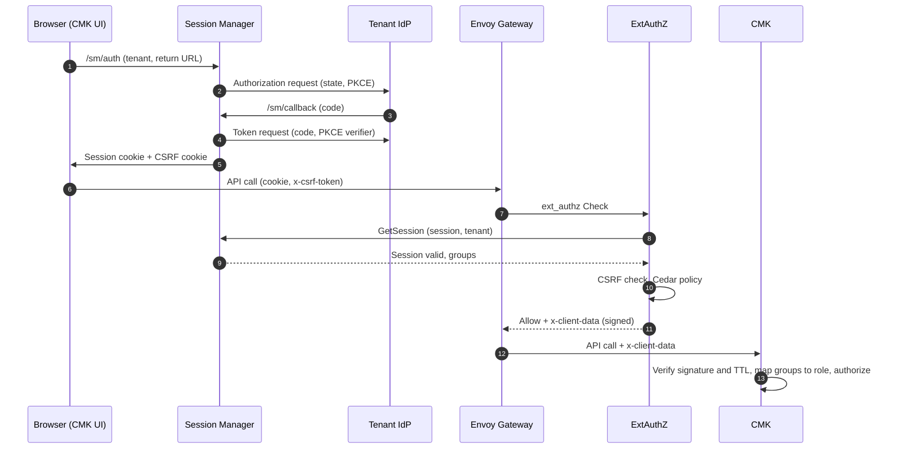

# Security architecture

OpenKCM separates authentication, authorization and key operations into
distinct components. Each request crosses several checks before it reaches a
key, and each component trusts only the evidence produced by the previous one.

## Security components at a glance

| Component | Responsibility |
| --- | --- |
| Envoy Gateway | Terminates TLS and sends every protected request to ExtAuthZ |
| [Session Manager](/components/cmk/session-manager) | OIDC login, browser sessions, per-tenant identity provider trust |
| [ExtAuthZ](/components/cmk/extauthz) | Authenticates the caller, evaluates Cedar policies, signs client data |
| [CMK](/components/cmk/security/cmk-authorization) | Verifies client data, enforces roles and tenant isolation |
| [Identity management plugins](/components/cmk/plugins#identity-management-plugins) | Resolve users and groups from the tenant's directory |

## Authentication methods

ExtAuthZ accepts three kinds of credentials. A request may carry more than one;
the most restrictive result wins.

| Method | Typical caller | Verified by |
| --- | --- | --- |
| Session cookie | Users of the CMK UI | Session Manager, through ExtAuthZ |
| Bearer JWT | Technical users and automation | ExtAuthZ, against the issuer's JWKS |
| Client certificate | Technical systems | Envoy (TLS) and ExtAuthZ (trusted subjects) |

## Request flow for a CMK UI user

1. The CMK UI sends the user to Session Manager, which starts an OpenID Connect
   authorization code flow with PKCE against the tenant's identity provider.
1. After the callback, Session Manager stores the session and sets a session
   cookie and a CSRF cookie for that tenant.
1. Every API call goes through Envoy Gateway, which asks ExtAuthZ for a
   decision.
1. ExtAuthZ validates the session with Session Manager, checks the CSRF token
   and evaluates the Cedar policies. Session Manager creates the CSRF token and
   ExtAuthZ checks it, so both use the same CSRF secret.
1. On success, ExtAuthZ returns a signed, short-lived `x-client-data` header
   describing the caller. Envoy forwards it to CMK.
1. CMK verifies the signature, resolves the caller's role from its groups and
   checks whether that role may call the requested API.

Technical clients skip steps 1 and 2 and present a bearer JWT or a client
certificate instead.

## Trust boundaries

- **Edge**: only Envoy Gateway is exposed. It must route every request for CMK
  and the Registry through ExtAuthZ.
- **Identity**: user identity comes from the tenant's own identity provider.
  Session Manager keeps one trust record per tenant (issuer, JWKS, audiences).
- **Service**: CMK trusts only client data signed by ExtAuthZ, and only for its
  short validity period.
- **Keys**: CMK never holds customer key material. Key operations run in the
  customer's keystore through keystore plugins.

## Next steps

- [Signed client data](/components/cmk/security/client-data)
- [Security configuration guide](/components/cmk/security/configuration)
- [Request walkthrough](/components/cmk/security/walkthrough)
- [Audit logging](/components/cmk/security/audit)
- [Hardening checklist](/components/cmk/security/hardening)
