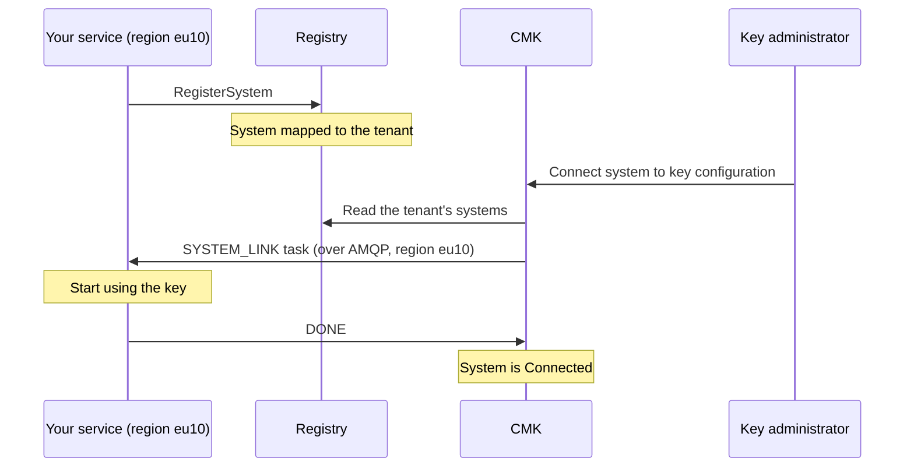

# Connect a regional system

This guide is for the teams who build a cloud service that encrypts customer
data with keys managed in CMK. It explains how your service registers its
systems, which tasks CMK sends to it when a customer connects, changes or
withdraws a key, and how your service must answer.

## How it works

A **system** is an instance of your service for one tenant in one region, for
example the database of tenant `acme` in region `eu10`. Your service registers
its systems in the [Registry](/components/cmk/registry). The customer's key
administrators then connect them to a key configuration in CMK, and CMK sends
your service a task in the system's region for every change.



Your service is responsible for carrying out each task: start or stop using a
key, switch to another key or key version. CMK tracks the result and shows it to
the customer.

## Step 1: Register your systems

Register each system with the Registry's `RegisterSystem` gRPC call, defined in
[api-sdk](https://github.com/openkcm/api-sdk) under
`proto/kms/api/cmk/registry/system/v1/system.proto`.

| Field | Content |
| --- | --- |
| `external_id` | Your identifier of the system. Keep it unique across all system types |
| `type` | `SYSTEM` or `SUBACCOUNT`. CMK supports only these types |
| `region` | The region the system runs in. It must be a region that CMK is configured for |
| `l2key_id` | The identifier of the system's key below the customer key |
| `status` | `STATUS_AVAILABLE` for a system that is ready |
| `labels` | Optional key–value labels |

The system must then be mapped to the customer's tenant (`MapSystemToTenant`),
typically when your service is provisioned for that tenant. Only mapped systems
appear in the customer's CMK.

## Step 2: Receive tasks from CMK

CMK sends tasks with [Orbital](https://github.com/openkcm/orbital) over an
AMQP 1.0 broker, separately for each region. For your region, the platform
operator gives you:

- the broker URL and your credentials (mutual TLS or user name and password),
- the **request address** on which CMK sends tasks for your region, and
- the **response address** on which CMK reads the answers.

Your service runs an Orbital *operator* that listens on the request address and
answers on the response address. Requests and responses are encoded in
protobuf. A sketch in Go, with Orbital v0.6:

```go
client, err := amqp.NewClient(ctx, &codec.Proto{}, amqp.ConnectionInfo{
    URL:    "amqps://broker.eu10.example.com:5671",
    Source: "<request address>",  // CMK sends tasks here
    Target: "<response address>", // CMK reads answers here
}, amqp.WithExternalMTLS("tls.crt", "tls.key", "ca.crt", "broker.eu10.example.com"))
if err != nil {
    log.Fatal(err)
}
defer client.Close(ctx)

operator, err := orbital.NewOperator(orbital.TargetOperator{Client: client})
if err != nil {
    log.Fatal(err)
}

for _, taskType := range []string{
    "SYSTEM_LINK", "SYSTEM_UNLINK", "SYSTEM_SWITCH", "SYSTEM_KEY_ROTATE",
    "KEY_ENABLE", "KEY_DISABLE", "KEY_DETACH",
} {
    if err := operator.RegisterHandler(taskType, handleTask); err != nil {
        log.Fatal(err)
    }
}

log.Fatal(operator.ListenAndRespond(ctx))
```

```go
func handleTask(ctx context.Context, req orbital.HandlerRequest, resp *orbital.HandlerResponse) {
    var data taskv1.Data // github.com/openkcm/api-sdk/proto/kms/api/cmk/eventprocessor/task/v1
    if err := proto.Unmarshal(req.TaskData, &data); err != nil {
        resp.Fail("INVALID_TASK_DATA:" + err.Error())
        return
    }

    if a := data.GetSystemAction(); a != nil {
        // Apply a.GetKeyIdTo() / a.GetKeyIdFrom() for system a.GetSystemId(),
        // using a.GetKeyAccessMetaData() to reach the key.
    }
    if a := data.GetKeyAction(); a != nil {
        // Stop or resume using key a.GetKeyId().
    }

    resp.Complete()
}
```

## Step 3: Handle the tasks

The task data is the protobuf message `kms.api.cmk.eventprocessor.task.v1.Data`.
It contains either a `SystemAction` or a `KeyAction`.

| Task type | When CMK sends it | What your service does |
| --- | --- | --- |
| `SYSTEM_LINK` | A key administrator connects the system to a key configuration | Start using the key `key_id_to` for this system |
| `SYSTEM_SWITCH` | The system moves to another key configuration, or its key configuration gets a new primary key | Switch from `key_id_from` to `key_id_to` |
| `SYSTEM_UNLINK` | A key administrator disconnects the system, or the tenant is offboarded | Stop using the key `key_id_from` |
| `SYSTEM_KEY_ROTATE` | The primary key has a new version in the customer's keystore | Start using the new version. `key_id_from` and `key_id_to` are the same key |
| `KEY_DISABLE` | The key was disabled, in CMK or in the customer's keystore | Stop using the key `key_id` in all systems of the tenant in your region |
| `KEY_ENABLE` | The key was enabled again | Resume using the key |
| `KEY_DETACH` | The tenant is being terminated | Release the key |

`SystemAction` carries:

| Field | Content |
| --- | --- |
| `system_id` | Your `external_id` of the system |
| `system_region`, `system_type` | Region and type of the system |
| `key_id_from`, `key_id_to` | The previous and the new key |
| `key_provider` | The keystore provider of the key, for example `aws` |
| `key_access_meta_data` | The access data for the key in this region; see below |
| `tenant_id`, `tenant_owner_id`, `tenant_owner_type` | The customer's tenant |
| `cmk_region` | The region of the CMK that sent the task |

`KeyAction` carries `key_id`, `tenant_id` and `cmk_region`.

::: tip Task type names
Register your handler for `SYSTEM_KEY_ROTATE`, which is the name CMK sends. In
the api-sdk enum, the same value is called `KEY_ROTATE`.
:::

### Key access data

`key_access_meta_data` tells your service how to reach the key in the keystore,
for the system's region. Its format is defined by the keystore plugin of the key
provider. For HYOK keys it also names the newest key version.

## Step 4: Answer

Every task needs an answer. With Orbital, the handler sets one of these:

| Handler call | Meaning | What CMK does |
| --- | --- | --- |
| `resp.Complete()` | The task is done | Marks the change as done, for example the system as **Connected** |
| `resp.Fail("CODE:message")` | The task cannot be done | Marks the system **Failed** and shows the code and message to the customer |
| `resp.ContinueAndWaitFor(d)` | Still working | Asks again after the duration `d` |

- Use error messages of the form `CODE:message`, with the code in upper case,
  for example `KEY_NOT_ACCESSIBLE:role cannot use the key`. CMK shows the code
  and the message separately.
- For `SYSTEM_KEY_ROTATE`, answer `KEY_VERSION_MISMATCH:<message>` if you do not
  see the new version yet. CMK then tries again at its next key check instead
  of marking the system failed.
- **Be idempotent.** CMK sends the same task again until it receives your
  answer, so the same task ID can arrive more than once.
- **Answer promptly.** If CMK gets no answer, it sends the task again with an
  increasing interval, starting at ten seconds. After 18 unanswered attempts,
  about one day, the task fails and the system shows **Failed**. The customer's
  key administrators can then retry.

## Region configuration

The platform operator configures one entry per region in CMK's
[`eventProcessor.targets`](/components/cmk/security/cmk-config#eventprocessor),
with the broker URL and the two addresses. Tasks for a system go to the entry
whose region matches the system's region.

| Error the customer sees | Cause |
| --- | --- |
| `UNCONFIGURED_REGION` | CMK has no `eventProcessor.targets` entry for the system's region |
| `UNSUPPORTED_REGION` | The key's access data has no entry for the system's region |
| System stays **Processing**, then **Failed** | No service answers on the region's request address |

## Checklist

- [ ] Each system is registered with a unique `external_id`, type `SYSTEM` or
  `SUBACCOUNT`, and a region that CMK serves.
- [ ] The systems are mapped to the customer's tenant.
- [ ] Your operator listens on the request address of your region and answers
  on the response address, with mutual TLS in production.
- [ ] Handlers exist for all task types, including `SYSTEM_KEY_ROTATE`.
- [ ] Handlers are idempotent and answer with `CODE:message` on failure.
- [ ] Your service stops using a key as soon as it receives `KEY_DISABLE` or
  `SYSTEM_UNLINK`.

## See also

- [Systems](/components/cmk/guide/systems): what the customer sees
- [Registry](/components/cmk/registry)
- [CMK-2-Krypton Bridge](/components/cmk/krypton-bridge): the CMK service that
  receives these tasks for Krypton
