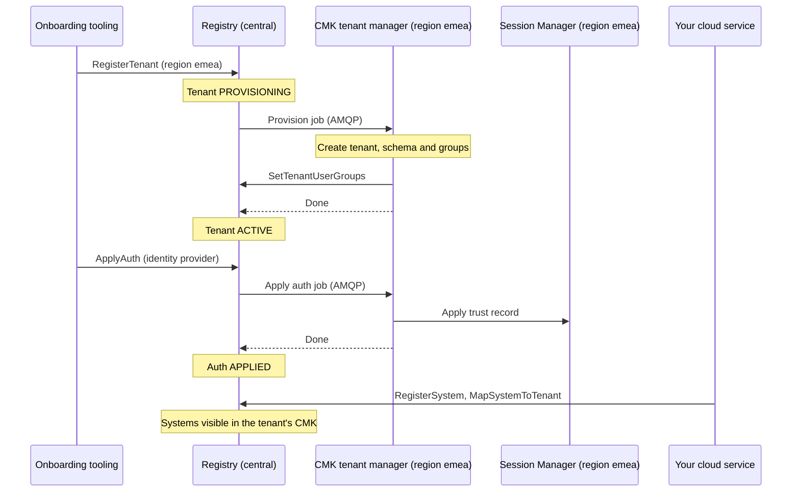
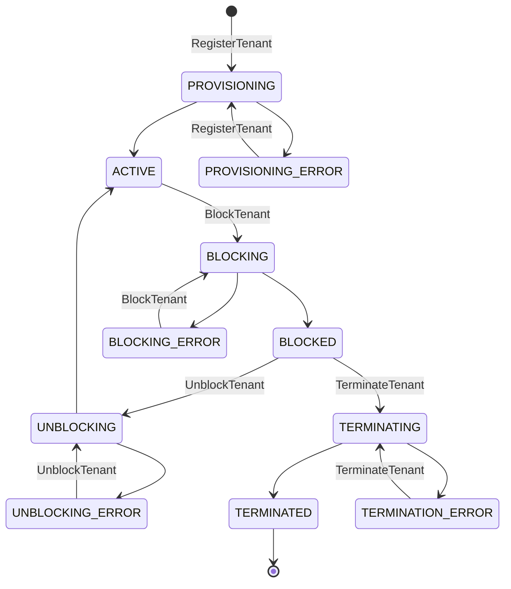

# Connect a regional tenant

This guide is for the platform team and the tooling that onboards its
customers. It explains how to register a tenant in the central Registry so that
the CMK of its region serves it, how to connect the tenant's identity provider
and systems, and how to change its limits, block it or terminate it.

## How it works

A **tenant** is a customer of your cloud service. You register it once, in the
Registry, with the **CMK region** that should serve it, for example `emea`.
From then on, the tenant lives in that region's deployment: its users sign in
with the region's Session Manager and manage their keys in the region's CMK UI
and API, and its keys and data stay in that region's databases.

Tenants are never created in CMK directly. The [Registry](/components/cmk/registry),
in the central deployment, is the source of truth for every tenant: its region,
its status, its identity provider settings and the systems mapped to it. The
Registry passes each change to the CMK of the tenant's region as a job, and
records CMK's result. See
[Deployment planning](/components/cmk/deployment#what-you-deploy) for the
central and regional deployments.



The Registry routes every job by the tenant's **region**: it sends the job to
the [`orbital.targets`](/components/cmk/security/registry-config#targets) entry
with that region, which is the request queue of that region's CMK tenant
manager. CMK itself does not check the region; the queues decide which
regional deployment receives the tenant.

| Step | Call | Who calls it |
| --- | --- | --- |
| [1. Register the tenant](#step-1-register-the-tenant) | `RegisterTenant` | Your onboarding tooling |
| [2. Connect its identity provider](#step-2-connect-the-identity-provider) | `ApplyAuth` | Your onboarding tooling |
| [3. Give the first administrator access](#step-3-give-the-first-administrator-access) | Group membership in the identity provider | The customer |
| [4. Map its systems](#step-4-map-the-tenant-s-systems) | `RegisterSystem`, `MapSystemToTenant` | Your cloud services, see [Connect a regional system](/components/cmk/system-integration) |
| [5. Change its limits](#step-5-optional-change-the-tenant-limits) | `UpdateTenantConfig` | Your onboarding tooling, optional |
| [Block, unblock, terminate](#block-unblock-and-terminate) | `BlockTenant`, `UnblockTenant`, `TerminateTenant` | Your onboarding tooling |

## The Registry API

The Registry offers gRPC only, on port 9092. Its services, defined in
[api-sdk](https://github.com/openkcm/api-sdk) under
`proto/kms/api/cmk/registry/`:

| gRPC service | Methods |
| --- | --- |
| `kms.api.cmk.registry.tenant.v1.Service` | `RegisterTenant`, `GetTenant`, `ListTenants`, `BlockTenant`, `UnblockTenant`, `TerminateTenant`, `SetTenantLabels`, `RemoveTenantLabels`, `SetTenantUserGroups` |
| `kms.api.cmk.registry.auth.v1.Service` | `ApplyAuth`, `GetAuth`, `ListAuths`, `RemoveAuth` |
| `kms.api.cmk.registry.tenant_config.v1.Service` | `GetTenantConfig`, `UpdateTenantConfig` |
| `kms.api.cmk.registry.system.v1.Service` | `RegisterSystem`, `ListSystems`, `DeleteSystem`, `UpdateSystemStatus`, `UpdateSystemL1KeyClaim`, `SetSystemLabels`, `RemoveSystemLabels` |
| `kms.api.cmk.registry.mapping.v1.Service` | `MapSystemToTenant`, `UnmapSystemFromTenant`, `Get` |

These calls create, block and terminate tenants. Allow only your onboarding
tooling, your cloud services, the regional CMK deployments and the
CMK-2-Krypton Bridges to reach the Registry, with network policies and a service
mesh with mutual TLS; see the [hardening checklist](/components/cmk/security/hardening#internal-network).

The examples below use `grpcurl` from a pod that may reach the Registry. The
Registry chart disables gRPC reflection, so add the proto files of
[api-sdk](https://github.com/openkcm/api-sdk), in the version that the Registry
uses, to every command:

```bash
git clone --depth 1 --branch v0.23.0 https://github.com/openkcm/api-sdk
grpcurl -plaintext -import-path api-sdk/proto -import-path api-sdk/vendor-proto \
  -proto kms/api/cmk/registry/tenant/v1/tenant.proto \
  -d '{"id":"acme"}' registry.services.svc.cluster.local:9092 \
  kms.api.cmk.registry.tenant.v1.Service/GetTenant
```

Each service has its own proto file, for example `auth/v1/auth.proto` for
`ApplyAuth`. The examples below leave these options out for brevity.

## Step 1: Register the tenant

```bash
grpcurl -plaintext -d @ registry.services.svc.cluster.local:9092 \
  kms.api.cmk.registry.tenant.v1.Service/RegisterTenant <<'EOF'
{
  "id": "acme",
  "name": "ACME Corporation",
  "region": "emea",
  "owner_id": "customer-4711",
  "owner_type": "customer",
  "role": "ROLE_LIVE"
}
EOF
```

| Field | Required | Rules |
| --- | --- | --- |
| `id` | yes | 1 to 40 characters: letters, digits, `.`, `_`, `~`, `-`. **Use lowercase letters, digits and hyphens only**, see below. The ID cannot be changed and cannot be used again after the tenant is terminated |
| `name` | yes | Display name. CMK copies changes daily (`tenant:refresh-name` task) |
| `region` | yes | The **CMK region** that serves the tenant, for example `emea`. Must equal the `region` of a Registry target. **Cannot be changed** once the tenant is active |
| `owner_id`, `owner_type` | yes | The owner of the tenant in your systems, for example a customer account |
| `role` | yes | `ROLE_LIVE`, `ROLE_TEST` or `ROLE_TRIAL` |
| `labels` | no | Key–value pairs; keys and values must not be empty |

Validation rules in the Registry's [`validations`](/components/cmk/security/registry-config#validations)
can restrict these values further. Add a `Tenant.Region` rule with your CMK
regions: without it, the Registry accepts any region and the tenant fails only
later, when no target matches.

What happens next:

1. The Registry stores the tenant with status `STATUS_PROVISIONING` and sends a
   provisioning job to the CMK of the tenant's region.
1. CMK's tenant manager creates the tenant, its database schema and two groups,
   `KMS_TenantAdministrator_<id>` and `KMS_TenantAuditor_<id>`.
1. CMK writes the two group names to the tenant's user groups in the Registry
   (`SetTenantUserGroups`) and reports the job as done.
1. The Registry sets the tenant to `STATUS_ACTIVE`.

No keystore is assigned at this point. CMK takes the tenant's keystore from the
[keystore pool](/components/cmk/security/cmk-config#keystorepool-provisioning-and-landscape)
when the tenant first needs it.

Check the result:

```bash
grpcurl -plaintext -d '{"id":"acme"}' registry.services.svc.cluster.local:9092 \
  kms.api.cmk.registry.tenant.v1.Service/GetTenant
```

::: warning Tenant IDs with `.`, `_` or `~`
The Registry accepts them, but the CMK group names built from them, such as
`KMS_TenantAdministrator_acme.eu`, do not match the Registry chart's default
`Tenant.UserGroups` rule (`^KMS_(TenantAdministrator|TenantAuditor)_[A-Za-z0-9-]+$`).
CMK then retries `SetTenantUserGroups` without end, and the tenant stays in
`STATUS_PROVISIONING`. Add a `Tenant.ID` rule such as
`^[a-z0-9][a-z0-9-]{2,39}$` to reject such IDs at registration.
:::

If the region has no Registry target, the job is canceled with
`no matching orbital target manager found for region` and the tenant moves to
`STATUS_PROVISIONING_ERROR`. Correct it with `RegisterTenant` for the same ID:
in `STATUS_PROVISIONING_ERROR`, and only there, the call updates the fields you
send, including `region`, and starts the provisioning again. For a tenant in
any other status it fails with `tenant is already provisioned`.

## Step 2: Connect the identity provider

The tenant's users sign in with the tenant's own OpenID Connect identity
provider. Register it with `ApplyAuth`; the tenant must be active:

```bash
grpcurl -plaintext -d @ registry.services.svc.cluster.local:9092 \
  kms.api.cmk.registry.auth.v1.Service/ApplyAuth <<'EOF'
{
  "external_id": "acme-oidc",
  "tenant_id": "acme",
  "type": "oidc",
  "properties": {
    "issuer": "https://idp.example.com/realms/acme",
    "client_id": "cmk-session-manager",
    "jwks_uri": "https://idp.example.com/realms/acme/protocol/openid-connect/certs",
    "audiences": "cmk-api,account"
  }
}
EOF
```

The Registry sends the settings to the CMK of the tenant's region. CMK writes
the tenant's **trust record** in that region's Session Manager, which then
accepts sign-ins with this identity provider, and ExtAuthZ accepts its tokens.
The auth's status moves from `AUTH_STATUS_APPLYING` to `AUTH_STATUS_APPLIED`,
or to `AUTH_STATUS_APPLYING_ERROR` with an `error_message`. Check it with
`GetAuth` (`{"external_id":"acme-oidc"}`).

- Each tenant has **one** trust record in Session Manager. Use one auth per
  tenant: applying a second auth overwrites the same record, and removing any
  auth of the tenant (`RemoveAuth`) removes the tenant's trust, so nobody can
  sign in until you apply an auth again.
- Calling `ApplyAuth` again with the same `external_id` updates the record.
- The properties are described in the
  [regional installation guide](/components/cmk/security/configuration#step-8-onboard-a-tenant).

## Step 3: Give the first administrator access

CMK created two groups for the tenant: `KMS_TenantAdministrator_<id>` and
`KMS_TenantAuditor_<id>`. The customer makes their first administrator a member
of `KMS_TenantAdministrator_<id>` in the tenant's identity provider, which must
send the group in the `groups` claim. Give the customer:

- the address of the CMK UI **of the tenant's region**,
- the tenant ID,
- the name of the administrator group.

The administrator then signs in and creates the groups for key administrators;
see [Sign-in, groups and roles](/components/cmk/guide/access).

## Step 4: Map the tenant's systems

A tenant sees in CMK only the systems that are mapped to it in the Registry.
Your cloud services register their systems and map them, as described in
[Connect a regional system](/components/cmk/system-integration):

- `MapSystemToTenant` requires the tenant to be active, and the system to be
  available, not mapped to another tenant and without an L1 key claim.
- The Registry does **not** compare a system's region with the tenant's region.
  The CMK of the tenant's region sends the system's tasks to its
  `eventProcessor.targets` entry for the **system region**; configure an entry
  for every system region in which your tenants have systems.

## Step 5 (optional): Change the tenant limits

CMK applies default limits to every tenant, set in its
[`tenant`](/components/cmk/security/cmk-config#workflow-keys-and-tenant)
section. Override them for one tenant with `UpdateTenantConfig`:

```bash
grpcurl -plaintext -d @ registry.services.svc.cluster.local:9092 \
  kms.api.cmk.registry.tenant_config.v1.Service/UpdateTenantConfig <<'EOF'
{
  "tenant_id": "acme",
  "values": { "system_limit": 200, "key_limit": 20 },
  "update_mask": "systemLimit,keyLimit"
}
EOF
```

| Limit | Counts |
| --- | --- |
| `system_limit` | Systems linked to one key configuration |
| `key_limit` | Keys of one key configuration, not counting deleted and detached keys |

Only `system_limit` and `key_limit` can be updated today. In JSON, write the
paths of `update_mask` in lowerCamelCase, as above. To return to CMK's default,
list the path in `update_mask` and leave the value out. The Registry sends the
change to the tenant's CMK; check the result with `GetTenantConfig`.

## Block, unblock and terminate

| Call | Allowed from | What happens |
| --- | --- | --- |
| `BlockTenant` | `STATUS_ACTIVE` | CMK blocks the tenant's trust record in Session Manager: session checks fail with `TENANT_BLOCKED`. Keys, systems and data stay unchanged. The tenant's auths become `AUTH_STATUS_BLOCKED` |
| `UnblockTenant` | `STATUS_BLOCKED` | CMK unblocks the trust record. The tenant is active again, its auths `AUTH_STATUS_APPLIED` |
| `TerminateTenant` | `STATUS_BLOCKED` only: **block a tenant before you terminate it** | The Registry detaches all of the tenant's systems at once and releases their L1 key claims. CMK removes the trust record, unlinks the systems, detaches the keys, then deletes the tenant and its schema and sends an audit event. The auths become `AUTH_STATUS_REMOVED` |

Every call takes the tenant ID: `{"id":"acme"}`.

- **Termination is final.** A terminated tenant stays in the Registry with
  `STATUS_TERMINATED`, and its ID cannot be registered again. CMK deletes the
  tenant's data in CMK; the key material stays in the keystores.
- CMK fails a termination that takes longer than
  [`tenantManager.terminationTimeout`](/components/cmk/security/cmk-config#tenantmanager),
  48 hours by default, for example while keys are still being detached.
- The calls are rejected with `auth in transient state` while one of the
  tenant's auths is being applied, removed, blocked or unblocked. Wait until it
  is done.
- A call that does not fit the current status is rejected with
  `FailedPrecondition`.

## Tenant statuses



- The statuses ending in `ING` wait for the CMK of the tenant's region. They
  end when CMK reports the job as done or failed.
- The `_ERROR` statuses mean that CMK failed the job, or that the Registry gave
  up after `orbital.maxPendingReconciles` unanswered sends. Fix the cause, then
  repeat the same call.
- Labels can be changed only on active tenants (`SetTenantLabels`,
  `RemoveTenantLabels`). Leave `SetTenantUserGroups` to CMK.

## Region configuration

The platform operator connects each CMK region once, before tenants are
registered for it:

| Where | Setting | Content |
| --- | --- | --- |
| Registry | [`orbital.targets`](/components/cmk/security/registry-config#targets) | One entry per CMK region: `region` as used in `RegisterTenant`, the broker URL, and the request and reply queues of that region's CMK tenant manager |
| Registry | [`validations`](/components/cmk/security/registry-config#validations) | A `Tenant.Region` rule with the CMK regions, and a `Tenant.ID` rule for lowercase IDs |
| CMK of the region | [`tenantManager.amqp`](/components/cmk/security/cmk-config#tenantmanager) | `source` equal to the target's request queue, `target` equal to its reply queue |
| CMK of the region | `services.registry`, `services.sessionManager` | The central Registry and the region's Session Manager |

CMK does not check a tenant's region: whichever CMK reads a target's request
queue serves the tenants of that region.

| What the onboarding tooling sees | Cause |
| --- | --- |
| Tenant in `STATUS_PROVISIONING_ERROR` with `no matching orbital target manager found for region` | The Registry has no target for the tenant's region |
| Tenant stays in `STATUS_PROVISIONING` | No CMK reads the target's request queue, or the queues do not match |

## Checklist

- [ ] The tenant's CMK region has a Registry target, and that region's CMK reads
  its queues.
- [ ] The tenant ID uses lowercase letters, digits and hyphens only.
- [ ] The tenant is `STATUS_ACTIVE` before you apply its identity provider.
- [ ] One auth per tenant, with the identity provider's exact `issuer`, is
  `AUTH_STATUS_APPLIED`.
- [ ] The customer knows the CMK UI address of the tenant's region, the tenant
  ID and the administrator group.
- [ ] The tenant's systems are registered and mapped, and the region's CMK has
  an `eventProcessor.targets` entry for each of their system regions.
- [ ] To offboard: block the tenant first, then terminate it.

## Troubleshooting

| Symptom | Cause and fix |
| --- | --- |
| `RegisterTenant` fails with `invalid tenant: validation failed for <field>` | A required field is empty, or a value breaks a `validations` rule |
| Tenant stays in `STATUS_PROVISIONING` | The CMK tenant manager of the region is not running, or its `tenantManager.amqp` queues do not match the Registry target. With an ID containing `.`, `_` or `~`, see the warning in [Step 1](#step-1-register-the-tenant) |
| Tenant in `STATUS_PROVISIONING_ERROR` | Check the job error. `no matching orbital target manager found for region`: the region has no Registry target |
| `ApplyAuth` fails: tenant not active | Wait until provisioning has finished |
| Auth in `AUTH_STATUS_APPLYING_ERROR` | Read `error_message`. Usually the `issuer` property is missing, or Session Manager of the region is not reachable from CMK |
| Users of the tenant cannot sign in | No applied auth, the issuer differs from the identity provider's exactly, or the tenant is blocked |
| `TerminateTenant` fails with `FailedPrecondition` | The tenant is not blocked. Call `BlockTenant` first |
| A tenant sees no systems | The systems are not mapped to it, or are mapped to another tenant |

## See also

- [Your tenant](/components/cmk/guide/tenant): what the customer sees of the
  tenant
- [Connect a regional system](/components/cmk/system-integration): how your
  cloud services register their systems
- [Registry](/components/cmk/registry)
- [Registry configuration reference](/components/cmk/security/registry-config)
- [Deployment planning](/components/cmk/deployment)
