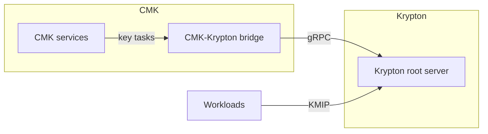

# Components

OpenKCM consists of two components. Each has its own services, repositories,
releases and documentation.

| Component | Purpose | Status |
| --- | --- | --- |
| [CMK](/components/cmk/) | Customer-Managed Keys: governance of customer keys and their keystores, tenants, roles, approval workflows and propagation to regions | Available |
| [Krypton](/components/krypton/) | Cryptographic keys: key hierarchies, key material and key delivery to workloads | Pre-production |

- **CMK requires Krypton** for its cryptographic key operations. It drives
  Krypton through the [CMK-Krypton bridge](/components/cmk/krypton-bridge), a
  CMK service.
- **Krypton is independent.** It does not depend on CMK and can be deployed and
  used on its own.

## CMK

CMK consists of the services CMK, CMK UI, Registry, ExtAuthZ, Session Manager
and the CMK-Krypton bridge, plus plugins for keystores and identity management.
[Go to the CMK documentation](/components/cmk/).

## Krypton

Krypton consists of a root server, agents and a command-line client.
[Go to the Krypton documentation](/components/krypton/).
