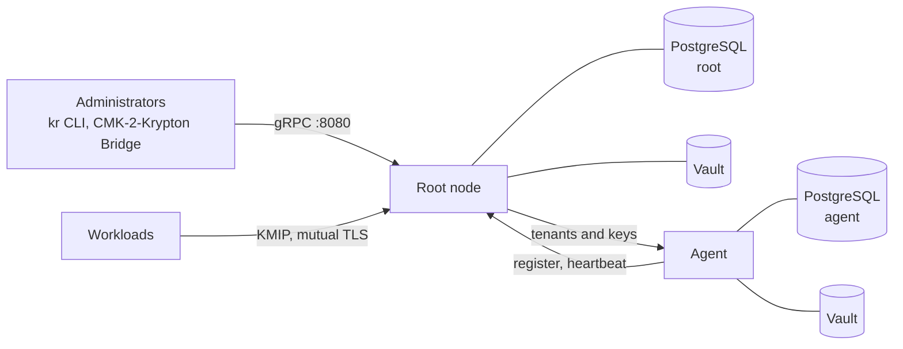
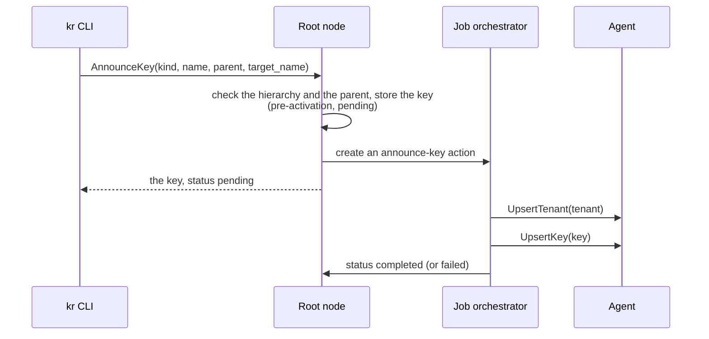

# Krypton architecture

A Krypton deployment consists of one root node and, optionally, agents. This page
shows what each of them runs, where data is kept, and how a key travels from the
root node to an agent.

## Overview

## Root node

The root node is built from `cmd/root` of the repository (image
`ghcr.io/openkcm/krypton/images/root`). It runs:

| Part | Purpose |
| --- | --- |
| gRPC server | One port (8080 by default, environment variable `SERVER_PORT`) for the admin APIs (`TenantService`, `KeyService`, `ActionService`) and the agent API (`agents.Service`). Mutual TLS when `auth` is configured |
| Job orchestrator | Runs the work that follows an API call in the background, as jobs grouped into **actions**, and retries it until it succeeds or fails for good. Built on [Orbital](https://github.com/openkcm/orbital); its tables are in the root node's database |
| Key processor | Creates, seals and reads the key material of the root node's segment, with the key bindings of its configuration |
| Agent health check | Every 10 seconds, marks agents without a heartbeat for 30 seconds as `unhealthy`, after 90 seconds as `de-registered`, and deletes them after 120 seconds |
| KMIP server | Optional (`kmip`): serves keys to workloads, see [KMIP](/components/krypton/kmip) |

At startup the root node creates its database tables, loads and checks its
configuration, and exits with an error if the configuration is not consistent.

## Agents

An agent is built from `cmd/agent` (image
`ghcr.io/openkcm/krypton/images/agent`). It manages the kinds of one segment of
the topology, for example a region, close to the workloads that use them. An
agent:

1. reads its bootstrap configuration: its name and the address of the root node;
2. registers with the root node under its name, and gets its configuration
   from the root: the hierarchy, its segment and key bindings, and the address of
   the node that holds its parent keys;
3. sends a heartbeat every 30 seconds;
4. creates its tables in its own PostgreSQL database;
5. serves a gRPC port (9091 by default) on which the root node creates the
   tenants and keys it manages;
6. deregisters when it stops.

If the registration fails, for example because the root node is not reachable or
does not know the agent's name, the agent exits; let your platform restart it.
See [Agents](/components/krypton/agents).

## Where data is kept

| Data | Kept in |
| --- | --- |
| Tenants, keys, key versions, their states and labels | PostgreSQL of the node that manages them. The root node has all keys; an agent has the keys of its segment |
| Agent registrations and actions | PostgreSQL of the root node |
| Key material | The vault of the key's binding, sealed. Never in PostgreSQL |
| Root key secret and other sealer secrets | Environment variables of the node (for example `KRYPTON_ROOT_KEY`), from a Kubernetes Secret |
| Hierarchy and topology | The root node's configuration file |

The root node and each agent need their own database: a database initialised
for one node type is refused by the other.

## How a key reaches an agent

When you announce a key that an agent manages (`target_name` is the agent's
name), the root node records it and hands it to the agent in the background:

Only key metadata crosses this connection, never key material. Temporary errors,
for example an agent that is not reachable, are retried every 2 seconds.

## Protected memory

Krypton keeps key material in memory that it locks against swapping (`mlock`),
excludes from core dumps, and overwrites before it releases it. At startup the
root node and the agents disable core dumps for the whole process. Each piece of
key material locks at least one memory page; see
[Security](/components/krypton/security#protected-memory) for the limits this
needs.

## See also

- [Concepts](/components/krypton/concepts)
- [Key lifecycle](/components/krypton/key-lifecycle)
- [gRPC API](/components/krypton/api)
