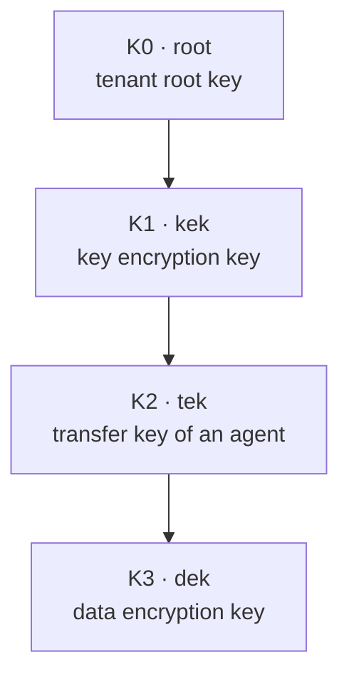
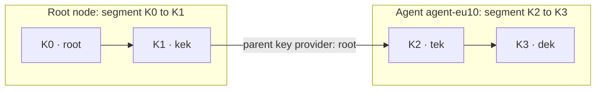

# Krypton concepts

Krypton manages keys in hierarchies: every key except the top one is protected
by its parent key. This page explains the terms of the Krypton configuration and
API: tenants, key kinds and roles, keys and their versions, segments and the
topology, key bindings, and labels.

## Tenants

A tenant owns a set of keys. Every key belongs to one tenant, and the key
material of different tenants is kept apart. A tenant has an ID (a UUID that
Krypton assigns), a name and optional labels. Create tenants with the
[`kr` CLI](/components/krypton/cli) or the
[`TenantService` API](/components/krypton/api#tenantservice).

## Key hierarchy

The key hierarchy defines the levels of keys, called **key kinds**, from the
top down. It is part of the root node's configuration (`hierarchy`), and the
same hierarchy applies to every tenant. Each kind has:

| Field | Meaning |
| --- | --- |
| `kind` | Name of the kind, for example `K0`. Unique in the hierarchy |
| `role` | What keys of the kind are for, see below |
| `algorithm` | `AES256`, the only algorithm today |
| `labels_spec` | Which labels keys of the kind may or must have |

| Role | Meaning | Position |
| --- | --- | --- |
| `root` | The top key of a tenant's hierarchy | First kind, exactly once |
| `kek` | Key encryption key: protects the keys of the kind below | Between `root` and `dek` |
| `tek` | Transfer key: the top key of the part of the hierarchy that an agent manages | Between `root` and `dek` |
| `dek` | Data encryption key: the key that workloads use | Last kind |

A hierarchy with four kinds, as in the example configuration of the
repository:



## Keys and key versions

A **key** is one key of a kind for one tenant. It has an ID (a UUID), a name
that is unique within the tenant, its kind, labels, and its **parent**: a key of
the kind directly above. A key of the `root` kind has no parent. Each key also
records which node manages it (`managed_by`): the root node, or an agent.

A key has **versions**. A version is one piece of key material; a key gets a new
version when its material is replaced. Each version can be stored in
**revisions**: the same material, sealed again, for example after its parent
changed. Krypton identifies stored material by tenant, key, version and
revision. Key rotation, which would create further versions, is not implemented
yet.

## Segments and the topology

The root node and the agents divide the hierarchy among themselves. Each node
manages a **segment**: a contiguous range of kinds, from `start_kind` to
`end_kind`.

- The root node's segment starts with the `root` kind (configuration key
  `segment`). It must not end with a `tek`.
- Each agent manages a segment below it, described in the root node's
  configuration under `topology.segments`. An agent segment starts with a `tek`
  kind and does not contain the `root` kind.

Without agents, the root node's segment covers the whole hierarchy. With the
four kinds above and one agent named `agent-eu10`:



The root node also needs the gRPC address of itself and of every agent
(`connections`); see [Agents](/components/krypton/agents).

## Key bindings

A **key binding** tells a node how the keys of one kind are protected and
stored. Each node has a binding for every kind of its segment
(`key_bindings`), and for no other kind.

| Part | Purpose | Types |
| --- | --- | --- |
| `sealer` | Seals key material with a secret that comes from outside Krypton | `aes256gcm-staticsecret`: AES-256-GCM with a 32-byte secret from a base64-encoded environment variable |
| `crypto` | Encrypts and decrypts with key material that Krypton generates | `aes256gcm`: AES-256-GCM |
| `vault` | Stores the sealed key material | `openbao`, `unsafe-sqlite` (a file), `unsafe-sqlite-memory` (memory only) |
| `parent_key_provider` | Names the node that holds the parent key of the first kind of an agent segment | `agent_name: root` or the name of another segment |

The rules:

- The binding of the `root` kind has a `sealer` and no `crypto`. The root key is
  protected by the secret of that sealer.
- Every other kind has a `crypto`.
- The first kind of an agent segment (the `tek`) has a `sealer` and a
  `parent_key_provider`.
- Each sealer, crypto and vault has a `name`.

The `unsafe-` vaults are for development and tests. Use OpenBao for keys that
must survive restarts and be shared by several pods; it gets one namespace per
tenant.

## Sealing

Krypton never stores key material in plain text. When it creates the material of
a key version, it:

1. generates 32 random bytes in protected memory;
2. seals them with the sealer of the key's binding, if it has one;
3. encrypts the result with the parent key (for the kind below the root, with
   the root key's sealer);
4. stores the sealed material in the vault, together with its additional
   authenticated data: tenant ID, key ID, version, revision and creation time.

The binding of the material to tenant, key, version and revision means that
sealed material cannot be swapped between keys without detection. Reading a key
reverses these steps.

## Labels

Keys and tenants can carry labels (`key=value`). You can filter keys by labels
when you list them. A kind's `labels_spec` describes the labels its keys should
have:

| Field | Meaning |
| --- | --- |
| `allow_user_labels` | Whether labels other than those in `requirements` are allowed |
| `requirements.<label>.is_required` | Whether the label must be present |
| `requirements.<label>.validator` | `type: regex` with `params.pattern`, or `type: enum` with `params.values` (comma-separated) |

Krypton checks `labels_spec` when it loads the configuration. Checking the
labels of keys against it when they are announced is not implemented yet.

## Identities

With mutual TLS (`auth` in the root node's configuration), every client of the
root node identifies itself by a URI in its certificate, called a **Krypton
identity**:

```
kryptonid://<domain>[/<type>/<name>…]
```

For example `kryptonid://example.org/node/root` or
`kryptonid://example.org/node/agent-eu10`. The domain must not be empty, the
optional path consists of pairs of type and name, and no part may contain `*`,
`/`, spaces, tabs or line breaks. See [Security](/components/krypton/security).

## See also

- [Architecture](/components/krypton/architecture)
- [Key lifecycle](/components/krypton/key-lifecycle)
- [Configuration reference](/components/krypton/configuration)
