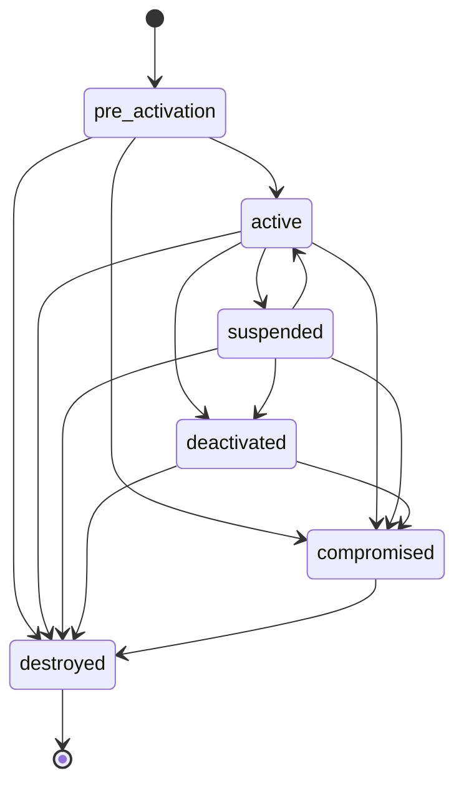

# Key lifecycle

Every Krypton key has a lifecycle state, which says whether it may be used, and
a processing status, which says whether the work started by the last change of
state has finished. This page lists both, the operations that change them, and
the actions with which you follow the background work.

## Lifecycle states

| State | Meaning |
| --- | --- |
| `pre-activation` | The key is known, but may not be used yet. Every key starts here |
| `active` | The key may be used |
| `suspended` | The key is temporarily not usable |
| `deactivated` | The key is no longer used for new data |
| `compromised` | The key must not be trusted |
| `destroyed` | The key's material is gone. Final state |

Krypton allows these transitions:

The API offers the operations for the first two states today: announce
(`pre-activation`) and activate (`active`). Suspending, deactivating, marking as
compromised and destroying keys are not implemented yet.

## Processing status

| Status | Meaning |
| --- | --- |
| `pending` | The change is recorded; the background work has not started |
| `in-progress` | The background work runs |
| `completed` | The background work is done |
| `failed` | The background work failed for good. Announcing the key again retries it |

## Announce a key

Announcing creates a key in the state `pre-activation` with the status `pending`
(`AnnounceKey`, `kr announce key`). Krypton checks that:

- the tenant exists;
- the kind exists in the hierarchy and belongs to the segment of the node that
  will manage the key: the root node, or the agent named in `target_name`;
- a key of the `root` kind has no parent, and every other key has a parent of the
  kind directly above, in the same tenant.

The background work then completes the announcement. For a key that an agent
manages, it sends the tenant and the key to that agent; see
[Architecture](/components/krypton/architecture#how-a-key-reaches-an-agent).
When the agent has stored the key, its status becomes `completed`.

Announcing is idempotent: announcing a key with the same tenant, name and
properties again returns the existing key. A key with the same name but other
properties is rejected as a conflict.

## Activate a key

Activating makes a key and its key material usable (`ActivateKey`,
`kr activate key`). Krypton checks that every ancestor of the key is `active`
with the status `completed`; otherwise it rejects the request with
`FailedPrecondition`. The key then moves to `active` with the status `pending`.

With `cascading: true` in the API, Krypton also activates the key's descendants,
layer by layer from the top. It activates keys that are `pre-activation` or
`suspended` with the status `completed`, and retries keys that are `active` with
the status `failed`.

::: warning Not processed yet
The background work of an activation, which creates the first key version and
its key material, is not implemented yet. An activated key stays `active` with
the status `pending`, and its child keys cannot be activated
(`parent key is in a transient state`). The root node logs
`no job handler registered for job type: activate-key`.
:::

## Key versions

In Krypton's design, activating a key creates its first key version: new key
material, sealed with the parent key's latest usable version and stored in the
vault. Versions are numbered from 1. A key version has its own lifecycle state
and a processing state, which is `usable` once the version can be used. KMIP
clients address version `0` to get the latest usable version of a key.

## Actions

The background work of an API call runs as an **action** (a job group of the
orchestrator). `ActionService.GetAction` returns its type, its status
(`CREATED`, `PROCESSING`, `DONE`, `FAILED` or `CANCELED`), and the key it
concerns.

| Operation | Action | How to follow it |
| --- | --- | --- |
| Announce a key | `announce-key` | Read the key (`GetKey`, `kr get key`) until its status is `completed` or `failed`. The response of `AnnounceKey` does not include the action ID yet |
| Activate a key | `activate-key` | `ActivateKey` returns the action ID (`job_group_id`); `GetAction` does not report activations yet |

## See also

- [Concepts](/components/krypton/concepts)
- [gRPC API](/components/krypton/api)
- [The kr CLI](/components/krypton/cli)
