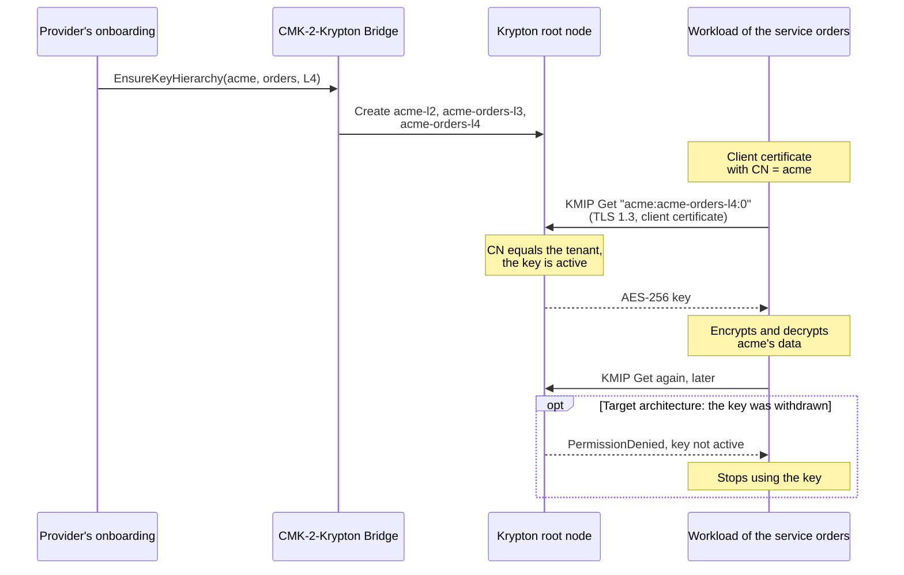
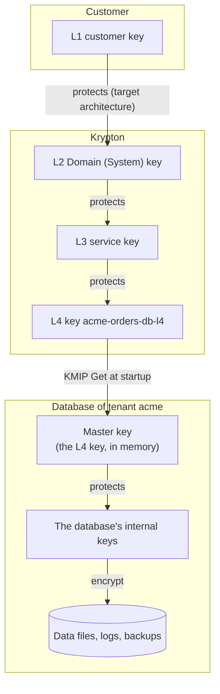
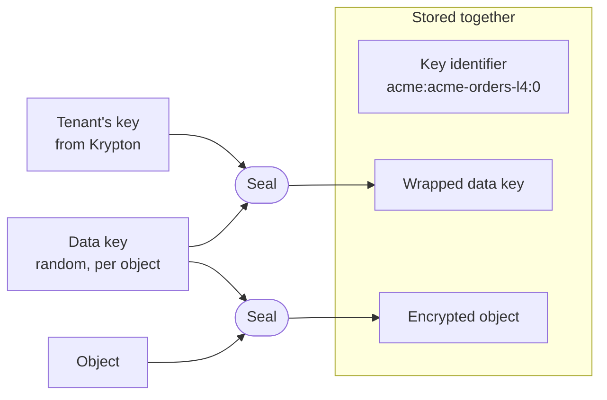
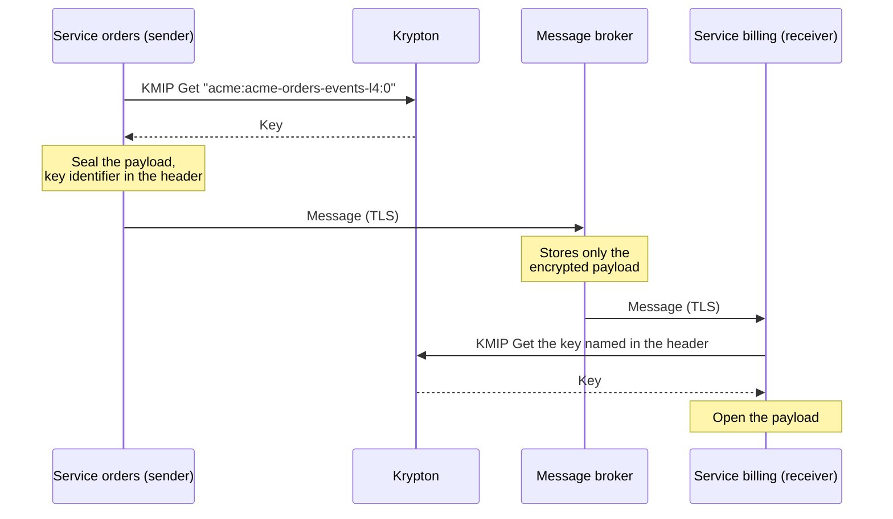

# Use keys in a workload

A cloud service protects its customers' data with keys from Krypton: the keys
are part of the customer's key chain, so the customer controls them. This guide
explains how the workloads of such a service get and use these keys, for the two
kinds of workloads that need them: databases and storage systems that encrypt
data at rest, and applications that encrypt data themselves, at rest or in
transit. For the server side, see [KMIP](/components/krypton/kmip).

::: danger Sandbox
Krypton creates key material when it processes the activation of a key, and the
processing of activations is not implemented yet (see
[Key lifecycle](/components/krypton/key-lifecycle#activate-a-key)). Until then,
`Get` answers `ItemNotFound` for every key. You can configure and connect your
workloads today; the keys follow with a later release.
:::

## Two kinds of workloads

| | Databases and storage systems | Applications and services |
| --- | --- | --- |
| Examples | A database with transparent data encryption (TDE), an encrypted volume, a backup system | The provider's own services: APIs, microservices, message processors, batch jobs |
| What the key protects | Data at rest: data files, tables, logs, volumes, backups | Data at rest that the application stores itself: fields, documents, objects. Data in transit: messages and files that it sends to other services |
| Who calls Krypton | The product's built-in KMIP client, which you configure | The application's own code, with a KMIP client library |
| Who encrypts | The product, with its own internal keys, which the tenant's key protects | The application, with the tenant's key or with data keys that it protects |
| Read on | [Databases and storage systems](#databases-and-storage-systems-data-at-rest) | [Applications and services](#applications-and-services-data-at-rest-and-in-transit) |

Both get their keys the same way, described in the next section.

## How a workload gets its key



1. The key exists in Krypton. In an OpenKCM deployment with CMK, the
   [CMK-2-Krypton Bridge](/components/cmk/krypton-bridge) creates it when the
   provider onboards the tenant or adds a service; see
   [Main flows](/architecture/flows#create-the-key-chain-of-a-service).
2. The workload has a client certificate for the tenant.
3. It connects to Krypton's KMIP server and gets the key.
4. It encrypts and decrypts the tenant's data with the key.
5. It gets the key again later, and stops using it when Krypton refuses it.
   Withdrawing keys in Krypton is part of the target architecture.

### Which key to ask for

KMIP addresses a key by its unique identifier:

```
<tenant ID>:<key ID>:<version>
```

A workload uses an L4 data encryption key. The Bridge gives the keys fixed IDs,
built from the tenant ID and the service ID of the `EnsureKeyHierarchy` request:

| Level | Key | Key ID | Unique identifier for the tenant `acme` and the service `orders` |
| --- | --- | --- | --- |
| L4 | Data encryption key | `{tenantID}-{serviceID}-l4` | `acme:acme-orders-l4:0` |
| L3 | Service key | `{tenantID}-{serviceID}-l3` | Protects the L4 key; not for workloads |
| L2 | Domain (System) key | `{tenantID}-l2` | Protects the L3 keys; not for workloads |

Choose the service ID by what the key protects: one for each database or
application of the tenant, for example `orders-db` and `orders`, and one for each
data flow whose sender and receiver share a key, for example `orders-events`.
Without the Bridge, use the key IDs under which the keys were announced, for
example with [the kr CLI](/components/krypton/cli).

Version `0` asks for the latest usable version of the key. Krypton answers with
the identifier as it was requested, so with `0` the answer does not name the
version. Key rotation is not implemented yet: every key has a single version.

### Get a client certificate

Krypton returns a key only to a client whose certificate's subject common name
(CN) is the key's tenant ID.

- Have the certificate issued by the CA that Krypton's KMIP server trusts
  (`kmip.tls.ca_path`). Ask the operators of Krypton for it.
- Use one certificate per tenant. A workload that serves several tenants needs a
  certificate, and a connection, for each of them.
- Request the extended key usage for client authentication.
- The certificate gives access to the tenant's keys. Keep its private key in a
  Kubernetes Secret, mount it only into the workload's containers, and keep the
  certificates short-lived.

With [cert-manager](https://cert-manager.io/) and an issuer for KMIP clients:

```yaml
apiVersion: cert-manager.io/v1
kind: Certificate
metadata:
  name: orders-kmip-acme
spec:
  secretName: orders-kmip-acme     # tls.crt, tls.key and ca.crt for the workload
  commonName: acme                 # the tenant ID
  usages: [client auth]
  duration: 24h
  privateKey:
    algorithm: ECDSA
    size: 256
  issuerRef:
    name: krypton-kmip-clients     # the issuer of the CA that Krypton trusts
    kind: Issuer
```

### Connect to Krypton

| Setting | Value |
| --- | --- |
| Address | The root node's KMIP service, for example `krypton-root.services.svc.cluster.local` |
| Port | Usually 5696, the port registered for KMIP |
| Protocol | KMIP 1.0 to 1.4 over TLS 1.3 |
| Server CA | The CA of the KMIP server's certificate |
| Client certificate and key | The tenant's certificate, see above |
| Operations | `Get` for the key, `GetAttributes` for its state, algorithm and length. Krypton answers all other operations with `OperationNotSupported` |

Ask the operators of Krypton to allow your workload in the root node's network
policy (`networkPolicy.kmip.from` in its Helm chart).

## Databases and storage systems: data at rest

Many databases and storage systems can encrypt their data at rest and keep the
key that protects it in an external key manager, which they reach over KMIP.
With Krypton as that key manager, the tenant's key protects the tenant's data on
disk.



How it works:

1. The database encrypts its data with internal keys that it creates itself.
   These keys are stored with the data, encrypted under a master key.
2. You configure the database's KMIP client with Krypton's address, the tenant's
   client certificate and the identifier of the tenant's key, for example
   `acme:acme-orders-db-l4:0`.
3. When the database needs the master key, usually at startup, it gets the key
   from Krypton over KMIP and holds it in memory. The data on disk, in logs and
   in backups stays encrypted.
4. Without the key, the database cannot open its data, and neither can anyone
   who copies its data files or backups: Krypton hands the key out only to a
   client with the tenant's certificate.

### What the product must support

Check in your product's documentation which KMIP operations it uses. Krypton
works with products that:

- speak KMIP 1.0 to 1.4 over TLS 1.3, with a client certificate;
- use an existing key by an identifier that you configure, and fetch it with
  `Get`.

Products that create or register their master key on the KMIP server (`Create`,
`Register`), search for keys (`Locate`), or let the server encrypt for them
(`Encrypt`, `Decrypt`) need operations that Krypton does not offer yet.

### One tenant per database

A database encrypts with one master key, but the tenant's key belongs to one
tenant. Use the database's encryption with a tenant's key only where a database
instance, or an encrypted unit with its own master key, holds the data of that
tenant alone. When one database holds the data of several tenants, encrypt in the
application instead, with each tenant's key; see
[Applications and services](#applications-and-services-data-at-rest-and-in-transit).

### When the key is withdrawn

The product decides when it fetches the key again. Many keep the master key in
memory while they run and fetch it again only when they start. Plan for this:
when a tenant's key is withdrawn, stop or restart the tenant's database, and act
on CMK's key tasks as described in
[Connect a regional system](/components/cmk/system-integration).

## Applications and services: data at rest and in transit

An application uses the tenant's key in its own code: it fetches the key over
KMIP and encrypts with a cryptographic library. It does so for data it stores,
and for data it sends to other services.

### Fetch the key

In Go, with the client of [ovh/kmip-go](https://github.com/ovh/kmip-go):

```go
package main

import (
	"context"
	"log"

	"github.com/ovh/kmip-go"
	"github.com/ovh/kmip-go/kmipclient"
)

func main() {
	client, err := kmipclient.Dial(
		"krypton-root.services.svc.cluster.local:5696",
		kmipclient.WithRootCAFile("/etc/kmip/ca.crt"),                          // CA of the KMIP server's certificate
		kmipclient.WithClientCertFiles("/etc/kmip/tls.crt", "/etc/kmip/tls.key"), // CN = tenant ID
	)
	if err != nil {
		log.Fatalf("connect: %v", err)
	}
	defer client.Close()

	resp, err := client.Get("acme:acme-orders-l4:0").ExecContext(context.Background())
	if err != nil {
		log.Fatalf("get key: %v", err) // for example PermissionDenied: key not active
	}
	key, ok := resp.Object.(*kmip.SymmetricKey)
	if !ok {
		log.Fatalf("unexpected object type %T", resp.Object)
	}
	material, err := key.KeyMaterial() // 32 bytes, AES-256
	if err != nil {
		log.Fatalf("key material: %v", err)
	}
	defer clear(material)

	// Encrypt and decrypt the tenant's data with material, see below.
}
```

Other KMIP clients work as well if they support KMIP 1.0 to 1.4 over TLS 1.3
with a client certificate.

Krypton returns the key as raw AES-256 key material and performs no
cryptographic operations for the application. Encrypt with an authenticated
cipher, such as AES-256-GCM. The two helpers below are used in the next
sections; they bind the key's identifier to the result, so that data encrypted
under one key cannot be opened as if it belonged to another:

```go
package tenantcrypto

import (
	"crypto/aes"
	"crypto/cipher"
	"crypto/rand"
	"errors"
)

// Seal encrypts plaintext with a 256-bit key (AES-256-GCM). The key's unique
// identifier is bound to the result as associated data, so the result opens
// only with the same key and identifier.
func Seal(key []byte, keyID string, plaintext []byte) ([]byte, error) {
	aead, err := newAEAD(key)
	if err != nil {
		return nil, err
	}
	nonce := make([]byte, aead.NonceSize())
	if _, err := rand.Read(nonce); err != nil {
		return nil, err
	}
	return aead.Seal(nonce, nonce, plaintext, []byte(keyID)), nil
}

// Open decrypts the result of Seal.
func Open(key []byte, keyID string, sealed []byte) ([]byte, error) {
	aead, err := newAEAD(key)
	if err != nil {
		return nil, err
	}
	if len(sealed) < aead.NonceSize() {
		return nil, errors.New("ciphertext too short")
	}
	nonce, ciphertext := sealed[:aead.NonceSize()], sealed[aead.NonceSize():]
	return aead.Open(nil, nonce, ciphertext, []byte(keyID))
}

func newAEAD(key []byte) (cipher.AEAD, error) {
	block, err := aes.NewCipher(key)
	if err != nil {
		return nil, err
	}
	return cipher.NewGCM(block)
}
```

### Encrypt data at rest

Encrypt what the application stores, such as fields, documents or objects,
before it writes them. Use envelope encryption: a new random data key for each
object or batch encrypts the data, and the tenant's key encrypts (wraps) the data
key.



```go
// Encrypt an object for tenant acme.
dataKey := make([]byte, 32)
if _, err := rand.Read(dataKey); err != nil {
	return err
}
defer clear(dataKey)
encrypted, err := tenantcrypto.Seal(dataKey, keyID, object)
if err != nil {
	return err
}
wrappedKey, err := tenantcrypto.Seal(tenantKey, keyID, dataKey)
if err != nil {
	return err
}
// Store keyID, wrappedKey and encrypted together.
```

To read the object, unwrap the data key with the tenant's key
(`tenantcrypto.Open(tenantKey, keyID, wrappedKey)`), then decrypt the object with
it.

- Store the key's unique identifier next to the data, so that you know which key
  decrypts it.
- Envelope encryption keeps the tenant's key away from the bulk of the data: it
  encrypts only small data keys, and a change of the tenant's key needs only the
  data keys to be encrypted again, not the data.
- With random nonces, keep the number of encryptions under one key within the
  limits of the cipher: for AES-GCM, about 2³² per key.

### Encrypt data in transit

TLS protects the connection between two services. It ends where the connection
ends: at a message broker, a queue, a cache or a file share, the data is in
plain text again. Encrypting the payload with the tenant's key protects it
along the whole way, from the sender to the receiver, and puts it under the
customer's control: once the key is withdrawn, the receiver can no longer read
it. Use it in addition to TLS, not instead of it.



1. Sender and receiver serve the same tenant and use the same key: the key of
   the data flow, for example the service `orders-events`. Both have a client
   certificate for the tenant.
2. The sender encrypts the payload with `tenantcrypto.Seal` and puts the key's
   unique identifier in the message header, in plain text.
3. The receiver reads the identifier from the header, gets that key from
   Krypton, and decrypts the payload with `tenantcrypto.Open`. Accept only
   identifiers of the tenant that the message belongs to.

For large payloads, such as files, use envelope encryption as for data at rest,
and send the wrapped data key with the payload.

### Keep the key safe

- Keep the key in memory only. Never write it to disk, logs, metrics or error
  messages, and overwrite it when you no longer need it.
- Get the key again at a fixed interval instead of keeping it for the lifetime of
  the process. The interval is the longest time your application keeps using a
  key after the customer withdrew it; keep it short.

## When Krypton refuses the key

| Result reason | Meaning | What the workload does |
| --- | --- | --- |
| `PermissionDenied`, message `key not active` | The key is not active | Stop encrypting and decrypting with it, drop every copy from memory, and report it |
| `PermissionDenied`, message `permission denied` | The certificate's CN is not the tenant of the identifier, or the client sent no certificate | Check the certificate and the identifier |
| `ItemNotFound` | The key or the version does not exist, or the key has no key material yet | Check the identifier; until Krypton processes activations, every key gives this answer |
| `InvalidField` | The identifier does not have the form `<tenant ID>:<key ID>:<version>` | Correct the identifier |
| `GeneralFailure` | A problem on the server side | Retry later |

A database reports these results in its own log and usually fails to start.
Treat a `PermissionDenied` for a key you used before as a withdrawal, not as a
passing error. Krypton does not suspend or deactivate keys yet, and the customer
key does not protect the Krypton keys yet; until then, a key that the customer
withdraws in CMK reaches your service only as a CMK task, see
[Connect a regional system](/components/cmk/system-integration).

## Checklist

All workloads:

- [ ] A key for each database, application or data flow of the tenant, with a
  service ID that says what it protects.
- [ ] One client certificate per tenant, with the tenant ID as CN, from the CA
  that Krypton trusts, kept in a Secret.
- [ ] The workload may reach the KMIP port, and trusts the CA of the KMIP
  server's certificate.

Databases and storage systems:

- [ ] The product uses an existing key by its identifier, with `Get`, over KMIP
  1.0 to 1.4 and TLS 1.3.
- [ ] Each encrypted database or unit holds the data of one tenant.
- [ ] You know when the product fetches the key, and how you stop the tenant's
  database when its key is withdrawn.

Applications and services:

- [ ] Data is encrypted with an authenticated cipher, with envelope encryption
  for stored data and large payloads.
- [ ] The key's identifier is stored with the data and sent with each message.
- [ ] Keys stay in memory only and are fetched again at a short interval.
- [ ] `PermissionDenied` with `key not active` stops the use of the key.

## See also

- [KMIP](/components/krypton/kmip): enabling and configuring the KMIP server
- [Security](/components/krypton/security#kmip-clients)
- [Key lifecycle](/components/krypton/key-lifecycle)
- [Main flows](/architecture/flows#deliver-keys-to-workloads)
