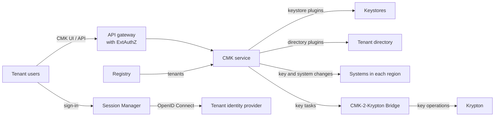

# CMK: Customer-Managed Keys

CMK is the OpenKCM component that lets the customers of a cloud service govern
the keys that protect their data. Tenants use it to create, import or link
their keys, to decide which systems use which key, and to control the key
lifecycle, with roles, approvals and audit events for every change.

CMK manages metadata and policy. The customer keys stay in a keystore, and their
key operations are performed there. For the cryptographic keys below the
customer keys, which protect the data, CMK requires
[Krypton](/overview/krypton): the **CMK-2-Krypton Bridge** turns CMK's decisions,
such as creating, enabling, disabling or deleting a key, into Krypton
operations.

## What CMK does

| Capability | Description |
| --- | --- |
| Customer keys | Import the customer's key material (BYOK), or link keys from the customer's own keystore (HYOK) |
| Key lifecycle | Enable, disable, detach and delete keys, and track key versions |
| Systems | Link the tenant's systems to a key, switch them to another key, or unlink them |
| Propagation | Send key and system changes to the systems of every region and track the result |
| Tenants | Onboard and offboard tenants, block and unblock them |
| Identity | Let each tenant sign in with its own identity provider and use its own user directory |
| Roles | Separate tenant administrators, key administrators and auditors |
| Approvals | Require approval by other users for sensitive key operations |
| Audit | Record key, system, login and access events for the customer's logging infrastructure |
| Cryptographic keys | Have Krypton create and operate the key hierarchy of each tenant and service, through the CMK-2-Krypton Bridge |

## Key types

| Key type | What the tenant does | What CMK does |
| --- | --- | --- |
| BYOK | Wraps their own key material with a key provided by the keystore and uploads it | Passes the wrapped material to the keystore, without keeping it |
| HYOK | Creates a key in their own keystore and registers it | Links the existing key, checks its state regularly and propagates changes |

See [Core concepts](/overview/core-concept#key-types) for a comparison.

## Key lifecycle

- **Disable and enable.** A key administrator disables a key in CMK, or, for
  HYOK keys, the customer disables it in their own keystore. CMK informs every
  linked system of the change.
- **New key versions.** Key material is never generated by CMK. New versions are
  created in the keystore; CMK detects them for HYOK keys and informs the linked
  systems.
- **Detach and delete.** Keys can be detached from their systems and deleted
  when they are no longer needed.

Changes reach the systems asynchronously. How quickly a system stops using a
disabled key depends on that system.

## How CMK works

| Service | Role |
| --- | --- |
| CMK service | API, business logic, workflows and propagation |
| CMK UI | Web console |
| Registry | Global registry of tenants and systems |
| Session Manager | Sign-in with the tenant's identity provider |
| ExtAuthZ | Checks every API request at the gateway |
| CMK-2-Krypton Bridge | Turns CMK's key decisions into Krypton operations (early stage) |

Keystores and user directories connect through plugins. Today CMK includes a
plugin for AWS KMS and plugins for SCIM directories; further keystores can be
added as plugins.

## Security in brief

- **No key material in CMK.** CMK holds references, metadata and policy only.
- **Every request is checked twice.** ExtAuthZ authenticates the caller at the
  gateway and signs the result; CMK verifies that signature and the caller's
  role.
- **Tenant isolation.** Each tenant has its own identity provider, roles and
  database schema.
- **Separation of duties.** A user holds exactly one role in a tenant, and
  sensitive operations can require approval.
- **Auditability.** Changes and rejected requests are sent as audit events.

The [CMK security documentation](/components/cmk/security/) explains each of
these in detail.

## Learn more

- [CMK components](/components/cmk/): the services and how they work together.
- [Security configuration guide](/components/cmk/security/configuration): set up
  authentication and authorization step by step.
- [Trust model](/overview/trust-model): who holds which keys and who can revoke
  access.
