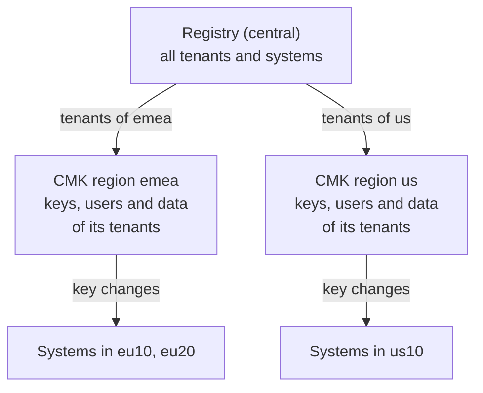
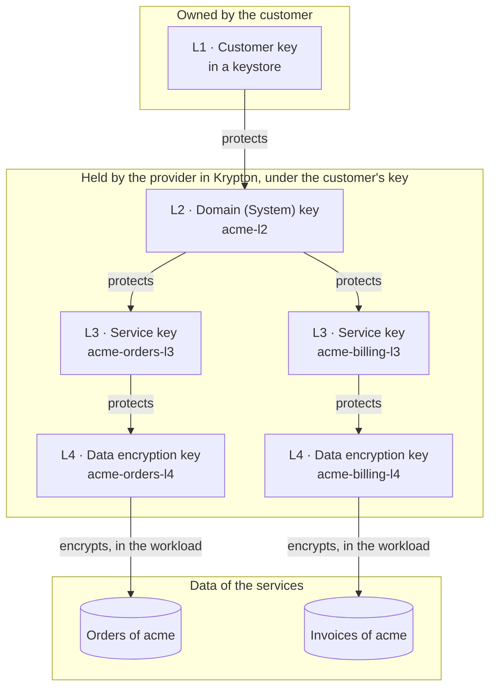
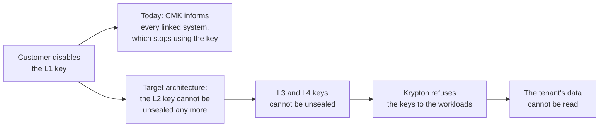

# Core concepts

This page explains the terms used throughout the OpenKCM documentation: who the
users are, which kinds of keys exist, how keys are organized, and how
responsibilities are split.

## Tenants, systems and regions

| Concept | Meaning |
| --- | --- |
| Tenant | A customer of the cloud service. Each tenant has its own keys, users, identity provider and data, isolated from other tenants |
| System | A service instance of the cloud service in a region that uses a tenant's key, for example a database service of that tenant |
| CMK region | A regional deployment of CMK. Each tenant belongs to exactly one CMK region, which keeps its keys, users and data |
| System region | A location where systems run. Key changes are propagated to the systems of each system region |
| Keystore | Where key material lives and key operations happen, for example an AWS KMS account |

Tenants and systems are registered centrally, in the **Registry**: the platform
registers each tenant with the CMK region that serves it, and the cloud services
register their systems and map them to tenants. The tenant's users then work in
the CMK of their region, where they link their systems to their keys. When a key
changes, for example when it is disabled or gets a new version, every system
linked to it is informed.

## Key types

CMK supports two ways for a tenant to own a key:

| Key type | Where the key lives | Where the key material comes from | Who controls it |
| --- | --- | --- | --- |
| BYOK (bring your own key) | A keystore that the platform provides for the tenant | Generated by the customer and imported, wrapped, through CMK | The tenant, through CMK. The customer keeps a copy of the material |
| HYOK (hold your own key) | **The customer's own keystore** | Generated and kept by the customer | The customer, directly in their keystore |

In both cases, the key material stays in a keystore. OpenKCM stores only
references and metadata, and asks the keystore to perform key operations.
Keys that the keystore generates on request (system-managed keys) are not
available in the current version of CMK.

HYOK gives the customer the strongest control: the key never leaves their
keystore, and they can disable it there at any time. CMK checks the state of
HYOK keys regularly, every five minutes by default, and informs the linked
systems of a change.

## Key hierarchy

OpenKCM organizes the keys that protect a tenant's data as a chain of four
levels, the **key hierarchy**: from the customer's own key (L1) down to the keys
that encrypt the data (L4). Each key protects (encrypts) the keys of the level
below, so whoever controls a key controls everything beneath it.

The example shows the tenant `acme` with two of the provider's services,
`orders` and `billing`:

### Why a hierarchy

Encrypting all data directly with the customer key would need a call to the
customer's keystore for every read and write. The hierarchy avoids that, and
brings further benefits:

- **Speed and cost.** The customer's keystore protects a single key per tenant.
  The data is encrypted in the workloads with L4 keys, with no remote call for
  each operation.
- **The customer's keystore stays out of the hot path.** Everyday encryption
  does not wait for the customer's keystore, which can be in another cloud or
  in the customer's data center.
- **One switch for everything.** Because each level protects the one below,
  withdrawing the customer key makes every key below it unusable, in every
  service and region, without deleting any data.
- **Isolation.** Each tenant has its own L2 key and each service its own L3 key,
  so no key is shared between tenants, and the keys of one service cannot open
  the data of another.
- **Scale.** A few customer keys protect any number of keys below them.
- **Independent lifecycles.** The provider creates keys for new services without
  involving the customer, and the customer manages their key on their own
  schedule.

::: info Design and current state
These are the benefits of the design. Krypton, which holds the L2 to L4 keys, is
in <Badge type="danger" text="Sandbox" />, and the protection of the L2 key by
the customer's L1 key is not implemented yet. The **Today** point of each level
below says what works now.
:::

### The levels one by one

Each level is described by the same points, so you can compare them by reading
down the page.

#### L1 · Customer key {#l1-customer-key}

- **What it is:** the tenant's own key, the root of trust for all of its data in
  the provider's services. The customer's key administrators manage it in CMK,
  in a key configuration to which they connect the tenant's systems.
- **Where it lives:** in a keystore. Either one that the provider runs for the
  tenant, with key material that the customer brings (BYOK), or the customer's
  own keystore (HYOK). AWS KMS today.
- **Who controls it:** the customer, through CMK, with approvals where the tenant
  requires them; for HYOK keys also directly in their own keystore.
- **How many:** one or more per tenant, grouped in key configurations.
- **Role for the business:** the customer's lever over their data. Whoever
  controls the L1 key decides whether the provider's services can use the keys
  below it.
- **Benefit:** meets the requirement that the customer, not the provider, owns
  and controls the key. The customer can rotate it, disable it or withdraw it
  at any time, and every linked system in every region is informed.
- **Today:** available, with AWS KMS. CMK informs the linked systems of every
  change: connect, switch, new version, disable, enable.

#### L2 · Domain (System) key {#l2-domain-system-key}

- **What it is:** the top key that the provider holds for the tenant, and the
  link between the customer's key and the provider's keys. The customer's L1
  key protects it, and it protects all of the tenant's service keys.
- **Where it lives:** in Krypton, sealed, as the `root` key of the tenant's
  hierarchy.
- **Who controls it:** the provider operates it; the customer controls it
  through their L1 key, without which it cannot be used.
- **How many:** one per tenant, for example `acme-l2`. The Registry records the
  L2 key of each of the tenant's systems.
- **Role for the business:** the point where the customer's control meets the
  provider's key infrastructure. The customer's keystore has to protect this one
  key only, not every key that the provider's services use.
- **Benefit:** keeps the customer's keystore out of everyday operations, with
  fewer calls, lower cost and lower latency, while the customer's key still
  decides over everything below. Separates tenants: no key below an L2 key is
  shared with another tenant.
- **Today:** <Badge type="danger" text="Sandbox" />. The CMK-2-Krypton Bridge creates it in Krypton.
  Protecting it with the customer's L1 key is not implemented yet.

#### L3 · Service key {#l3-service-key}

- **What it is:** a key encryption key for one of the provider's services, for
  one tenant, for example the service `orders` of `acme`. It protects the data
  encryption keys of that service.
- **Where it lives:** in Krypton, sealed by the L2 key, as a `kek` key.
- **Who controls it:** the provider operates it, under the tenant's L2 key.
- **How many:** one per tenant and service, for example `acme-orders-l3`.
- **Role for the business:** draws a boundary around each of the provider's
  services, for each tenant.
- **Benefit:** contains incidents to one service: the keys of one service cannot
  open the data of another. A new service gets its own keys for a tenant without
  any change to the keys of the other services.
- **Today:** <Badge type="danger" text="Sandbox" />. The CMK-2-Krypton Bridge creates it in Krypton.

#### L4 · Data encryption key {#l4-data-encryption-key}

- **What it is:** the key that encrypts the data. Workloads use it as the master
  key of a database, or in an application for data at rest and in transit.
- **Where it lives:** in Krypton, sealed by the L3 key, as a `dek` key. Krypton
  delivers it over KMIP to the tenant's workloads, which hold it in memory only.
- **Who controls it:** Krypton hands it out only to workloads with the tenant's
  client certificate, and only while the key is active.
- **How many:** one per tenant and service, for example `acme-orders-l4`.
- **Role for the business:** does the actual work, close to the data.
- **Benefit:** encryption runs at full speed in the workload, with no remote call
  for each operation, and the data stays readable only as long as the chain of
  keys above it is intact. See [Use keys in a workload](/components/krypton/workloads).
- **Today:** <Badge type="danger" text="Sandbox" />. The CMK-2-Krypton Bridge creates it in Krypton; key
  material is not created yet.

### When the customer withdraws their key

- **Today:** CMK sends a `KEY_DISABLE` task to every system linked to the key,
  in every region, and shows which systems have confirmed it. For HYOK keys,
  CMK notices when the customer disables the key in their own keystore, every
  five minutes by default.
- **Target architecture:** the L1 key protects the L2 key. Without the L1 key,
  Krypton can no longer unseal the L2 key, nor anything below it, so the
  workloads get no keys and the tenant's data cannot be read. When
  the customer enables the key again, access returns.

The levels of Krypton's hierarchy are configurable; L2 to L4 is the layout that
CMK uses. See [Krypton concepts](/components/krypton/concepts) and the
[trust model](/overview/trust-model).

## Governance and key material are separated

OpenKCM splits responsibilities so that no single component both decides about
keys and holds their material:

| Responsibility | Component |
| --- | --- |
| Decides who may use which key, records approvals and audit events | CMK |
| Holds key material and performs key operations | The keystore (for L1), Krypton (for lower levels) |
| Translates CMK's decisions into Krypton operations | CMK-2-Krypton Bridge |
| Uses keys to encrypt data | The systems of the cloud service |

CMK never stores key material. For BYOK, the wrapped material passes through CMK
to the keystore without being kept.

## Users, roles and approvals

- **Identity providers.** Each tenant signs in with its own OpenID Connect
  identity provider. Users and groups come from the tenant's directory.
- **Roles.** Tenant administrators manage the tenant and its groups. Key
  administrators manage keys and systems. Tenant auditors can read everything
  and change nothing. A user can hold only one of these roles in a tenant, which
  keeps duties separated.
- **Approval workflows.** Sensitive key operations can require approval by
  other users before they are carried out.
- **Audit events.** Key changes, system changes, logins and rejected requests
  are recorded as audit events.

## See also

- [Glossary](/overview/glossary): every term used in the documentation
- [CMK](/overview/cmk) and [Krypton](/overview/krypton)
- [Trust model](/overview/trust-model)
