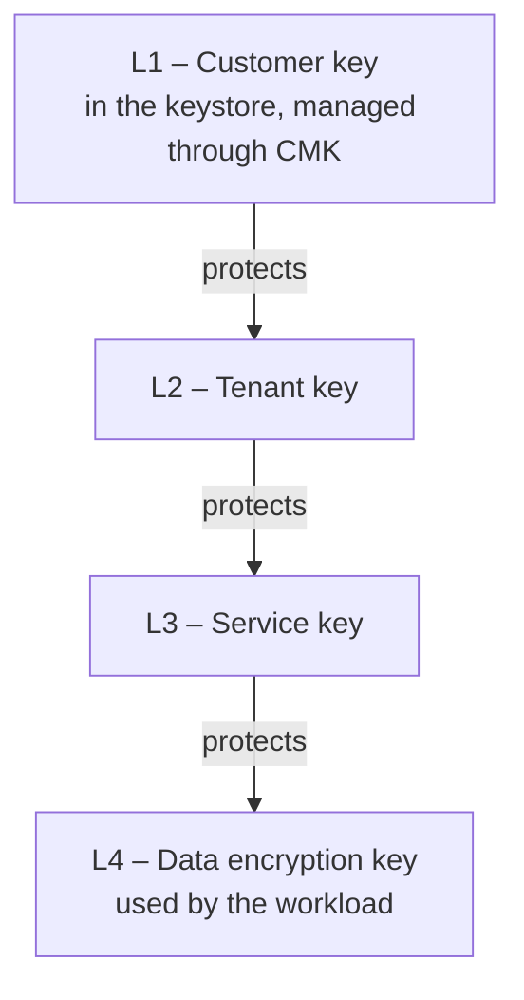

# Core concepts

This page explains the terms used throughout the OpenKCM documentation: who the
users are, which kinds of keys exist, how keys are organized, and how
responsibilities are split.

## Tenants, systems and regions

| Concept | Meaning |
| --- | --- |
| Tenant | A customer of the cloud service. Each tenant has its own keys, users, identity provider and data, isolated from other tenants |
| System | A service instance of the cloud service in a region that uses a tenant's key, for example a database service of that tenant |
| Region | A location where systems run. Key changes are propagated to the systems of each region |
| Keystore | Where key material lives and key operations happen, for example an AWS KMS account |

A tenant links its systems to its keys. When a key changes, for example when it
is disabled or gets a new version, every system linked to it is informed.

## Key types

OpenKCM supports three ways for a tenant to own a key:

| Key type | Where the key lives | Where the key material comes from | Who controls it |
| --- | --- | --- | --- |
| System-managed | A keystore that the platform provides for the tenant | Generated by the keystore | The tenant, through CMK |
| BYOK (bring your own key) | A keystore that the platform provides for the tenant | Generated by the customer and imported, wrapped, through CMK | The tenant, through CMK. The customer keeps a copy of the material |
| HYOK (hold your own key) | **The customer's own keystore** | Generated and kept by the customer | The customer, directly in their keystore, and the tenant through CMK |

In all three cases, the key material stays in a keystore. OpenKCM stores only
references and metadata, and asks the keystore to perform key operations.

HYOK gives the customer the strongest control: the key never leaves their
keystore, and they can disable it there at any time. CMK checks the state of
HYOK keys regularly, every five minutes by default, and informs the linked
systems of a change.

## Key hierarchy

Encrypting all data directly with a customer key would require a call to the
customer's keystore for every operation. OpenKCM therefore uses a hierarchy of
keys, where each key protects (encrypts) the keys of the level below:

| Level | Purpose | Managed by |
| --- | --- | --- |
| L1 | The customer's root of trust. Disabling it cuts off everything below | CMK and the keystore |
| L2 | Separates tenants. Protected by the tenant's L1 | Krypton (target architecture) |
| L3 | Separates services of a tenant | Krypton (target architecture) |
| L4 | Encrypts the actual data | Krypton or the workload (target architecture) |

::: info Current state
CMK manages the L1 keys and informs the systems that use them. Krypton
implements the levels below with a configurable hierarchy. CMK drives Krypton
through the CMK-Krypton bridge, which creates the L2 to L4 keys of a tenant and
service in Krypton; the bridge is at an early stage. Protecting the L2 key with
the tenant's L1 key is not implemented yet.
:::

## Governance and key material are separated

OpenKCM splits responsibilities so that no single component both decides about
keys and holds their material:

| Responsibility | Component |
| --- | --- |
| Decides who may use which key, records approvals and audit events | CMK |
| Holds key material and performs key operations | The keystore (for L1), Krypton (for lower levels) |
| Translates CMK's decisions into Krypton operations | CMK-Krypton bridge |
| Uses keys to encrypt data | The systems of the cloud service |

CMK never stores key material. For BYOK, the wrapped material passes through CMK
to the keystore without being kept.

## Users, roles and approvals

- **Identity providers.** Each tenant signs in with its own OpenID Connect
  identity provider. Users and groups come from the tenant's directory.
- **Roles.** Tenant administrators manage the tenant and its groups. Key
  administrators manage keys and systems. Tenant auditors can read everything
  and change nothing. A user can hold only one of these roles in a tenant, which
  keeps duties separated.
- **Approval workflows.** Sensitive key operations can require approval by
  other users before they are carried out.
- **Audit events.** Key changes, system changes, logins and rejected requests
  are recorded as audit events.

## Glossary

| Term | Meaning |
| --- | --- |
| BYOK | Bring your own key: the customer provides the key material |
| HYOK | Hold your own key: the key stays in the customer's own keystore |
| KEK | Key encryption key: a key that protects other keys |
| DEK | Data encryption key: a key that encrypts data |
| KMIP | Key Management Interoperability Protocol, used by workloads to fetch keys from Krypton |
| Plugin | A separate process that connects CMK to a keystore or a user directory |
| SCIM | System for Cross-domain Identity Management, a standard API for user directories |
| Wrapping | Encrypting a key with another key |

## See also

- [CMK](/overview/cmk) and [Krypton](/overview/krypton)
- [Trust model](/overview/trust-model)
