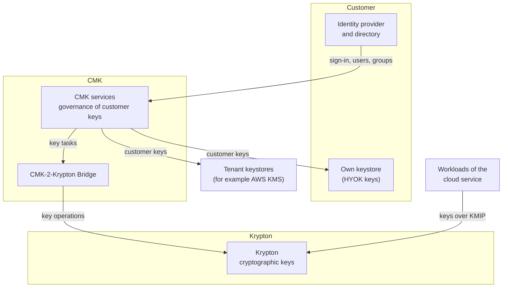

# Overview

**OpenKCM** (Open Key Chain Manager) is an open-source key management platform
for cloud services. It lets the customers of a cloud service keep control over
the keys that protect their data, whether the data is stored (at rest) or sent
between services (in transit): the keys are kept in a keystore dedicated to the
customer, or in the customer's own keystore, and the customer decides when they
may be used.

One key can protect the data of many services. The customer connects each of
their services to a key. When they disable that key, every service that shares
it is informed and stops using it; when a new key version is created, all of
them switch to it. Each service decides how it uses the key, for example to
encrypt the data it stores or the data it sends.

## Why OpenKCM

Cloud services encrypt the data they store for their customers. Usually the
provider also holds the keys, so customers have to trust the provider with
unrestricted access to their data. Many organizations cannot accept that:
regulations such as GDPR and DORA, sector rules and data sovereignty
requirements ask that customers decide who may use their keys, where, and for
how long, and that they can withdraw that permission.

OpenKCM gives a cloud service the building blocks to offer this control:

- **Customer-managed keys.** Keys are either created from key material the
  customer brings (BYOK) or kept in the customer's own keystore (HYOK).
- **Governance without key material.** The control plane manages metadata,
  permissions and policies. Key operations run in the keystore that holds the
  key.
- **Multi-tenant and multi-region.** A central Registry knows every tenant and
  the region that serves it. Each region runs its own CMK deployment, which
  keeps the keys, identity provider settings and data of its tenants. Key
  changes are propagated to the systems of each region.
- **Separation of duties.** Tenant administrators, key administrators and
  auditors have different, non-overlapping roles; sensitive changes can require
  approval by several people.
- **Auditability.** Key, system and access events are sent as audit events to
  the customer's logging infrastructure.
- **Open and pluggable.** Keystores and user directories connect through
  plugins. OpenKCM is open source under the Apache 2.0 license and runs on
  Kubernetes.

## Two components

OpenKCM consists of two components:

| Component | What it does | Status |
| --- | --- | --- |
| [CMK](/overview/cmk) (Customer-Managed Keys) | Governs customer keys: tenants, keys and their keystores, the systems that use them, roles, approval workflows and audit | Available |
| [Krypton](/overview/krypton) | Creates and operates the cryptographic keys: key hierarchies, key material and key delivery to workloads | Pre-production |

How they relate:

- **CMK uses Krypton.** CMK governs the customer keys; the cryptographic keys
  below them, which protect the data, are created and operated by Krypton. CMK
  therefore requires Krypton for its cryptographic key operations, and drives it
  through the **CMK-2-Krypton Bridge**, a CMK service that turns CMK's decisions
  into Krypton requests.
- **Krypton stands on its own.** Krypton does not depend on CMK. It can be
  deployed and used independently by any workload that needs managed key
  hierarchies.

## What is available today

| Capability | Status |
| --- | --- |
| System-managed keys, generated by the keystore on request | Not available in the current version of CMK |
| Bring your own key: importing the customer's key material (BYOK, AWS KMS) | Available |
| Hold your own key: linking an existing key in the customer's own keystore (HYOK, AWS KMS) | Available |
| Keystores other than AWS KMS | Not yet available; can be added as keystore plugins |
| Sign-in with each tenant's own OpenID Connect identity provider | Available |
| Roles, approval workflows and audit events | Available |
| Propagation of key changes to the systems of each region | Available |
| Key hierarchies, key storage and key delivery over KMIP (Krypton) | Pre-production |
| CMK using Krypton through the CMK-2-Krypton Bridge | Early stage |
| Customer key protecting the Krypton key hierarchy | Not yet available |
| Gateway components running next to the workloads | Not yet available |

## Who uses OpenKCM

- **Cloud and SaaS providers** that want to offer customer-managed keys (BYOK
  and HYOK) to their enterprise customers.
- **Customers in regulated industries** that need to keep control over the keys
  for their data in a provider's service.
- **Platform teams** that need key management across many tenants, services and
  regions.

## Where to go next

Continue with the concepts:

- [Core concepts](/overview/core-concept): tenants, systems, key types and the
  key hierarchy.
- [CMK](/overview/cmk) and [Krypton](/overview/krypton): what each component does.
- [Trust model](/overview/trust-model): who holds which keys and who can revoke
  access.
- [Glossary](/overview/glossary): every term in one place.

Or go straight to your task:

| You are… | Go to |
| --- | --- |
| A customer managing keys in CMK | [Manage your keys](/components/cmk/guide/) |
| Building a cloud service that uses customer keys | [Connect a regional system](/components/cmk/system-integration) |
| Operating the platform | [Deployment planning](/components/cmk/deployment) |
| Onboarding customers as tenants | [Connect a regional tenant](/components/cmk/tenant-integration) |
