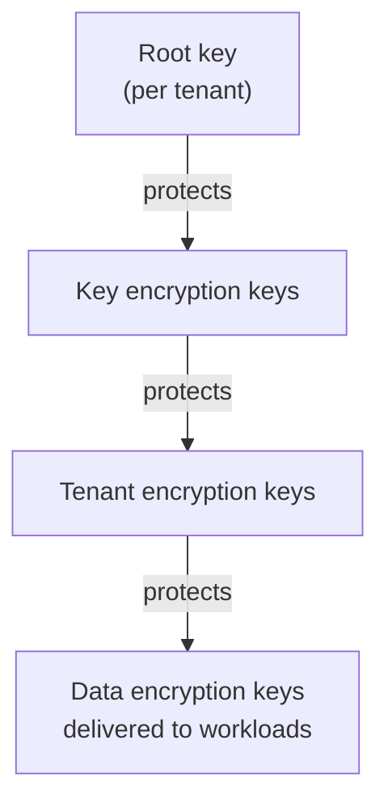
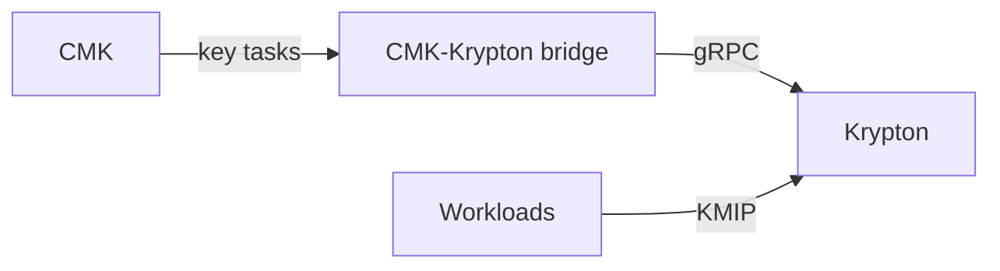

# Krypton

Krypton is the OpenKCM component that creates and operates cryptographic keys.
It generates key hierarchies for tenants, protects each key with the key above
it, stores the protected key material, and delivers keys to authorized
workloads.

Krypton is **independent**: it does not depend on CMK and can be deployed and
used on its own. CMK, in turn, uses Krypton for its cryptographic key
operations.

::: warning Pre-production
Krypton is under active development and not intended for production use yet.
:::

## Why a key hierarchy

Workloads need many keys and use them constantly. Calling a customer's keystore
for every operation would be slow and would make every workload depend on that
keystore. A key hierarchy solves this: a few keys at the top protect many keys
below them, and only the lowest keys are handed to workloads.

The levels are configurable. The example above is Krypton's sample
configuration.

## What Krypton does

| Capability | Description |
| --- | --- |
| Key hierarchies | Define the levels of a hierarchy, each with its role and algorithm |
| Key generation | Generate the key material of every level |
| Sealing | Encrypt the material of every key with its parent key, bound to the tenant, key and version |
| Key storage | Store sealed key material in OpenBao, separately for every tenant |
| Key delivery | Hand keys to workloads over KMIP, with mutual TLS and a check that the workload belongs to the tenant |
| Agents | Distribute tenant and key information to agents (early stage) |

## Using Krypton on its own

Any workload or platform that needs managed key hierarchies can use Krypton
directly: administer tenants and keys through its gRPC API, and let workloads
fetch their keys over KMIP. No CMK installation is needed.

## Krypton with CMK

[CMK](/overview/cmk) uses Krypton for its cryptographic key operations. The
**CMK-Krypton bridge**, a CMK service, receives CMK's key tasks and creates the
tenant, service and data keys in Krypton:

In the target architecture, the tenant's customer key managed by CMK also
protects the top of the Krypton hierarchy, so that disabling the customer key
cuts off every key below it. That step is not implemented yet.

## Current limitations

- Not intended for production use.
- Key rotation is not implemented yet.
- The root of a hierarchy is not yet protected by the tenant's customer key.
- Gateway components running next to the workloads are part of the target
  architecture and not available yet.

## Learn more

- [Krypton component documentation](/components/krypton/)
- [Trust model](/overview/trust-model)
