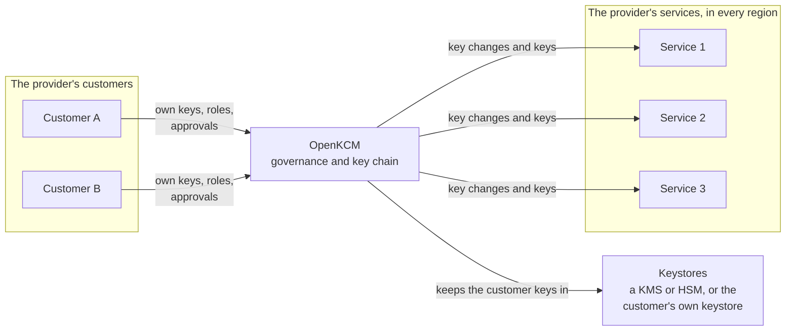
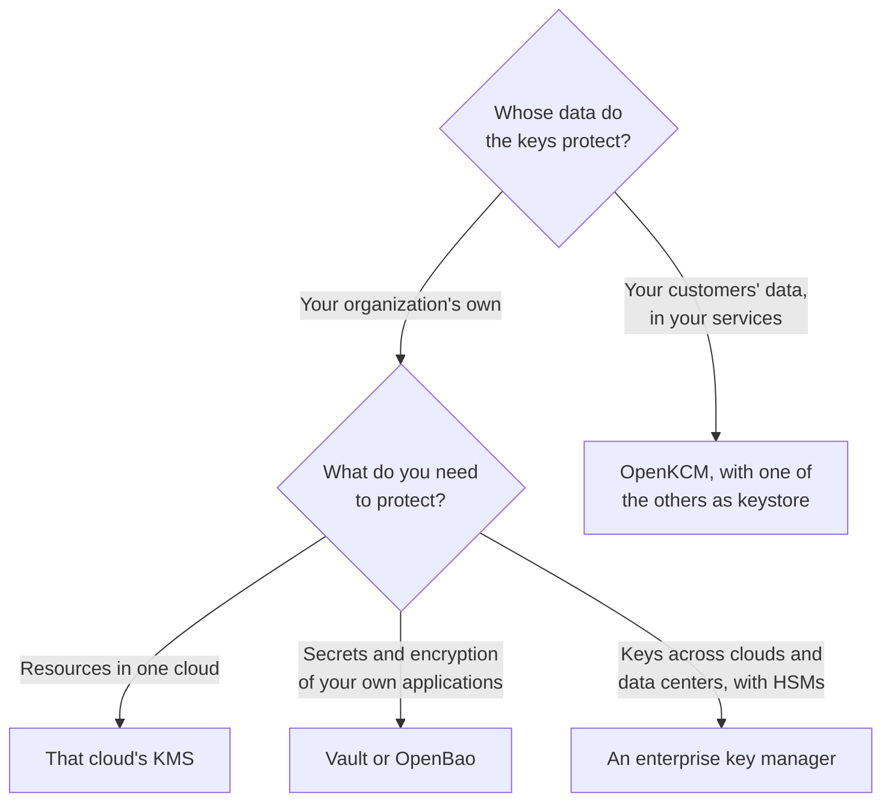

# OpenKCM vs. KMS offerings

OpenKCM is not another key management service (KMS). A KMS holds keys and
performs key operations for its owner. OpenKCM manages the relationship between
a provider's customers and the provider's services: which customer key protects
which service, who may change that, and what happens everywhere when it changes.
It uses a KMS as the keystore for the customer keys.

## The short answer

A KMS answers the question *"where is my key, and who in my account may use
it?"*. OpenKCM answers *"which of my customers' keys protects which of my
services, and what happens in all of them when a customer changes their key?"*.
It sits between the provider's customers, the provider's services and the
keystores:

## Benefits over a KMS alone

The KMS stays: OpenKCM keeps the customer keys in it. These are the benefits
that OpenKCM adds on top, for each party involved.

### For the provider

1. **One integration for all services and regions.** Each service registers its
   systems once and receives key changes as tasks. CMK sends every change to
   every linked system, in every region, and tracks the answers.

   *With a KMS alone:* every service integrates with the KMS on its own, and with
   each customer's keystore for HYOK.
2. **Customer-managed keys as a ready product feature.** BYOK and HYOK for all
   customers, with tenant onboarding, a self-service UI and a REST API, roles,
   approvals and audit events.

   *With a KMS alone:* the provider builds tenant management, the customer UI,
   approvals and the propagation of key changes itself.
3. **No lock-in.** Apache 2.0, self-hosted on any Kubernetes, with standard
   interfaces: gRPC, AMQP 1.0 and KMIP. Keystores connect as plugins, so the
   governance stays the same whichever keystore holds the keys. AWS KMS is
   supported today.

   *With a KMS alone:* the keys, the permissions and every integration are tied to
   that vendor's service and API.
4. **The whole key chain.** Krypton creates the keys below the customer key,
   per tenant and service, and delivers them to workloads over KMIP
   <Badge type="danger" text="Sandbox" />.

   *With a KMS alone:* each service builds and protects its own keys below the KMS
   key.

### For the provider's customers

5. **Their own people decide.** Each customer signs in with its own identity
   provider. Its own tenant administrators, key administrators and auditors hold
   separate roles, and sensitive changes can require approval by several people.

   *With a KMS alone:* the customer grants the provider cross-account or
   cross-tenant permissions on its key, for each resource that uses it.
6. **Withdraw access everywhere, and see the result.** Disabling a key reaches
   every linked system in every region, and CMK shows which systems have
   confirmed it. For HYOK keys, CMK also notices when the customer disables the
   key in their own keystore.

   *With a KMS alone:* each service notices the change only when it next uses the
   key, and nothing confirms that it has acted on it.
7. **One way to manage BYOK and HYOK.** Imported keys and keys in the customer's
   own keystore go through the same roles, approvals, propagation and audit.

   *With a KMS alone:* key import and external key stores are separate features with
   their own setup and permissions.
8. **Data stays in its region.** Each tenant is served by one CMK region, whose
   databases keep its key configurations, groups, approvals and settings.

### For security and compliance teams

9. **Governance without key material.** The control plane decides and records,
   and never holds key material. Key operations stay in the keystore that holds
   the key.
10. **Evidence for audits.** Key, system, sign-in and access events are sent as
    audit events to the provider's collector, which helps to show how
    requirements such as those of GDPR, DORA and data sovereignty rules are met.
11. **Open and verifiable.** Customers and auditors can read the code that
    handles their keys, instead of relying on a vendor's description.

### Things to consider

- **You run it.** OpenKCM is self-hosted: the provider operates it on
  Kubernetes, with PostgreSQL, an AMQP broker and Valkey or Redis. See
  [Deployment planning](/components/cmk/deployment).
- **Keystores.** AWS KMS is supported today; further keystores need a
  [keystore plugin](/components/cmk/plugins).
- **Maturity.** CMK is available; Krypton and the CMK-2-Krypton Bridge are in
  <Badge type="danger" text="Sandbox" />. See [What is available today](/overview/#what-is-available-today).
- **Only your own resources?** To protect only your organization's own
  resources in one cloud, that cloud's KMS alone is simpler.

## Which do you need?

The offerings are not exclusive: a provider that runs OpenKCM still uses a KMS,
and often a secrets manager, underneath.

## The offerings one by one

Each offering below is described by the same points, so you can compare them
by reading down the page. Based on the vendors' documentation as of October
2026; see [Sources](#sources).

### Cloud provider KMS

*AWS KMS, Azure Key Vault and Managed HSM, Google Cloud KMS*

- **Built for:** the account owner, to protect resources in that cloud and
  their own applications.
- **Runs:** in that cloud, as a proprietary service.
- **Customer brings the key (BYOK):** by importing key material.
- **Key stays with the customer (HYOK):** AWS External Key Store, Azure Managed
  HSM external key management and Google Cloud External Key Manager, each through
  a proxy or partner that runs outside the cloud.
- **A key change reaches:** the services of that cloud that use the key, when
  they next use it.
- **Workloads get keys:** through the cloud's API.
- **With OpenKCM:** the keystore of the customer keys. CMK keeps them in AWS KMS
  today: BYOK keys in an account that the provider runs for the tenant, HYOK keys
  in the customer's own account. Other cloud KMSs can be added as
  [keystore plugins](/components/cmk/plugins).

### Self-hosted secrets managers

*HashiCorp Vault, OpenBao*

- **Built for:** an organization's own applications and secrets.
- **Runs:** self-hosted; Vault also as a managed service. Vault is licensed under
  the Business Source License 1.1, OpenBao under the MPL 2.0.
- **Customer brings the key (BYOK):** by importing keys into the Transit secrets
  engine.
- **Key stays with the customer (HYOK):** the keys are held in Vault or OpenBao
  itself.
- **A key change reaches:** the applications that call it.
- **Workloads get keys:** through the API; over KMIP in Vault Enterprise.
- **With OpenKCM:** Krypton stores its sealed key material in OpenBao.

### Enterprise key managers

*Thales CipherTrust, Fortanix DSM, Entrust KeyControl*

- **Built for:** an enterprise's keys across clouds, applications and HSMs.
- **Runs:** as a physical or virtual appliance, or as a service; proprietary.
- **Customer brings the key (BYOK):** yes, to several clouds.
- **Key stays with the customer (HYOK):** yes, as the external key manager of the
  clouds.
- **A key change reaches:** the clouds and applications that it is integrated
  with.
- **Workloads get keys:** through the API, KMIP or PKCS#11.
- **With OpenKCM:** can be added as a [keystore plugin](/components/cmk/plugins),
  so that customers who run one keep their keys in it.

### SaaS customer key features

*Salesforce Shield, Microsoft Purview Customer Key, Google Workspace client-side
encryption*

- **Built for:** the customers of one SaaS vendor.
- **Runs:** inside the vendor's service; proprietary.
- **Customer brings the key (BYOK):** Salesforce Shield; Purview Customer Key,
  with keys in Azure Key Vault.
- **Key stays with the customer (HYOK):** Salesforce cache-only keys and
  Workspace client-side encryption.
- **A key change reaches:** that vendor's services.
- **Workloads get keys:** inside the service.
- **With OpenKCM:** these are the features that OpenKCM lets a provider build
  into its own services, for all of them at once.

### OpenKCM

*CMK and Krypton*

- **Built for:** a provider that offers customer-controlled keys to its
  customers.
- **Runs:** self-hosted by the provider on Kubernetes; Apache 2.0.
- **Customer brings the key (BYOK):** yes, with AWS KMS today.
- **Key stays with the customer (HYOK):** yes, keys in the customer's own
  keystore, with AWS KMS today.
- **A key change reaches:** every service of the provider that registers its
  systems, in every region, with confirmation.
- **Workloads get keys:** over KMIP, from Krypton <Badge type="danger" text="Sandbox" />.
  Services integrate through documented gRPC and AMQP 1.0 interfaces, independent
  of any cloud.

## Sources

- AWS:
  [AWS KMS](https://docs.aws.amazon.com/kms/latest/developerguide/overview.html),
  [importing key material](https://docs.aws.amazon.com/kms/latest/developerguide/importing-keys.html),
  [external key stores](https://docs.aws.amazon.com/kms/latest/developerguide/keystore-external.html),
  [access from other accounts](https://docs.aws.amazon.com/kms/latest/developerguide/key-policy-modifying-external-accounts.html)
- Microsoft:
  [Azure Key Vault](https://learn.microsoft.com/en-us/azure/key-vault/general/basic-concepts),
  [Managed HSM external key management](https://learn.microsoft.com/en-us/azure/key-vault/managed-hsm/external-key-management-overview),
  [cross-tenant customer-managed keys](https://learn.microsoft.com/en-us/azure/storage/common/customer-managed-keys-configure-cross-tenant-new-account),
  [Purview Customer Key](https://learn.microsoft.com/en-us/purview/customer-key-overview)
- Google:
  [Cloud KMS](https://docs.cloud.google.com/kms/docs/key-management-service),
  [Cloud External Key Manager](https://docs.cloud.google.com/kms/docs/ekm),
  [Workspace client-side encryption](https://developers.google.com/workspace/cse/guides/overview)
- HashiCorp and OpenBao:
  [Vault license](https://www.hashicorp.com/en/bsl),
  [Vault Transit](https://developer.hashicorp.com/vault/docs/secrets/transit),
  [Vault KMIP](https://developer.hashicorp.com/vault/docs/secrets/kmip),
  [OpenBao secrets engines](https://openbao.org/docs/secrets/)
- Enterprise key managers:
  [Thales CipherTrust Cloud Key Management](https://www.thalesdocs.com/ctp/cm/2.7/reference/cckmapi/cckm-overview/index.html),
  [Fortanix DSM](https://www.fortanix.com/platform/data-security-manager),
  [Entrust KeyControl](https://nshielddocs.entrust.com/interops-docs/hpe-storage-9000/deploy-entrust-kc.html)
- [Salesforce Shield BYOK](https://help.salesforce.com/s/articleView?id=xcloud.security_shield_pe_byok.htm)
