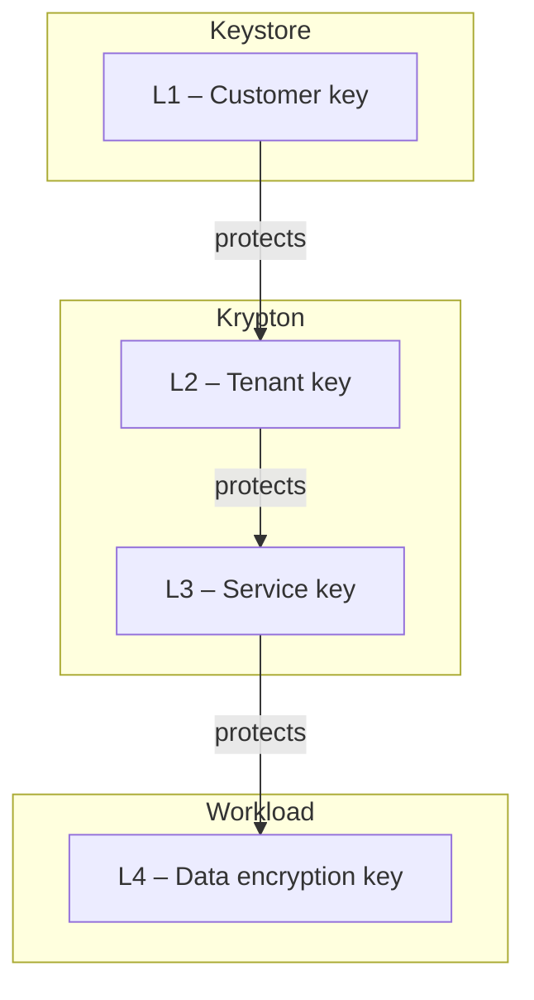

# Trust model

This page explains whom a customer has to trust when using OpenKCM: who holds
which keys, who decides about their use, how access to the platform is checked,
and what happens when a customer withdraws a key.

## Principles

1. **The customer controls the key.** Every tenant key is managed through CMK
   under the tenant's own roles; HYOK keys stay in the customer's own keystore.
2. **Governance is separated from key material.** CMK decides and records; the
   keystore holds the key material and performs key operations.
3. **Tenants are isolated.** Each tenant has its own keys, identity provider,
   roles and data.
4. **Least privilege and separation of duties.** Administration, key management
   and auditing are separate roles; sensitive changes can require approval.
5. **Everything is traceable.** Key changes, system changes, logins and
   rejected requests are recorded as audit events.

## Who holds what

| Party | Holds | Can |
| --- | --- | --- |
| Customer | HYOK keys in their own keystore; their identity provider and directory | Disable or delete HYOK keys in their keystore; decide who belongs to which group |
| Tenant users in CMK | Their role in the tenant | Create, import, link, enable, disable and delete keys; link systems; approve changes |
| CMK | Key references, metadata, policies, roles, workflow state | Instruct keystores through plugins; inform systems of changes. Never holds key material |
| Keystore | Key material | Perform key operations |
| CMK-Krypton bridge | The mapping of CMK's keys to Krypton keys | Create and update keys in Krypton on behalf of CMK |
| Krypton (pre-production) | Sealed key material of key hierarchies | Generate keys and deliver them to authorized workloads |
| Systems of the cloud service | The keys they are allowed to use | Encrypt and decrypt the tenant's data |

## Key ownership and revocation

| Key type | Key material | How the customer withdraws access |
| --- | --- | --- |
| System-managed | Generated in the keystore provided for the tenant | A key administrator disables or deletes the key in CMK |
| BYOK | Provided by the customer, imported into the keystore provided for the tenant | A key administrator disables or deletes the key in CMK. The customer keeps their own copy of the material |
| HYOK | Generated and kept in the customer's own keystore | The customer disables the key in their own keystore, or a key administrator disables it in CMK |

When a key is disabled:

1. CMK registers the change. For a HYOK key disabled in the customer's
   keystore, CMK notices it at its next check, every five minutes by default.
1. CMK sends the change to every system linked to the key, in every region.
1. Each system stops using the key. How quickly that takes effect depends on the
   system and how it caches keys.

For HYOK keys, the keystore itself refuses further operations as soon as the
customer disables the key, independent of OpenKCM.

## Key hierarchy

In the target architecture, the customer key is the root of trust of a key
hierarchy. Each key protects the keys below it, so withdrawing the customer key
makes every key below it unusable:

| Part | Status |
| --- | --- |
| L1 customer keys managed through CMK, with propagation to systems | Available |
| Key hierarchies with sealing in Krypton | Pre-production |
| CMK creating the L2 to L4 keys in Krypton through the CMK-Krypton bridge | Early stage |
| L1 protecting the Krypton hierarchy | Not yet available |
| Key delivery to workloads over KMIP | Pre-production |

## Access to the platform

Every request to CMK passes several independent checks:

1. **Sign-in.** Users sign in with their tenant's identity provider through
   Session Manager. Technical clients use tokens or client certificates.
1. **Gateway check.** ExtAuthZ checks the session, token or certificate and the
   access policies, and signs a short-lived statement about the caller.
1. **Authorization.** CMK verifies that statement, maps the caller's groups to a
   role, and checks that the role may perform the operation in that tenant.

The [request walkthrough](/components/cmk/security/walkthrough) shows these steps
in detail.

## Target architecture

The diagram shows the target architecture of OpenKCM: CMK as the governance
control plane, Krypton as the execution plane, and gateways close to the
workloads. Parts of it are not implemented yet; the status tables above and the
[component documentation](/components/) describe what is available today.

<ZoomImage
src="/architecture/high-level-architecture.png"
alt="Target architecture of OpenKCM"
/>

## See also

- [Core concepts](/overview/core-concept)
- [CMK security architecture](/components/cmk/security/)
- [CMK hardening checklist](/components/cmk/security/hardening)
